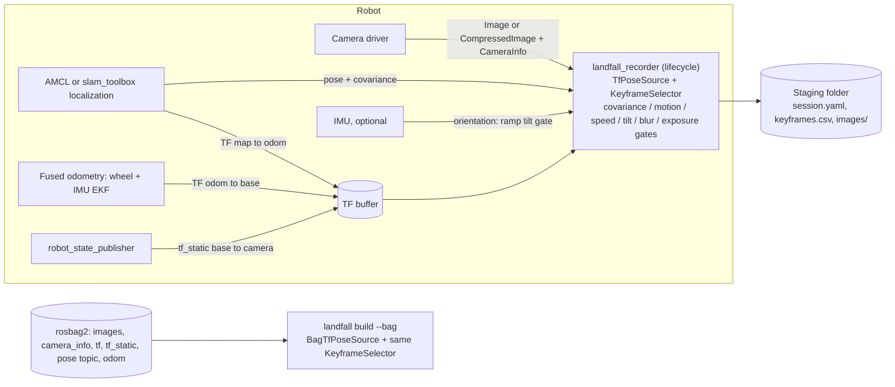
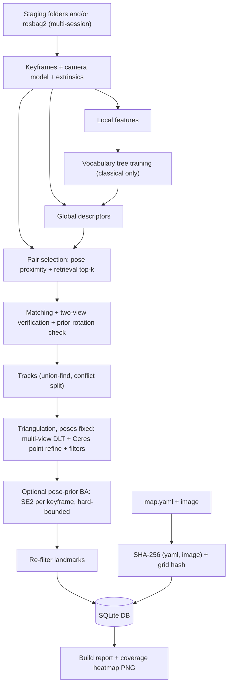
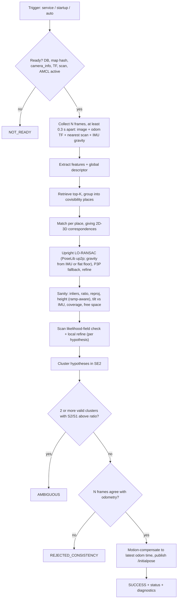

# Landfall — v1.0 Implementation Plan

Date: 2026-10-29 · Repo: `github.com/ali-pahlevani/Landfall` (public, 1 commit) · Status: APPROVED (rev 3)

**Review decisions folded into this revision (2026-10-29):**

| # | Decision |
|---|---|
| D1 | No paid or non-commercial component anywhere. The only closed-source pieces are NVIDIA's CUDA/cuDNN/TensorRT, used solely by the optional GPU path (documented, §8). Ubuntu's Ceres → SuiteSparse (GPL parts) stays confined to the offline builder (documented). |
| D2 | Odometry comes **only** from the `odom→base` TF, the same one AMCL uses. The recorder doesn't subscribe to an odometry topic. Recommended fusion: **robot_localization's EKF (`ekf_node`)** over wheel + IMU (see D12). |
| D3 | **IMU gravity (optional):** when an IMU is present, its orientation supplies gravity for the upright solver, the tilt check, ramp-aware height and LiDAR checks, and the recorder's ramp gate (§7.18). |
| D4 | Distros unchanged: Humble + Jazzy required; Lyrical allowed-failure until green, then promoted. |
| D5 | Calibration: only what's necessary. A startup DB-vs-TF extrinsics check plus an extrinsics **health monitor** (detection only, never correction) (§7.19). |
| D6 | Methods are the field-standard ones (§7.0). The GPU preset becomes ALIKED + LightGlue, falling back to XFeat + LighterGlue if ALIKED's ONNX export fails. |
| D7 | First release is **v1.0.0** (your decision). 1.0 promises stable interfaces, so the plan earns it with an interface-freeze review and a **field-validation milestone on your forklift (M8)**; v1.0.0-rc.1 comes first (§11.1). |
| D8 | All other recommendations from rev 1's open questions are accepted. |
| D9 | **You do all git commits and pushes.** I stop after every milestone with a report and a suggested split into conventional commits (messages + files). GitHub CI runs on your push. I only use read-only git (`status`, `diff`). |
| D10 | Disk: I ask you to free space whenever a step needs it (first likely at M0's Jazzy/Lyrical images); I never delete anything myself. |
| D11 | GPU: CPU-only release gate. The GPU path ships labeled **experimental** (not covered by 1.0 validation) unless cuDNN is installed for testing. |
| D12 | Fusion recommendation: **robot_localization `ekf_node`** (EKF; ROS 1's `ekf_localization_node`), over its UKF and over `fuse`. It's Nav2's documented odometry-smoothing setup, available on all three distros, and light enough for a CPU-only PC. UKF adds compute for no gain on planar wheel + IMU. `fuse` isn't released for Humble. Gravity (roll/pitch) comes separately from the IMU's orientation, because the EKF in `two_d_mode` discards roll/pitch: the driver's own AHRS output if present, else `imu_complementary_filter` (BSD-3). |
| D13 | Field target: **your forklift, industrial mini PC, no GPU** (assumed x86_64). It gets the `classical` and `learned_cpu` presets, and real-robot timings and validation come from it (M8). |

---

## 1. Executive summary and explicit assumptions

**Context.** Nav2 robots on AMCL need an initial pose at startup and after kidnapping. AMCL's global
localization fails exactly where 2D scans look alike (aisles, corridors). Cameras disambiguate those places.
Landfall is a CPU-capable, permissively licensed, monocular **visual relocalizer** that works on the user's
**existing 2D map in AMCL's `map` frame**. It proposes a pose from vision, **verifies it with LiDAR and
odometry**, and publishes `/initialpose` only when every check passes. Misses are acceptable; wrong poses are not.

**How it works.**
1. **Record** keyframes (image + camera pose in `map`) while AMCL or slam_toolbox localization is confident. This runs live (lifecycle recorder) or offline from a rosbag2.
2. **Build** a SQLite map database offline with a C++ CLI. It computes global descriptors and local features, matches pairs selected by pose and retrieval, triangulates with poses held fixed, and optionally runs a bounded pose-prior BA. The map hash is stored so the relocalizer can refuse a different map.
3. **Query** online, triggered by a service, at startup, or by AMCL degrading. It retrieves top-K keyframes, matches 2D–3D, and solves with an upright PoseLib LO-RANSAC (gravity from the IMU when present, else from the flat-floor extrinsics), falling back to P3P. It then runs sanity checks, multi-frame odometry consistency, hypothesis clustering for ambiguity, and a LiDAR likelihood-field check. The pose is motion-compensated before `/initialpose` is published.
4. **Two backend families behind one interface set.** The **classical** family (ORB + our own vocabulary tree; any CPU down to a Pi 5) is the default. The **learned** family (ALIKED + LightGlue or XFeat, with MegaLoc/EigenPlaces) runs on ONNX Runtime and is a compile-time option.
5. **Nav2 integration:** a BT plugin for BT.CPP v3 and v4, example BTs, launch files, and a lifecycle-ordering guide. A **kidnap benchmark** produces the README results table.
6. **Operational health:** a startup extrinsics check and a low-rate extrinsics health monitor warn when the camera has moved on its mount. They detect only and never auto-correct.

**Explicit assumptions** (each one can be overridden in §14):

| # | Assumption |
|---|---|
| A1 | Ground robot (reference field robot: a forklift). `base_footprint` lies on the floor (map z = 0). The camera should sit on the fixed chassis or overhead guard. If it rides on a moving part (mast/carriage), that joint must be in TF: base→camera is looked up **at each image stamp**, never assumed static. Camera height and tilt come from TF (URDF). Flat floor by default. **With an IMU**, the robot can relocalize while standing on a ramp (gravity from the IMU), but ramps are **not mapped**: a 2D map has no elevation, so the recorder skips tilted keyframes. Multi-level buildings are out of scope. |
| A2 | Intrinsics are calibrated and published in `CameraInfo` (plumb_bob, rational_polynomial, or equidistant). Rolling shutter is ignored. Image stamps are near exposure time; a configurable offset is provided. |
| A3 | Recording happens while AMCL (or slam_toolbox localization) is well localized. Prior poses carry cm-level error and are gated by reported covariance. |
| A4 | A `LaserScan` is available. Scan verification is **required** by default; camera-only mode is an explicit opt-in. |
| A5 | One database is bound to one occupancy map (verified by hash). One camera per database in v1.0; the schema allows several. |
| A6 | Default base frame is **`base_footprint`** (Nav2 AMCL default on all three distros, verified). The spec says `base_link`; a floor-plane frame is needed for the camera-height check. The frame is configurable. |
| A7 | Python appears only in `landfall_tools` (model export, plotting; `COLCON_IGNORE`d) and in **launch_testing test files**, which the spec requires. Launch files are **XML** (verified: Humble's XML frontend exposes `node`, `node_container`, `load_composable_node`, `set_parameter`, `set_remap`). |
| A8 | The reference simulation platform is **Jazzy + Gazebo Harmonic + TurtleBot 4** (`nav2_minimal_tb4_sim`). The TB3 minimal sim has **no RGB camera** (depth only, verified). |
| A9 | v1.0 ships as source plus Docker images. A ROS buildfarm (bloom) release can follow in 1.x. |
| A10 | The repo is relicensed **MIT → Apache-2.0** in M0. The existing `LICENSE` is MIT © 2026 Ali Pahlevani. |
| A11 | Odometry comes only from the `odom→base` TF. Recommended: robot_localization `ekf_node` fusing wheel (or steer + drive encoders on a forklift) + IMU yaw rate. Wheel-only is supported. IMU-only is not: it can't provide translation, and Nav2/AMCL need odometry anyway. |
| A12 | The IMU is optional: `sensor_msgs/Imu` with a valid orientation (roll/pitch) from the driver's own filter or the BSD-3 `imu_complementary_filter`, plus a static base→IMU transform. |
| A13 | The first release is **v1.0.0**, preceded by v1.0.0-rc.1 (§11.1). |
| A14 | The forklift publishes a `LaserScan` usable for verification (one topic, e.g. the one AMCL uses, possibly merged from several scanners), `CameraInfo`-calibrated images, and the TF chain above. Details to confirm by M8 (§14). |

---

## 2. Environment findings (probed 2026-10-29, read-only)

| Item | Finding | Consequence |
|---|---|---|
| OS / HW | Ubuntu 22.04.5, kernel 6.8, x86_64 i7-13620H (10C/16T), 15 GiB RAM, 8 GiB swap | Humble is native; Jazzy and Lyrical run in Docker |
| **Disk** | **13 GB free of 246 GB (95 % used)** | **Blocker-level.** 3 distro images + sim + build caches need roughly 20–25 GB (§13 R8; you free space on request, D10) |
| ROS | Only `/opt/ros/humble` (desktop + navigation2 1.1.20, nav2_bringup, slam_toolbox 2.6.10, BT.CPP v3 3.8.7, rosbag2 0.15.16 + mcap plugin, image_transport 3.1.13, cv_bridge 3.2.1, diagnostic_updater 4.0.7, bondcpp 4.1.4, tf2_ros 0.25.20, launch_testing) | Host `LD_LIBRARY_PATH` includes other workspaces (`decomp_ws`, `livox_ws`), so **all verification builds run in clean Docker** |
| Gazebo on host | gz-harmonic 1.0.0 + `ros-humble-ros-gzharmonic` (non-default pairing), ignition-fortress 1.0.3. No TB3/TB4 sims installed (available via apt) | Not used for verification; sims run in Docker |
| Tooling | colcon (core 0.21.0), rosdep, vcs, bloom, git-lfs, CMake 3.22.1, GCC 11.4, clang-tidy 14. **No** clang-format, ninja, ccache, or `gh` | Lint uses pinned versions in Docker/CI, not host tools |
| Docker | 29.6.1, user in `docker` group, `nvidia` runtime registered (nvidia-container-toolkit 1.19.1). Local: `ros:humble-ros-base-jammy` plus about 9 GB of unrelated images | GPU containers work for the sim's camera rendering |
| GPU | RTX 4050 Laptop 6 GB (CC 8.9), driver 595.84, CUDA toolkit 12.6. **No cuDNN, no TensorRT** | ORT CUDA EP can't be validated without cuDNN 9; GPU path ships experimental (D11) |
| Python (host) | 3.10, torch 2.5.1, torchvision 0.20.1, onnx 1.17.0, onnxruntime 1.20.0, numpy 2.2.6, opencv-python 4.10 | Model export is possible on the host (run inside a venv) |
| Repo | `LICENSE` (**MIT**), 15-byte README, GitHub's C++ `.gitignore` template (lacks `install/`, `log/`). Remote is public | Relicense and update `.gitignore` in M0 |

**Ecosystem facts verified online (rosdistro, packages.ros.org, upstream sources):**
- **Lyrical Nav2 binaries are available now**: `ros-lyrical-navigation2` 1.5.2 on packages.ros.org for resolute amd64 and arm64 (built 2026-09-21), plus `nav2-minimal-tb3/tb4-sim` 1.3.0, slam_toolbox 2.10.0, BT.CPP 4.10.0. The Tier-2 gate condition is met; Lyrical is promoted once our CI is green on it (D4).
- Lyrical **does** require C++20 for ROS-linked code: `ament_cmake_ros_core::ament_ros_defaults` sets `cxx_std_20`, and rclcpp links it. Humble and Jazzy rclcpp use `cxx_std_17`.
- **`onnxruntime_vendor`** (ros-controls, Apache-2.0) is in rosdistro for Humble, Jazzy, and Lyrical. It downloads the official **ORT 1.24.3 CPU** tarball for x86_64 and aarch64 at build time, with **no hash check** (their TODO). So ORT *is* now rosdep-installable for CPU. Ubuntu 26.04 additionally ships `libonnxruntime-dev` 1.23.2. Latest upstream ORT is 1.31.1 (2026-10-26), with x64, x64-gpu_cuda12, x64-gpu_cuda13, and aarch64 tarballs.
- Official `ros:{humble,jazzy,lyrical}-ros-base` Docker images exist for amd64 and arm64. GitHub-hosted **arm64 runners** (`ubuntu-22.04-arm`, `ubuntu-24.04-arm`) are free for public repos (GA since 2025-08).

---

## 3. Repository tree and package responsibilities

```
Landfall/
├── LICENSE (Apache-2.0)  NOTICE  README.md  CHANGELOG.md  THIRD_PARTY_LICENSES.md  CONTRIBUTING.md
├── .clang-format  .clang-tidy  .gitignore  .gitattributes  .pre-commit-config.yaml
├── .github/workflows/  ci.yml  lint.yml  docker.yml  nightly.yml
├── docker/             Dockerfile (ARG ROS_DISTRO; deps/build/runtime stages)  Dockerfile.sim  README.md
├── scripts/            docker_ci.sh <distro>  format.sh  tidy.sh  check_todos.sh  fetch_models.sh
├── docs/               PLAN.md  TODO.md  architecture.md  parameters.md  database.md  recording.md
│                       tuning.md  troubleshooting.md  models.md  benchmark.md  nav2_integration.md
│                       sensors.md (odometry fusion, IMU, extrinsics guide)  field_validation.md (M8 protocol)
├── landfall_core/      (ament_cmake; NO rclcpp) C++ library + gtests
│   ├── cmake/          FindONNXRuntime.cmake  landfall_core-extras.cmake (helpers: landfall_link_package,
│   │                   landfall_set_cxx_standard)  PoseLib.cmake (FetchContent, pinned URL+SHA256)
│   ├── include/landfall/
│   │   ├── types.hpp camera_model.hpp registry.hpp
│   │   ├── interfaces/  global_descriptor.hpp local_features.hpp matcher.hpp pose_solver.hpp
│   │   │                retrieval_index.hpp pose_source.hpp hypothesis_verifier.hpp
│   │   ├── features/    orb.hpp sift.hpp vocab_tree.hpp bow_descriptor.hpp matchers.hpp
│   │   ├── geometry/    triangulation.hpp upright_pnp.hpp pnp.hpp refinement.hpp two_view.hpp gravity.hpp
│   │   ├── db/          database.hpp schema.hpp migrations.hpp
│   │   ├── query/       localizer.hpp clustering.hpp sanity.hpp consistency.hpp decision.hpp
│   │   │                extrinsics_monitor.hpp
│   │   ├── grid/        occupancy_grid.hpp map_loader.hpp likelihood_field.hpp scan_verifier.hpp
│   │   ├── record/      keyframe_selector.hpp image_quality.hpp
│   │   ├── build/       pair_selection.hpp tracks.hpp pose_prior_ba.hpp map_builder.hpp report.hpp
│   │   ├── onnx/        session.hpp xfeat.hpp global_onnx.hpp lightglue.hpp   (only if ORT)
│   │   ├── util/        sha256.hpp thread_pool.hpp rng.hpp
│   │   └── compat/      ceres.hpp opencv.hpp
│   ├── src/ …  test/ …
├── landfall_msgs/      msg/RelocalizationResult.msg RelocalizationScores.msg Hypothesis.msg RecorderStatus.msg
│                       srv/Relocalize.srv
├── landfall_ros/       lifecycle nodes (components) + `landfall` CLI + ROS glue
│   ├── include/landfall/ros/  recorder_node.hpp relocalizer_node.hpp image_input.hpp tf_pose_source.hpp
│   │                          imu_gravity_source.hpp
│   │                          bag_reader.hpp params.hpp conversions.hpp
│   │                          compat/{cv_bridge,rosbag2,qos}.hpp
│   ├── src/ …   test/ (gtest + launch_testing)   test/fixtures/depot_small/ (≤5 MB bag + map)
├── landfall_nav2/      BT plugins: ReLocalize (BtServiceNode), IsLocalized (condition)
│   ├── include/landfall/nav2/compat/bt.hpp   behavior_trees/*.xml.in → generated per BT format
├── landfall_bringup/   launch/*.launch.xml  params/*.yaml (incl. per-distro Nav2 overlays)  rviz/  sim/
├── landfall_benchmark/ C++ kidnap runner node, scenario YAMLs, sim adapter (ros_gz services), metrics
└── landfall_tools/     COLCON_IGNORE'd Python project: export/*.py, models.yaml (manifest+SHA-256),
                        install_onnxruntime.sh, plot_benchmark.py, requirements.txt (pinned)
```

| Package | Responsibility | Depends on |
|---|---|---|
| `landfall_core` | Pure C++. Libraries: **`landfall_core`** (runtime: types, cameras, features, vocab tree, retrieval, matching, PoseLib solvers, query pipeline, grid/scan verification, decision policy, SQLite DB, map loader, SHA-256); **`landfall_core_build`** (offline: pair selection, tracks, triangulation refinement, pose-prior BA, report; links **Ceres**); **`landfall_core_onnx`** (optional, ORT). Exported targets `landfall_core::*` | Eigen, OpenCV (core, imgproc, imgcodecs, features2d, calib3d), SQLite3, yaml-cpp, PoseLib (static, private), Ceres (build lib only), ORT (optional), FAISS (optional) |
| `landfall_msgs` | Interfaces (§4.3) | geometry_msgs, builtin_interfaces |
| `landfall_ros` | `RecorderNode`, `RelocalizerNode` (lifecycle, components), `landfall` CLI (`build`, `inspect`, `verify`, `migrate`, `report`, `query`), ROS↔core glue, compat headers | core, msgs, rclcpp(_lifecycle/_components), tf2_ros, tf2_eigen, cv_bridge, rosbag2_cpp (+ storage plugins), diagnostic_updater, bondcpp, nav2_msgs, sensor/nav/visualization msgs |
| `landfall_nav2` | `ReLocalize` BT action node, `IsLocalized` BT condition, example BT XMLs (generated per BT format) | msgs, nav2_behavior_tree, behaviortree_cpp(_v3) |
| `landfall_bringup` | XML launch files, params, RViz config, sim wrappers, per-distro Nav2 param overlays | ros, nav2 (exec only) |
| `landfall_benchmark` | Kidnap runner (C++ node), scenarios, CSV output | core, msgs, ros_gz_interfaces (Jazzy+) |
| `landfall_tools` | Python model export, model manifest, ORT install script, benchmark plotting. **Never a runtime dependency** (colcon ignores it) | torch etc. (pinned) |

Deviation from the spec: Dockerfiles live in top-level `docker/` instead of `landfall_bringup`. They build
the whole workspace and are CI infrastructure, not a ROS package's installable content.

---

## 4. Interface specification

### 4.1 Core C++ interfaces (namespace `landfall`)

```cpp
struct Features { std::vector<Keypoint> kps; cv::Mat desc; DescriptorType type; };     // u8 bin | f32 | f16
class ILocalFeatures   { virtual Features extract(const cv::Mat& gray) const = 0; virtual BackendId id() const = 0; };
class IGlobalDescriptor{ virtual GlobalDescriptor compute(const cv::Mat& img, const Features* f) const = 0; virtual BackendId id() const = 0; };
class IMatcher         { virtual Matches match(const Features& q, const Features& db) const = 0; };
class IPoseSolver      { virtual std::optional<PoseSolution> solve(const Corr2D3D&, const CameraModel&, const GroundPrior&) const = 0; };
class IRetrievalIndex  { virtual void build(...)=0; virtual std::vector<Candidate> search(const GlobalDescriptor&, int k) const = 0; };
class IPoseSource      { virtual std::optional<StampedPose> poseAt(int64_t t_ns) = 0; };   // recording (live TF, bag TF; Stage 4: VIO)
class IHypothesisVerifier { virtual Verification verify(const Hypothesis&, const VerifyContext&) = 0; }; // scan (v1.0); Stage 3: mono-depth rays
class IGravitySource   { virtual std::optional<GravitySample> gravityInBase(int64_t t_ns) = 0; };  // flat floor | IMU orientation
class ExtrinsicsMonitor { void addSample(const Pose3& T_map_cam_visual, const Pose3& T_map_cam_tf); OffsetEstimate estimate() const; }; // detection only
class Localizer        { FrameResult localize(const QueryFrame&); };   // stateless per frame; reused by Stage-2 continuous localizer
class DecisionPolicy   { Decision decide(const std::vector<FrameResult>&, const OdomDeltas&); };
```
`BackendRegistry` uses explicit registration (`registerBuiltinBackends()`, `onnx::registerBackends()`), with no
static-init tricks. A `BackendId` is name + version + canonical-config SHA-256, stored in the DB, and the
relocalizer refuses a DB built with different backends.

### 4.2 Nodes

| Node (component class) | Default name | Kind | Purpose |
|---|---|---|---|
| `landfall::ros::RelocalizerNode` | `landfall_relocalizer` | lifecycle, component + exe `relocalizer_node` | Query pipeline, `/initialpose` |
| `landfall::ros::RecorderNode` | `landfall_recorder` | lifecycle, component + exe `recorder_node` | **Active = recording** into a staging folder |
| `landfall` CLI | — | executable (landfall_ros) | `build`, `inspect`, `verify`, `migrate`, `report`, `query` (offline query of a bag against a DB) |
| `landfall_benchmark::KidnapRunner` | `kidnap_runner` | node | Benchmark orchestration |
| BT plugins `ReLocalize`, `IsLocalized` | — | library `landfall_nav2_bt_nodes` | Nav2 BT |

Lifecycle: `configure` loads and validates params, opens the DB **read-only**, checks schema and backends,
and builds indices. `activate` creates subscriptions, starts the bond, and arms startup and auto triggers.
`deactivate` cancels an in-flight query (BUSY → abort) and resets publishers. `cleanup` releases the DB.
A long query runs on a **worker thread** and answers through rclcpp's deferred-response service callback
(verified present in Humble). Image, scan, and odometry callbacks therefore keep flowing even in a
single-threaded component container.

### 4.3 Messages and services (`landfall_msgs`)

```
# srv/Relocalize.srv
uint8   num_frames   # 0 = node default (consistency.num_frames)
float32 timeout      # s, 0 = node default (query.timeout)
bool    dry_run      # run every check, never publish
---
landfall_msgs/RelocalizationResult result

# msg/RelocalizationResult.msg   (also published latched on ~/status)
uint8 SUCCESS=0
uint8 AMBIGUOUS=1
uint8 NO_MATCH=2
uint8 REJECTED_SANITY=3
uint8 REJECTED_SCAN_CHECK=4
uint8 REJECTED_CONSISTENCY=5   # proposed addition: multi-frame/odometry disagreement
uint8 NOT_READY=6              # DB/map/TF/camera_info/scan/AMCL not ready, map mismatch
uint8 BUSY=7                   # proposed addition: a query is already running
builtin_interfaces/Time stamp
uint8   status
string  trigger                # service | startup | auto
string  message
bool    published
geometry_msgs/PoseWithCovarianceStamped pose     # filled ONLY when status == SUCCESS
landfall_msgs/RelocalizationScores scores        # inliers, inlier_ratio, reproj_px, height_err_m, tilt_err_deg,
                                                 # coverage, ambiguity_ratio, scan_hit_ratio, scan_violation_ratio,
                                                 # consistency_trans_m, consistency_rot_deg, frames_used, elapsed_s
landfall_msgs/Hypothesis[] hypotheses            # diagnostics, best first: pose, cluster_id, inliers,
                                                 # keyframe_ids[], stage_reached, rejection_reason
# msg/RecorderStatus.msg: session, frames_seen, keyframes, rejections per reason, last keyframe pose
```

### 4.4 Topics, services, QoS

| Node | Name (default) | Type | Dir | QoS |
|---|---|---|---|---|
| both | `image` / `image/compressed` (param `image.topic`, `image.transport`) | sensor_msgs/Image / CompressedImage | sub | SensorData (best effort, depth 5) |
| both | `camera_info` | sensor_msgs/CameraInfo | sub | SensorData (matches reliable publishers too) |
| relocalizer | `scan` | sensor_msgs/LaserScan | sub | SensorData |
| relocalizer | `map` | nav_msgs/OccupancyGrid | sub | reliable + **transient_local**, depth 1 |
| relocalizer | `amcl_pose` (auto-trigger) | geometry_msgs/PoseWithCovarianceStamped | sub | reliable, volatile (matches AMCL's latched and slam_toolbox's volatile publishers) |
| recorder | `amcl_pose` (`pose_source.covariance_topic`) | PoseWithCovarianceStamped | sub | reliable, volatile |
| both | `imu` (optional, `imu.topic`) | sensor_msgs/Imu (orientation only) | sub | SensorData |
| both | `/tf`, `/tf_static` | tf2_msgs/TFMessage | sub | tf2_ros defaults. `odom→base` is the **only** odometry input; there is no odometry topic |
| relocalizer | `/initialpose` (`output.topic`) | PoseWithCovarianceStamped | pub | reliable, volatile, depth 1 (compatible with AMCL on all 3 distros and slam_toolbox, verified) |
| relocalizer | `~/status` | landfall_msgs/RelocalizationResult | pub | reliable, transient_local, depth 1 |
| recorder | `~/status` | landfall_msgs/RecorderStatus | pub | reliable, transient_local, depth 1 |
| both | `~/markers` | visualization_msgs/MarkerArray | pub | reliable, depth 1 |
| relocalizer | `~/debug_image` | sensor_msgs/Image | pub | default; rendered only when it has subscribers |
| both | `/diagnostics` | diagnostic_msgs/DiagnosticArray | pub | diagnostic_updater |
| both | `/bond` | bond/Status | pub/sub | bondcpp (for nav2_lifecycle_manager) |
| relocalizer | `~/relocalize` | landfall_msgs/srv/Relocalize | srv | — |
| relocalizer | `/set_initial_pose` (`output.service`, service mode) | nav2_msgs/srv/SetInitialPose | client | AMCL serves it on all 3 distros (verified); exact resolved name to verify in M3 |
| relocalizer | `/<amcl_node>/get_state` | lifecycle_msgs/srv/GetState | client | refuse (NOT_READY) if AMCL isn't `active` |
| recorder | `~/set_paused` | std_srvs/SetBool | srv | pause while driving through unwanted areas |

### 4.5 Parameters

All parameters are declared with `ParameterDescriptor` (description, ranges, `read_only` for structural ones),
with string-enum and cross-parameter validation in `add_on_set_parameters_callback`. Thresholds can change
at runtime and apply to the next request. `docs/parameters.md` is **generated** from the declared descriptors
by a small dump tool, and CI fails if it is stale.

**Relocalizer**

| Name | Type | Default | Range / values | Notes |
|---|---|---|---|---|
| `database_path` | string | "" | existing file | read-only while active |
| `map_yaml` | string | "" | optional path | if set, YAML and image SHA-256 must match the DB |
| `require_map_match` | bool | true | — | `/map` grid (data, size, resolution, origin) must match the DB |
| `frames.global` / `frames.odom` / `frames.base` | string | map / odom / base_footprint | — | |
| `frames.camera` | string | "" | "" = CameraInfo frame_id | |
| `image.topic` / `image.transport` | string | image / raw | raw, compressed | |
| `image.time_offset` | double | 0.0 | [-0.5, 0.5] s | added to image stamps |
| `tf_timeout` | double | 0.2 | [0, 5] s | |
| `gravity.source` | string | auto | auto, imu, flat_floor | auto = IMU when a fresh sample exists, else flat floor |
| `imu.topic` / `imu.max_age` | string / double | imu / 0.1 | — / [0.01, 1] s | orientation (roll/pitch) only |
| `imu.max_angular_rate` | double | 0.1 | [0, 2] rad/s | gravity is used only while nearly still |
| `gravity.ramp_tilt_deg` | double | 1.5 | [0.5, 15] | IMU tilt above this means "on a ramp" |
| `backend.execution_provider` | string | cpu | cpu, cuda, tensorrt | learned only |
| `backend.num_threads` | int | 0 | [0, 64] | 0 = hardware concurrency |
| `backend.models_dir` | string | "" | — | "" = `$LANDFALL_MODELS_DIR` or `~/.local/share/landfall/models` |
| `query.top_k` | int | 10 | [1, 100] | |
| `query.timeout` | double | 10.0 | [1, 120] s | whole request, including frame accumulation |
| `query.max_keypoints` | int | 2000 | [100, 10000] | |
| `matching.ratio` | double | 0.8 | [0.5, 1.0] | binary descriptors (+ mutual check) |
| `matching.min_cosine` | double | 0.82 | [0, 1] | float descriptors (MNN) |
| `pnp.solver` | string | upright_then_p3p | upright, p3p, upright_then_p3p, opencv | |
| `pnp.max_reproj_error_px` | double | 0 | [0, 50] | 0 = auto (1 % of image width) |
| `pnp.max_iterations` / `pnp.success_prob` | int / double | 10000 / 0.9999 | [100, 1e6] / [0.9, 0.999999] | |
| `sanity.min_inliers` | int | 40 | [6, 10000] | |
| `sanity.min_inlier_ratio` | double | 0.25 | [0, 1] | |
| `sanity.max_mean_reproj_error_px` | double | 0 | [0, 20] | 0 = auto (0.5 × PnP threshold) |
| `sanity.max_height_error` | double | 0.10 | [0.01, 1] m | camera height vs extrinsics (flat floor) |
| `sanity.max_floor_elevation` | double | 0.0 | [0, 5] m | height tolerance while on a ramp; 0 = ramp queries rejected until you set your ramp's rise |
| `sanity.max_tilt_error_deg` | double | 3.0 | [0.5, 30] | roll/pitch from vision vs IMU (vs extrinsics without an IMU) |
| `sanity.min_inlier_coverage` | double | 0.15 | [0, 1] | fraction of an 8×6 image grid holding inliers |
| `sanity.require_free_space` | bool | true | — | base pose must be on a known-free map cell |
| `consistency.num_frames` | int | 3 | [1, 10] | |
| `consistency.min_frame_interval` | double | 0.3 | [0, 5] s | |
| `consistency.max_translation_error` | double | 0.15 | [0.01, 2] m | solved relative motion vs odometry |
| `consistency.max_rotation_error_deg` | double | 5.0 | [0.5, 45] | |
| `ambiguity.cluster_radius` / `ambiguity.cluster_angle_deg` | double | 0.5 / 15 | [0.05, 5] m / [1, 180] | |
| `ambiguity.max_score_ratio` | double | 0.5 | [0, 1] | S2/S1 above this ⇒ AMBIGUOUS (if S2 ≥ min_inliers) |
| `scan_check.mode` | string | required | required, optional, disabled | |
| `scan_check.max_time_offset` | double | 0.5 | [0, 5] s | scan vs image stamp |
| `scan_check.max_range` | double | 10.0 | [0.5, 100] m | |
| `scan_check.hit_tolerance` | double | 0.10 | [0.01, 1] m | |
| `scan_check.min_hit_ratio` | double | 0.60 | [0, 1] | |
| `scan_check.max_violation_ratio` | double | 0.05 | [0, 1] | beams passing through occupied cells |
| `scan_check.min_known_ratio` / `scan_check.min_valid_beams` | double / int | 0.5 / 60 | [0, 1] / [10, 1e5] | |
| `scan_check.search_radius` / `scan_check.search_angle_deg` | double | 0.10 / 3.0 | [0, 0.5] m / [0, 10] | local refinement window |
| `scan_check.refine_pose` | bool | true | — | |
| `output.mode` | string | topic | topic, service | |
| `output.topic` / `output.service` | string | /initialpose / /set_initial_pose | — | |
| `output.amcl_node` | string | amcl | "" disables the check | require AMCL to be `active` |
| `output.std_xy` / `output.std_yaw_deg` | double | 0.25 / 5.0 | [0.01, 5] m / [0.1, 90] | published covariance |
| `output.compensate_motion` | bool | true | — | |
| `startup.enabled` | bool | false | — | |
| `startup.delay` / `startup.max_attempts` / `startup.retry_interval` | double / int / double | 2.0 / 3 / 5.0 | [0, 60] / [1, 100] / [0, 300] | |
| `auto_trigger.enabled` | bool | **false** | — | |
| `auto_trigger.pose_topic` | string | amcl_pose | — | |
| `auto_trigger.max_std_xy` / `auto_trigger.max_std_yaw_deg` | double | 0.5 / 15 | [0.05, 10] m / [1, 180] | |
| `auto_trigger.duration` / `auto_trigger.cooldown` | double | 5.0 / 30.0 | [0, 600] / [0, 3600] s | |
| `debug.publish_image` / `debug.publish_markers` | bool | true / true | — | |
| `debug.dump_dir` | string | "" | — | saves query frames and results for offline tuning |
| `bond.enabled` | bool | true | — | heartbeat for nav2_lifecycle_manager |
| `extrinsics_check.warn_translation` / `extrinsics_check.warn_rotation_deg` | double | 0.01 / 0.5 | [0.001, 1] m / [0.1, 10] | startup: DB extrinsics vs current TF (WARN only) |
| `extrinsics_monitor.enabled` | bool | true | — | detection only; never changes any transform |
| `extrinsics_monitor.period` | double | 60 | [5, 3600] s | non-publishing localization while AMCL is confident |
| `extrinsics_monitor.max_amcl_std_xy` | double | 0.05 | [0.01, 1] m | confidence gate for taking a sample |
| `extrinsics_monitor.min_samples` | int | 10 | [3, 1000] | median over a sliding window |
| `extrinsics_monitor.warn_translation` / `extrinsics_monitor.warn_rotation_deg` | double | 0.02 / 1.0 | [0.001, 1] m / [0.1, 10] | WARN on `/diagnostics` (ERROR at 2.5×) |
| `shadow.log_path` | string | "" | — | if set, every non-publishing query (monitor or `dry_run`) is appended to a CSV with AMCL's pose; field validation (M8) |

**Recorder**

| Name | Type | Default | Range / values |
|---|---|---|---|
| `output_dir` / `session_name` | string | `~/.local/share/landfall/sessions` / "" (timestamp) | — |
| `frames.*`, `image.topic`, `image.transport`, `image.time_offset` | as relocalizer | | |
| `image.format` / `image.jpeg_quality` | string / int | png / 95 | png, jpg / [50, 100] |
| `pose_source.type` | string | tf_with_covariance | tf_with_covariance, tf_only (e.g. Cartographer) |
| `pose_source.covariance_topic` / `pose_source.max_covariance_age` | string / double | amcl_pose / 5.0 s | — / [0, 60] |
| `gating.max_std_xy` / `gating.max_std_yaw_deg` | double | **0.05 m / 2.0°** | [0.001, 1] / [0.1, 45] |
| `gating.min_translation` / `gating.min_rotation_deg` | double | **0.5 m / 15°** | [0, 10] / [0, 180] |
| `gating.max_linear_speed` / `gating.max_angular_speed` | double | 0.6 m/s / 0.5 rad/s | [0, 5] (computed from the `odom→base` TF) |
| `gravity.source`, `imu.topic`, `imu.max_age` | as relocalizer | | |
| `gating.max_tilt_deg` | double | 1.5 | [0.5, 15] (IMU only; skips keyframes on ramps) |
| `quality.min_sharpness` | double | 60 | [0, 1e5] (Laplacian variance at 640-px width) |
| `quality.min_mean_intensity` / `quality.max_mean_intensity` / `quality.max_saturated_fraction` | int / int / double | 30 / 225 / 0.20 | [0, 255] / [0, 255] / [0, 1] |
| `max_keyframes` | int | 0 (unlimited) | [0, 1e7] |

**Builder** (YAML config for `landfall build`; same `KeyframeSelector` gating keys when reading a bag)

| Key | Default | Key | Default |
|---|---|---|---|
| `backend.local` | orb (orb, sift, xfeat, aliked) | `triangulation.max_reproj_error_px` | 0 = auto (0.6 % width) |
| `backend.global` | bow (bow, megaloc, eigenplaces, boq) | `triangulation.min_angle_deg` | 2.0 |
| `backend.matcher` | auto (ratio/MNN; lighterglue, lightglue) | `triangulation.min_track_length` | 3 |
| `features.max_keypoints` | 2000 (ORB) / 2048 (XFeat) | `triangulation.depth_range` | [0.2, 30] m |
| `features.grid` | 8×6 bucketing | `triangulation.min_height` | −0.05 m (rejects floor reflections) |
| `vocab.branching` / `vocab.depth` | 10 / 5 | `ba.enabled` | true |
| `pairs.max_distance` / `pairs.max_angle_deg` | 6.0 m / 60° | `ba.max_shift_xy` / `ba.max_shift_yaw_deg` | 0.10 m / 2.0° (hard bounds) |
| `pairs.retrieval_k` / `pairs.max_per_keyframe` | 10 / 25 | `ba.loss` / `ba.loss_scale_px` | cauchy / 2.0 |
| `pairs.min_inliers` | 20 | `ba.prior_floor_xy` / `ba.prior_floor_yaw_deg` | 0.02 m / 0.5° |
| `pairs.max_rotation_deviation_deg` | 5.0 (vs prior) | `db.prune_unobserved_features` | true |
| `retrieval.index` / `retrieval.pca_dim` | brute_force / 0 | `db.global_dtype` | f16 |

### 4.6 TF frames

| Frame | Source | Used for |
|---|---|---|
| `map` | AMCL / slam_toolbox (map→odom) | recording poses; output frame of `/initialpose` |
| `odom` | fused odometry (odom→base), recommended: robot_localization `ekf_node` over wheel + IMU | motion compensation, multi-frame consistency, scan↔image alignment. **The relocalizer needs only odom→base**, not map→odom, so it works before AMCL has a pose |
| `base_footprint` (`frames.base`) | URDF | robot pose; floor plane (z = 0) |
| camera optical frame | `CameraInfo.header.frame_id`; TF **looked up at each image stamp** (static mount, or a moving mount modeled by a joint, e.g. a forklift mast) | extrinsics base→camera (REP-103 optical: z forward, y down) |
| laser frame | `LaserScan.header.frame_id`, static TF | scan verification |
| IMU frame (optional) | `Imu.header.frame_id`, static TF | gravity direction (roll/pitch only; yaw ignored, so no magnetometer needed) |

The relocalizer never publishes TF.

---

## 5. Data-flow diagrams







---

## 6. Database schema (SQLite, file `*.landfall.db`)

`PRAGMA application_id = 0x4C444641` ('LDFA'), `PRAGMA user_version = <schema>` (starts at **1**),
`foreign_keys = ON`. The builder uses WAL. The relocalizer opens with `SQLITE_OPEN_READONLY`.

| Table | Columns (key ones) | Notes |
|---|---|---|
| `meta` | `key TEXT PK, value TEXT` | schema_version, landfall_version, created_utc, git_sha, builder_config (YAML), build_report (JSON), content_sha256, frames |
| `maps` | `id, yaml_sha256, image_sha256, grid_sha256, resolution, origin_x, origin_y, origin_yaw, width, height, yaml_text` | grid hash covers data + size; resolution/origin compared numerically (1e-6) |
| `cameras` | `id, frame_id, model, width, height, intrinsics BLOB(f64), distortion BLOB(f64), T_base_cam BLOB(7×f64: t, q xyzw)` | |
| `sessions` | `id, name, source (bag/staging path), pose_source, started_ns, notes` | multi-day / multi-lighting |
| `keyframes` | `id, session_id FK, camera_id FK, stamp_ns, x, y, yaw (prior), cov BLOB(3×3 f64), rx, ry, ryaw (refined), T_map_cam BLOB, flags, quality TEXT(JSON), thumbnail BLOB (JPEG ≤160 px)` | index `(session_id)` |
| `backends` | `id, role CHECK(global/local/matcher/vocabulary), name, version, model_sha256, config TEXT, config_sha256` | relocalizer refuses mismatches |
| `local_features` | `PK(keyframe_id, backend_id), num, keypoints BLOB(num×5 f32: x, y, size, angle, score), desc_dtype, desc_dim, descriptors BLOB` | one row per keyframe (COLMAP-style blobs); WITHOUT ROWID; loaded lazily for top-K only |
| `global_descriptors` | `PK(keyframe_id, backend_id), dim, dtype, data BLOB` | f16 by default; BoW stored sparse |
| `landmarks` | `id, x, y, z, track_length, mean_reproj_px, max_angle_deg, descriptor BLOB` | representative descriptor kept for Stage 2 |
| `observations` | `PK(keyframe_id, keypoint_idx), landmark_id FK` | WITHOUT ROWID; index `(landmark_id)` |
| `covisibility` | `PK(kf_a, kf_b), shared` | query-time place grouping |
| `vocabulary` | `backend_id PK, k, depth, data BLOB` | classical |
| `pca` | `backend_id PK, mean BLOB, components BLOB, out_dim` | optional |

**Versioning and migration.** `user_version` is the single source of truth. Migrations are an ordered list
of `vN→vN+1` steps (SQL + optional C++), each in one transaction, run **only** by `landfall migrate`, which
backs up the file first. The relocalizer never migrates: a version mismatch yields NOT_READY with an
actionable message. A DB newer than the binary is refused. `landfall verify` runs `PRAGMA integrity_check`,
recomputes `content_sha256`, and (with `--map`) checks the map hashes. Builds are deterministic: fixed RNG
seeds give the same input → same content hash.

---

## 7. Algorithms, default thresholds, and rationale

**7.0 Provenance: every stage is a field-standard method.** Nothing here is novel; the engineering is in combining these methods and in the safety gating.

| Stage | Method | Where it's standard |
|---|---|---|
| Pipeline | Retrieval → local matching → 2D–3D → PnP in RANSAC | hloc (Sarlin et al., CVPR 2019), the reference visual-localization pipeline |
| Classical retrieval | Vocabulary tree + TF-IDF bag of words (Nistér & Stewénius 2006) | DBoW2 in ORB-SLAM2/3, VINS-Mono, RTAB-Map |
| Classical features | ORB (SIFT optional) | ORB: robotics default (ORB-SLAM); SIFT: COLMAP default |
| Learned retrieval | MegaLoc, EigenPlaces | top permissively licensed performers on place-recognition benchmarks |
| Learned features / matcher | ALIKED + LightGlue (GPU), XFeat (CPU) | LightGlue is the standard learned matcher (successor to SuperGlue) |
| Matching | Lowe ratio + mutual nearest neighbour | universal |
| Pair verification | Essential matrix in RANSAC/MAGSAC | COLMAP, OpenCV |
| Triangulation with known poses | Multi-view DLT + refinement, filtered by reprojection, ray angle, track length | COLMAP `point_triangulator`, which hloc uses for this exact case |
| Bundle adjustment | Ceres with pose priors and bounds | COLMAP (Ceres), GTSAM-style priors |
| Pose | P3P / upright 2-point (Kukelova 2010) in LO-RANSAC (Chum 2003), via PoseLib | P3P + LO-RANSAC everywhere; upright 2-point whenever gravity is known (VIO, AR) |
| LiDAR verification | Likelihood field + beam "see-through" test + small correlative search (Olson 2009) | AMCL's sensor model; Cartographer / slam_toolbox scan matching |
| Temporal check | Multi-frame consistency vs odometry | ORB-SLAM loop-closure consistency |
| Blur | Variance of Laplacian | the most common blur metric |

Deviations from "most common" are license-driven. SuperPoint weights are non-commercial, NetVLAD has no license, and DBoW2 carries an extra license clause, so we reimplement the same algorithm. The decision thresholds (ambiguity ratio, scan hit ratio, …) are engineering defaults that the M7 benchmark tunes.

**7.1 Keyframe gating (recorder and offline builder share `KeyframeSelector`).**
- Camera pose = `T_map_base(t_img) · T_base_cam(t_img)`, both from TF at the image stamp. A camera on a moving part (e.g. a forklift mast) therefore works if its joint is published. Frames are rejected on any TF lookup or extrapolation failure.
- Gates:
  - Covariance (latest pose message, age ≤ 5 s): σxy < 0.05 m, σyaw < 2° (spec defaults).
  - Motion since the last keyframe: ≥ 0.5 m or ≥ 15°.
  - Speed, computed from the `odom→base` TF over the last 0.2 s: ≤ 0.6 m/s and ≤ 0.5 rad/s. This bounds time-sync error: 20 ms → 1.2 cm / 0.6°.
  - Tilt (IMU only) ≤ 1.5°: no keyframes on ramps. A 2D pose has no elevation, so landmarks would land at wrong heights. Flat areas above and below a ramp are each self-consistent.
  - Sharpness: variance of Laplacian ≥ 60 on grayscale rescaled to 640 px width.
  - Exposure: mean intensity in [30, 225], saturated fraction ≤ 0.2.
- Rejections are counted per reason and published.
- Caveat: AMCL's particle covariance is a self-estimate. It is often > 0.05 m even when accurate (too strict) and can be overconfident in corridors. The rejection statistics and the BA consistency check (7.6) expose this; the tuning guide covers it.

**7.2 Local features.**
- **ORB** (OpenCV): detect 2× budget, then 8×6 grid bucketing to 2000 keypoints (uniform coverage helps PnP conditioning). scale 1.2, 8 levels, FAST 20 with per-cell retry at 7, 256-bit descriptors.
- **SIFT** (OpenCV ≥ 4.4 main module; patent expired) is optional.
- **XFeat**: export only the dense network to ONNX. NMS, top-k (2048), and bilinear descriptor sampling run in C++. This avoids dynamic-shape and top-k export problems. Descriptors are 64-D, L2-normalized, stored as f16.

**7.3 Global descriptors.**
- **Classical BoW:** our own hierarchical vocabulary tree (k = 10, L = 5, k-means++ seeding, k-majority for binary descriptors), trained on the map's own descriptors (subsample ≤ 1 M). TF-IDF weighting, L1-normalized vectors, inverted file, DBoW-style L1 score.
  - Rationale: the in-domain vocabulary needs no external data. DBoW2/DBoW3 carry a non-standard "notify the author on redistribution" clause, and ORB-SLAM's ORBvoc is GPL-3.0.
- **Learned:** a generic ONNX global backend driven by a manifest (input size, normalization, output dim). MegaLoc (322×322 → 8448-D), EigenPlaces (ResNet-18 → 512-D or ResNet-50 → 2048-D).

**7.4 Pair selection and matching (build).**
- Candidate pairs: camera centers ≤ 6 m apart with optical axes ≤ 60° apart, plus retrieval top-10 (catches cross-session revisits). Capped at 25 per keyframe.
- Matching: Lowe ratio 0.8 + mutual check (binary), or MNN with cosine ≥ 0.82 (XFeat reference default). Optional LightGlue/LighterGlue.
- Geometric verification: essential-matrix MAGSAC (homography/rotation model when the prior baseline is < 5 cm). Require ≥ 20 inliers.
- Pairs whose estimated relative rotation deviates > 5° from the prior are rejected. Such deviation flags a wrong match set or a bad prior.

**7.5 Tracks and triangulation (poses fixed).**
- Union-find over verified matches. Tracks with two keypoints from one keyframe are split or dropped.
- Multi-view DLT on normalized bearings, then Ceres point-only refinement (Huber 1 px).
- Filters:
  - Reprojection ≤ auto (≈ 3.8 px at 640 px; drop the observation and re-triangulate).
  - Max ray angle ≥ 2°, which bounds depth uncertainty.
  - Track length ≥ 3, positive depth in every view, depth in [0.2, 30] m.
  - z ≥ −0.05 m. Shiny-floor reflections triangulate below the floor.

**7.6 Pose-prior BA (optional, default on).**
- Parameters: per-keyframe **SE(2)** base pose (x, y, θ), with extrinsics fixed (ground-robot model: 3 DoF, no manifold needed) and free landmarks.
- Residuals: reprojection (Cauchy, 2 px) plus whitened prior residuals (recorded covariance, floors 2 cm / 0.5°).
- Ceres `SetParameterLower/UpperBound` hard bounds (available in 2.0 and 2.2) enforce |Δx|, |Δy| ≤ 0.10 m and |Δθ| ≤ 2°: "never move poses far from their priors" holds by construction.
- Keyframes that hit a bound are flagged (`keyframes.flags`) and reported. Landmarks are re-filtered at a tighter threshold.
- A mean shift > 2 cm triggers a warning (the gauge is anchored by priors, so the frame is preserved).
- Optional extrinsics refinement (off): SO(3) via quaternion **manifold** → exercises the Ceres compat layer.

**7.7 Query retrieval and matching.**
- Top-K = 10 by cosine (Eigen brute force; f16 storage, f32 compute) or BoW score.
- Retrieved keyframes are grouped into **places** by covisibility (≥ 15 shared landmarks) or proximity (≤ 2 m, ≤ 45°). 2D–3D correspondences are merged per place, as in hloc, giving more inliers and one hypothesis per place.
- Matching parameters are as in 7.4, deduplicated to one correspondence per query keypoint and per landmark.
- Only DB features that have landmarks are stored (`prune_unobserved_features`), which shrinks the DB 3–5×.

**7.8 Pose estimation.**
- Gravity in the camera frame is `g_cam = R_cam_base · g_base`, with `g_base` from the IMU when available (7.18), else the flat-floor value (0, 0, −1). We use PoseLib 2.0.5 `up2p(x, X, g_cam, g_world, …)` (verified signature) as the minimal solver in a custom estimator plugged into `poselib::ransac<Estimator>` (verified template: `sample_sz`, `num_data`, `generate_models`, `score_model`, `refine_model`).
- The LO step is a 4-DoF (yaw + t) Gauss-Newton refinement with Cauchy loss. Threshold = 1 % of image width (6.4 px at 640), up to 10 k iterations, success probability 0.9999, fixed seed.
- Fallback when the upright model fails: PoseLib P3P LO-RANSAC (6-DoF).
- Final: PoseLib 6-DoF `bundle_adjust` (Cauchy) on inliers. It is intentionally unconstrained so the sanity checks can *measure* height and tilt drift.
- `OpenCvPnpSolver` (`solvePnPRansac` + `UsacParams`/SQPnP, present in OpenCV 4.5.4, verified) serves as a fallback backend and as a test cross-check.
- Output SE(2) = projection of `T_map_cam · T_cam_base`.

**7.9 Sanity checks** (any failure ⇒ hypothesis rejected):
- Height: |z − z_expected| ≤ 0.10 m on flat floor. While the IMU reports a ramp, the check becomes |z − z_expected| ≤ `max_floor_elevation` (default 0, so ramp queries are rejected until configured).
- Roll/pitch from vision vs the IMU (vs extrinsics without an IMU) ≤ 3°. With an IMU, this also detects a camera that tilted on its mount.
- Inliers ≥ 40 and ratio ≥ 0.25. Mean inlier reprojection ≤ 0.5 × threshold.
- Inlier coverage ≥ 15 % of an 8×6 grid. This guards against a single poster or one repetitive patch.
- The base pose is on a known-free map cell. A robot cannot be inside a wall, and this check also works in camera-only mode.

**7.10 Multi-frame consistency.**
- Collect N = 3 frames ≥ 0.3 s apart (more apart if the robot moves) within `query.timeout`.
- For frames i < j: `H_i ⊕ Δodom_ij` vs `H_j` must agree within 0.15 m / 5°, using the winning place cluster in every frame.
- Final pose = robust mean of all `H_i` propagated to the latest frame via odometry.
- A stationary robot still gives a repeatability check. The BT may run Nav2 `Spin` first for view diversity; the node never commands motion.
- Fewer than N valid frames before timeout ⇒ the deepest failure status (below).
- Odometry is the `odom→base` TF, ideally robot_localization `ekf_node` over wheel + IMU. IMU yaw rate keeps spin-in-place and tight forklift turns consistent. Wheel-only odometry works but may need a larger `max_rotation_error_deg` because wheels slip during spins.

**7.11 Hypothesis clustering and ambiguity.**
- Per frame, cluster place hypotheses in SE(2) (0.5 m / 15°). Score = inliers.
- Scan verification runs on the top clusters **before** the ambiguity decision, so a visually similar competitor that fails LiDAR is not a competitor.
- AMBIGUOUS if the second-best *valid* cluster has S2 ≥ `min_inliers` and S2/S1 ≥ 0.5. Then nothing is published.
- Limitation, documented: in geometrically *and* visually identical aisles both clusters pass. The result is AMBIGUOUS (a miss, never a wrong pose).

**7.12 Scan verification ("vision proposes, LiDAR verifies").**
- From `/map`: an occupied mask (≥ 65), an unknown mask (−1), and an L2 distance transform (`cv::distanceTransform`) capped at 1 m. This is the likelihood field.
- The scan nearest the image (≤ 0.5 s) is propagated to the hypothesis via odometry and transformed with `base→laser`. Valid beams are those inside [range_min, min(range_max, 10 m)].
- Per beam: an endpoint in unknown space is excluded. A **hit** is an endpoint within 0.10 m of an occupied cell. A **violation** is a ray (Bresenham, stopping 0.15 m short) crossing an occupied cell, i.e. "seeing through a wall".
- Accept if: valid beams ≥ 60, known ratio ≥ 0.5, hit ratio ≥ 0.60, violation ratio ≤ 0.05.
- Evaluation runs over a local search window (±0.10 m at 2.5 cm steps × ±3° at 1° steps, about 570 poses, < 50 ms). The best pose optionally refines the output.
- Rationale: dynamic obstacles produce *short* readings (misses, tolerated up to 40 %) but never violations. AMCL's own field (σ = 0.2, 2 m) is looser on purpose; ours is a stricter gate.
- On a ramp (IMU tilt > 1.5°): beam endpoints are projected with the IMU tilt, and beams that hit the floor or ramp (projected endpoint height < 0.05 m) are dropped. Expect more misses on ramps, which is safe.
- Limitation, documented: lengthwise error in featureless corridors is weakly constrained by LiDAR. Vision coverage and multi-frame checks carry it.

**7.13 Decision policy.**
- Readiness failure ⇒ NOT_READY. A running query ⇒ BUSY.
- Any frame with an ambiguous valid set ⇒ **AMBIGUOUS** (safety first).
- No frame yields a valid hypothesis ⇒ the deepest stage reached across top hypotheses: NO_MATCH (no solve with min inliers) < REJECTED_SANITY < REJECTED_SCAN_CHECK.
- Frames disagree ⇒ REJECTED_CONSISTENCY.
- Otherwise SUCCESS. Publish unless `dry_run`.
- Every threshold errs toward misses.

**7.14 Publishing.**
- `T_map_base(t_pub) = T_map_base(t_img) · T_odom_base(t_img)⁻¹ · T_odom_base(t_pub)`, where t_pub is the latest available odometry TF. Stamp = t_pub, frame = `map`.
- Covariance: diagonal σxy = 0.25 m, σyaw = 5° (AMCL reads xx, xy, yy, yaw-yaw).
- Topic mode requires ≥ 1 subscriber and AMCL `active` (via `get_state`), else NOT_READY. Service mode calls AMCL's `SetInitialPose` for delivery confirmation.
- AMCL also compensates stamped-in-the-past poses internally (verified in `handleInitialPose`). slam_toolbox does not, which is why we compensate ourselves.

**7.15 Triggers.**
- **Service:** `~/relocalize`.
- **Startup** (off by default): after activation, wait until ready, then up to 3 attempts 5 s apart.
- **Auto** (off by default): σxy > 0.5 m or σyaw > 15° from `amcl_pose` continuously for 5 s ⇒ trigger, with a 30 s cooldown, skipped while busy. AMCL publishes `amcl_pose` only on filter updates, so this uses last-value semantics.

**7.16 AMCL interplay** (verified in source, all three distros):
- AMCL subscribes to `initialpose` once configured. A pose received while **inactive** is stored and applied **on activation**, *unless* `set_initial_pose: true`, whose parameter pose wins.
- `always_reset_initial_pose: true` makes AMCL discard the last pose on (re)activation and wait. This is the recommended pairing with Landfall startup relocalization.
- Recommended ordering: put `landfall_relocalizer` **after `amcl`** in `lifecycle_manager_localization.node_names`. Startup relocalization then begins only once AMCL is active (our node supports bonds).
- AMCL publishes no map→odom until it has a pose. Landfall doesn't need it.

**7.17 Build report.**
- Counts: keyframes, landmarks, mean track length, mean observations per keyframe, % keyframes with ≥ 100 landmarks.
- BA shift histogram and flagged keyframes.
- Coverage heatmap PNG over the occupancy grid: keyframe positions with heading arrows, an 8-sector heading rose per 1 m cell to show "drive both directions" gaps, and landmark density.
- Outputs `report.md` + `report.json` + `coverage.png`.

**7.18 Gravity source (IMU optional).**
- `gravity.source: auto` uses the IMU when a sample ≤ 0.1 s old exists, else the flat-floor assumption.
- `g_base` = IMU orientation (roll/pitch only; yaw is ignored, so no magnetometer is needed) rotated by the static base→IMU TF.
- A sample is used only while the robot is nearly still (|ω| ≤ 0.1 rad/s), because orientation filters are disturbed by acceleration. Relocalization happens stationary or slowly anyway; otherwise the node waits for a still moment within `query.timeout`.
- "On a ramp" means IMU tilt > 1.5°. Effects:
  - height check switches to `max_floor_elevation`;
  - LiDAR beams are projected with the tilt;
  - the recorder skips keyframes.
- Rationale: on a 5–10° ramp, the flat-floor assumption feeds the upright solver a gravity off by the ramp angle. That breaks the 2-point model or forces the P3P fallback. IMU gravity keeps it correct. Consumer IMU roll/pitch (~0.5–1°) is well within the 3° tilt tolerance.
- Recommended orientation source: the IMU driver's own filter, or `imu_complementary_filter` (BSD-3). Not `imu_filter_madgwick`, which is GPL-3.0. Either way it's a separate process, never linked.

**7.19 Extrinsics health (detection only, never correction).**
- **Startup check:** compare the `T_base_cam` stored in the DB with the current TF. WARN on `/diagnostics` if they differ by > 1 cm or > 0.5°. This catches a DB built for another robot or URDF. The map itself stays valid; the operator should simply know. If base→camera isn't static (camera on a moving joint), the check is skipped and the monitor below covers it.
- **Health monitor:**
  - Every 60 s, while AMCL is confident (σxy ≤ 0.05 m) and the robot is slow, run the query pipeline **without publishing**.
  - Each success yields the camera pose from vision and the camera pose predicted by AMCL + TF. Their difference is one sample of extrinsic error.
  - A median over ≥ 10 samples raises WARN past 2 cm / 1° and ERROR past 5 cm / 2.5°.
- **Why necessary:** a camera rotated left or right (yaw) on its mount passes the height and tilt checks. With an IMU, roll/pitch shifts already show up through the tilt check. The monitor is the only thing that catches yaw and position shifts before success rates silently drop.
- Recalibration stays a human URDF change. Cost: about one 0.2 s query per minute on x86.

**Timing budget (x86, classical, per frame):** extraction ~15 ms, retrieval < 5 ms, matching 10 places ~100 ms, RANSAC ~30 ms, scan check ~40 ms. About 0.2 s per frame and ~1–1.5 s for N = 3 with spacing. Pi 5 is estimated ~3–4× slower, which is acceptable (robustness over speed).

---

## 8. Dependencies (all verified on 2026-10-29 unless marked)

| Name | Purpose | License | Humble (22.04) | Jazzy (24.04) | Lyrical (26.04) | Obtained via |
|---|---|---|---|---|---|---|
| Eigen | linear algebra | MPL-2.0 (file-level; headers unmodified) | 3.4.0 | 3.4.0 | 3.4.0 | apt / rosdep `eigen` |
| OpenCV (core, imgproc, imgcodecs, features2d, calib3d only) | images, ORB/SIFT, geometry | Apache-2.0 | 4.5.4 | 4.6.0 | 4.10.0 | apt / rosdep `libopencv-dev` |
| Ceres | triangulation refinement, BA (**builder library only**) | BSD-3 (Ubuntu build links SuiteSparse, which has LGPL/GPL parts, see R9) | 2.0.0 | 2.2.0 | 2.2.0 | apt / rosdep `libceres-dev` |
| SQLite3 | database | public domain | 3.37.2 | 3.45.1 | 3.46.1 | apt / rosdep `sqlite3` |
| yaml-cpp | map YAML, builder config, staging metadata | MIT | 0.7.0 | 0.8.0 | 0.8.0 | apt / rosdep `yaml-cpp` |
| PoseLib | up2p / P3P, LO-RANSAC, refinement | BSD-3 | 2.0.5 | 2.0.5 | 2.0.5 (apt `libposelib` also exists) | **FetchContent** (pinned URL + SHA256, static PIC, private); `LANDFALL_USE_SYSTEM_POSELIB` option |
| ONNX Runtime | learned backends (optional) | MIT | vendor 1.24.3 CPU | vendor 1.24.3 CPU | apt 1.23.2 / vendor 1.24.3 | `FindONNXRuntime.cmake`: `ONNXRUNTIME_ROOT` (custom/GPU builds) → `onnxruntime_vendor` (rosdep, CPU, x64 and aarch64) → system. `install_onnxruntime.sh` (SHA-256 verified; x64 CPU, x64 CUDA 12, aarch64) |
| FAISS | optional retrieval index (OFF) | MIT | 1.7.2 | **not in noble** (source build) | 1.13.2 | apt where available |
| NVIDIA CUDA / cuDNN / TensorRT | optional GPU execution providers | **closed-source, free of charge** (NVIDIA license) | user-installed | user-installed | user-installed | never required; the default build and CPU path don't use them; unavoidable on Jetson |
| robot_localization (`ekf_node`) / imu_complementary_filter | **recommended, not dependencies**: odometry fusion (EKF), IMU orientation (only if the IMU driver has none) | Apache-2.0 / BSD-3 (avoid `imu_filter_madgwick`: GPL-3.0) | 3.5.4 / imu_tools 2.1.6 | 3.8.3 / 2.1.6 | 3.10.0 / 2.2.2 | apt; set up per `docs/sensors.md` |
| GoogleTest | unit tests | BSD-3 | 1.11.0 | 1.14.0 | 1.17.0 | ament_cmake_gtest |
| rclcpp, rclcpp_lifecycle, rclcpp_components | nodes | Apache-2.0 | 16.0.x | 28.1.x | 32.0.x | rosdep |
| tf2_ros, tf2_eigen, tf2_geometry_msgs | TF | BSD | 0.25.x | 0.36.x | 0.45.x | rosdep |
| cv_bridge | image conversion | Apache-2.0 / BSD | 3.2.1 (`.h` only) | 4.1.0 (`.hpp` only) | 4.1.0 (`.hpp` only) | rosdep |
| rosbag2_cpp + storage_default_plugins + storage_mcap | offline builder | Apache-2.0 | 0.15.x | 0.26.x | 0.33.x | rosdep |
| diagnostic_updater | diagnostics | BSD-3 | 4.0.7 | 4.2.7 | 4.4.7 | rosdep |
| bondcpp | nav2_lifecycle_manager bond | BSD-3 | 4.1.4 | 4.2.0 | 4.4.0 | rosdep |
| nav2_msgs, nav2_behavior_tree (+ nav2_util / nav2_ros_common) | AMCL service, BT plugin | Apache-2.0 | 1.1.20 | 1.3.14 | 1.5.2 (apt) | rosdep |
| BehaviorTree.CPP | BT plugin | MIT | v3 3.8.7 (`behaviortree_cpp_v3`) | v4 4.10.0 (`behaviortree_cpp`) | v4 4.10.0 | rosdep |
| sensor/geometry/nav/visualization/lifecycle msgs, std_srvs | interfaces | Apache-2.0 | ✓ | ✓ | ✓ | rosdep |
| ament_cmake_ros (`ament_ros_defaults`) | C++20 on Lyrical | Apache-2.0 | — | — | ✓ | rosdep |
| launch_testing(_ament_cmake), ament_lint_auto/common | tests, lint | Apache-2.0 | ✓ | ✓ | ✓ | rosdep (test_depend) |
| nav2_amcl, nav2_map_server, nav2_lifecycle_manager | integration-test **peers** (never linked) | LGPL-2.1+ (AMCL) / Apache-2.0 / BSD | 1.1.20 | 1.3.14 | 1.5.2 | rosdep (test/exec only) |
| Gazebo + ros_gz | sims, benchmark | Apache-2.0 | Fortress (ros_gz 0.244) / Classic 11 | Harmonic (ros_gz 1.0.25) | Jetty (gz-sim 10.5.0 via gz_sim_vendor 0.4.6; ros_gz 3.0.x) | apt (sim image only) |
| nav2_minimal_tb4_sim / turtlebot4_simulator | sim robot | Apache-2.0 | tb4_simulator 1.0.3 (Fortress) | minimal_tb4_sim 1.0.1 | minimal_tb4_sim 1.3.0 | apt (sim image only) |
| Fuel assets | sim worlds | Depot **CC-BY-4.0**; warehouse shelves **CC-BY-NC-4.0 / CC-BY-NC-ND-4.0**; barrier and person CC0 | | | | runtime download; NC renders **never committed** |
| Python tools: torch, torchvision, onnx, onnxruntime, numpy, matplotlib, pandas | export and plots only | BSD / Apache / MIT / PSF-style | | | | `landfall_tools/requirements.txt` (pinned) |
| clang-format / clang-tidy 18 | lint (dev only) | Apache-2.0 with LLVM exception | | | | pip wheel `clang-format==18.1.x`; jazzy apt clang-tidy-18 |

**License hygiene rules.** Only permissive, linked runtime dependencies. GPL/LGPL components appear only as
separate processes (AMCL, slam_toolbox, any user-chosen IMU filter) or as transitive system libraries of the **offline builder**
(SuiteSparse via Ubuntu's Ceres). The online relocalizer does **not** link Ceres. OpenCV is linked by explicit
module list (no videoio/highgui, which pull ffmpeg/GTK). The only closed-source components are NVIDIA's, and only in the optional GPU path. Everything goes into `THIRD_PARTY_LICENSES.md`.

---

## 9. Distro compatibility matrix and compat strategy

| Area | Humble | Jazzy | Lyrical | Concrete strategy (each verified by compiling on all distros in CI) |
|---|---|---|---|---|
| Ubuntu / GCC / CMake | 22.04 / 11.4 / 3.22 | 24.04 / 13.2 / 3.28 | 26.04 / 15.2 / **4.2** | `cmake_minimum_required(VERSION 3.22)` (CMake 4 dropped < 3.5 compat; PoseLib needs 3.10, OK). Strict warnings; GCC 15 catches missing includes |
| C++ standard | 17 | 17 | **20** (`ament_ros_defaults`) | `landfall_set_cxx_standard()`: link `ament_cmake_ros_core::ament_ros_defaults` if present, else `cxx_std_17`. Extra CI job builds Jazzy with `CMAKE_CXX_STANDARD=20` |
| BT.CPP | v3 3.8.7 | v4 4.10.0 | v4 4.10.0 | CMake picks `behaviortree_cpp` else `_v3` and sets `LANDFALL_BTCPP_V4`. `compat/bt.hpp` switches headers. The plugin subclasses `nav2_behavior_tree::BtServiceNode<Relocalize>`, whose subclass API (ctor, `on_tick`, `on_completion(response)`, `providedBasicPorts` with `service_name`/`server_timeout`) is **identical on all three (verified)**. Registration via `BT_REGISTER_NODES` |
| Nav2 BT internals | `rclcpp::Node` on blackboard | `rclcpp::Node` | **`nav2::LifecycleNode`**, `nav2::ServiceClient` | Hidden by BtServiceNode. `IsLocalized` uses `compat/bt.hpp::getBtNode()` (CMake detects `nav2_ros_common`) and rclcpp free-function `create_subscription(node_topics_interface…)` |
| BT XML | `<root main_tree_to_execute>` | `BTCPP_format="4"` | `BTCPP_format="4"` | `*.xml.in` templates → `configure_file` for the detected format, one installed name per tree. A gtest loads every XML with Nav2 plugins on each distro |
| bt_navigator `plugin_lib_names` | must list **all** plugins | built-ins auto-loaded; list only ours | same as Jazzy | per-distro param overlays `params/nav2_{humble,jazzy,lyrical}.yaml`, chosen by `$ROS_DISTRO` |
| Nav2 CMake exports | no targets (vars only) | no targets | `ament_export_targets` | `landfall_link_package(tgt PUBLIC pkg)`: `pkg::pkg` or `${pkg}_TARGETS` if present, else `${pkg}_INCLUDE_DIRS/_LIBRARIES`. **Never `ament_target_dependencies`** (CI grep gate) |
| Ceres | 2.0.0 (LocalParameterization) | 2.2.0 (Manifold only) | 2.2.0 | `compat/ceres.hpp`: `setQuaternionManifold()`, `setSubsetManifold()` behind a `CERES_VERSION` ≥ 2.1 check. Unit-tested on both; the main BA uses SE(2) + bounds (no manifold) |
| OpenCV | 4.5.4 | 4.6.0 | 4.10.0 | restrict to APIs present in 4.5.4 (USAC `UsacParams`, SQPnP, SIFT verified); explicit component list |
| cv_bridge header | `cv_bridge.h` only | `cv_bridge.hpp` only | `.hpp` only | `compat/cv_bridge.hpp` with `__has_include` |
| image_transport | 3.1.13: `rclcpp::Node*` + `rmw_qos_profile_t` | 5.1.8: same | 6.4.10: `RequiredInterfaces` + `rclcpp::QoS` | Lifecycle nodes can't use it on Humble/Jazzy, so `ImageInput` subscribes raw `Image` or `CompressedImage` directly (decoded by `cv::imdecode`, compressed_image_transport-compatible). Other transports via `image_transport republish`. Lyrical-native path → TODO |
| rosbag2 | `time_stamp`; default sqlite3 | `recv_timestamp`/`send_timestamp`; default mcap | same as Jazzy | `compat/rosbag2.hpp` detection-idiom accessor. exec_depend on sqlite3 + mcap storage plugins. Header stamps used for timing |
| tf2_ros headers | `.hpp` and `.h` | both | both | use `.hpp` everywhere (no shim) |
| bondcpp | ctor(LifecycleNode::SharedPtr) | same (4.2.0) | same (4.4.0) | direct use; verified per tag |
| diagnostic_updater | `template<NodeT>` ctor (verified) | expected same | expected same | direct use; compile-probed on every distro in M0 |
| AMCL | `initialpose` topic (SystemDefaults) + `set_initial_pose` srv | same | topic (nav2 QoS) + srv | publisher reliable/volatile/depth 1, compatible with all |
| Gazebo + TB sims | Fortress (TB4 sim 1.0.3), Classic (TB3) | Harmonic: nav2_minimal_tb4_sim (depot, warehouse) | Jetty: nav2_minimal_tb4_sim 1.3.0 | reference = Jazzy. Lyrical uses the same launch. Humble demo via turtlebot4_ignition_bringup (best effort, not CI). Run-tested only in M6 (availability verified now) |
| ORT | none in apt | none in apt | apt 1.23.2 | Find module order above. Minimum supported ORT 1.20. Uses only the stable C++ API. EP setup isolated in `onnx/session.cpp` (CUDA EP moved to a plugin model in 1.30+) |
| clang-format/tidy | 14 | 18 | 21 | pinned v18 in a dedicated lint job; never per-distro |

---

## 10. Model and backend shortlist (code AND weights checked)

| Role | Candidate | Code license | Weights | Notes | Verdict |
|---|---|---|---|---|---|
| Local | **XFeat** | Apache-2.0 | in repo, no separate license ⇒ repo license | 64-D, CPU real-time at VGA; trained on MegaDepth + COCO-20k (COCO terms); no official ONNX (upstream PR open) ⇒ we export the dense net | ✅ **learned CPU local**; GPU fallback |
| Local | **ALIKED** | BSD-3 | in repo (BSD-3) | more accurate than XFeat, official LightGlue weights; deformable conv ⇒ ONNX `DeformConv` (opset 19) support in ORT to be verified in M5 | ✅ **preferred GPU local feature** (subject to the M5 export check) |
| Local | DISK / DeDoDe | Apache-2.0 / MIT | ok | heavier | ⏸ not in v1.0 |
| Local | SuperPoint (Magic Leap) | non-commercial | non-commercial | — | ❌ |
| Matcher | MNN + ratio / cosine | ours | — | CPU default | ✅ default |
| Matcher | LightGlue (ALIKED/DISK) | Apache-2.0 | Apache-2.0 (README: SuperPoint excluded) | GPU | ✅ **GPU matcher** (with ALIKED) |
| Matcher | LighterGlue (XFeat) | Apache-2.0 (XFeat repo) | trained by XFeat authors, repo license | ~3× faster than LightGlue; export via adapted LightGlue-ONNX (Apache-2.0) code | ✅ optional (GPU) |
| Matcher | SuperGlue | non-commercial | — | — | ❌ |
| Global | **MegaLoc** | MIT | HF `gberton/MegaLoc` (repo MIT) | DINOv2 backbone (Apache-2.0), 322², 8448-D. **Training data undisclosed and non-redistributable**: provenance risk, documented | ✅ **default learned global (GPU/x86)** |
| Global | EigenPlaces / CosPlace | MIT | torch.hub releases | ResNet-18 512-D … ResNet-50 2048-D; CPU-friendly; SF-XL street imagery | ✅ learned CPU option |
| Global | BoQ | MIT | torch.hub | 16384-D (R50) / 12288-D (DINOv2): heavy storage | ✅ allowed, not default |
| Global | SALAD | **GPL-3.0** | — | copyleft | ❌ |
| Global | NetVLAD / MixVPR | **no LICENSE file found** upstream (checked main/master) | research weights | unclear | ❌ |
| Global | DINOv3-based | custom DINOv3 license (not OSI-approved; re-check if ever needed) | — | — | ❌ |
| Classical | ORB (+ grid) / SIFT | OpenCV Apache-2.0 | — | ORB unpatented; SIFT patent expired 2020 | ✅ default classical |
| Classical | own vocabulary tree | Apache-2.0 (ours) | trained per map | — | ✅ |
| Classical | DBoW2 / DBoW3 / ORBvoc | BSD + notify clause / GPL-3.0 | — | non-standard / copyleft | ❌ |

**Presets:**
- `classical` (**default**, Pi 5 class): ORB-2000 + BoW + ratio.
- `learned_cpu`: XFeat-2048 + EigenPlaces-R18-512 + MNN.
- `learned_gpu`: ALIKED + LightGlue + MegaLoc. If ALIKED's ONNX export fails in M5, it falls back to XFeat-4096 + LighterGlue + MegaLoc.

Models are never committed. `landfall_tools/models.yaml` pins upstream commit, URL, license, and the SHA-256 of each exported ONNX. `scripts/fetch_models.sh` downloads them from GitHub Release assets and verifies them (§14, resolved).

---

## 11. Milestones and acceptance criteria

Working agreement for every milestone:
- Implement, then build and test in clean Docker on **Humble and Jazzy (+ Lyrical)** with `scripts/docker_ci.sh`.
- Fix. **No git writes by me:** the report ends with a suggested split into small conventional commits (message + files) for you to commit and push. GitHub CI results come from your push; I read them from the public Actions page.
- Report with **actual output** (test logs, timings, sizes), deviations, and the next step. Then pause.
- Every TODO links to `docs/TODO.md`; `check_todos.sh` enforces this.
- A wrong plan gets a proposed PLAN.md update, never a silent divergence.

| M | Scope | Acceptance criteria (measured, reported verbatim) |
|---|---|---|
| **M0** Skeleton | Apache-2.0 relicense (+ NOTICE), `.gitignore`, 7 package skeletons, CMake helpers, `.clang-format`/`.clang-tidy`, Dockerfile (ARG distro) + `docker_ci.sh`, GH Actions (build/test matrix, lint), TODO.md, README stub, THIRD_PARTY_LICENSES skeleton. **Compat probes**: tiny compiled tests for cv_bridge shim, rosbag2 timestamp accessor, bond + diagnostic_updater with `LifecycleNode`, BT v3/v4 detection + BtServiceNode subclass compile, Ceres manifold shim, `landfall_link_package` on Nav2 | `colcon build && colcon test` green in Docker for humble + jazzy (lyrical attempted, result reported); compat probes pass on each; CI green on GitHub for humble + jazzy after your push; no `ament_target_dependencies` (grep gate); image sizes reported |
| **M1** Core | types/cameras (plumb_bob, rational, equidistant), SHA-256, SQLite DB v1 + migration framework, map loader (map_server semantics) + grid hash, ORB + bucketing, vocab tree + BoW + inverted index, brute-force retrieval (+ FAISS opt), matchers, multi-view DLT + Ceres refine + filters, upright PoseLib LO-RANSAC + P3P + refine, OpenCV fallback, sanity/clustering/consistency/decision logic, likelihood field + scan verifier, Ceres compat, gravity utilities (IMU / flat floor) + ramp-aware sanity logic, extrinsics-offset robust estimator | Synthetic gtests: triangulation (10 views, 0.5 px noise) median 3D error < 1 cm at 3 m; upright PnP (50 % outliers, 1 px noise, 1000 trials) ≥ 99.5 % within 2 cm / 0.2°; P3P fallback same with 2° tilt; upright PnP with IMU-style gravity on a synthetic 6° ramp same accuracy; ramp height/tilt logic covered; injected outliers (> 4 px) 100 % filtered; DB round-trip bit-exact + version-mismatch + read-only; BoW recall@1 ≥ 0.95 on synthetic places; scan verifier: true pose hit ≥ 0.9, 0.5 m offset rejected, through-wall violation detected; decision table covers every status. ASan/UBSan job clean |
| **M2** Recorder + builder | `ImageInput`, `TfPoseSource`/`BagTfPoseSource` (IPoseSource), `KeyframeSelector` (TF-based speed, IMU tilt gate), recorder lifecycle node + staging writer, `landfall build/inspect/report/verify/migrate`, report + coverage heatmap. **Sim bag**: Jazzy + nav2_minimal_tb4_sim depot, AMCL localized, both-direction route; fixture ≤ 5 MB (sqlite3, compressed images, readable on Humble) + recorded `ros2 bag record` command in docs | On a ~5 min depot drive: ≥ 150 keyframes, mean track length ≥ 3.5, post-BA reprojection RMS ≤ 1.5 px, BA shifts ≤ 3 cm; recorder keyframe poses vs Gazebo GT ≤ 5 cm / 1°; map loader equals nav2_map_server's `/map` (integration test); build deterministic (same content hash twice); fixture builds in CI < 60 s |
| **M3** Relocalizer | lifecycle node, DB/map checks, query pipeline (single frame first), sanity, `/initialpose` with motion compensation, service (deferred response), `~/status`, diagnostics, debug image, markers, startup trigger, bond, AMCL state check, IMU gravity input, startup extrinsics check, component registration | On the fixture query segment: success ≥ 90 % (≤ 0.25 m / 5° vs GT), **0** published poses with error > 0.5 m; NOT_READY paths (no DB, map mismatch, no camera_info, no TF, AMCL inactive) and BUSY tested; launch_test: AMCL converges after our `/initialpose`; lifecycle transitions + composition tested; latency logged |
| **M4** Safety layer | scan verification in-node, multi-frame consistency, ambiguity with LiDAR-filtered competitors, auto-trigger state machine, ramp-aware LiDAR projection, extrinsics health monitor (diagnostics only) | Injected wrong poses (0.5–5 m) rejected 100 %; true poses accepted ≥ 95 %; synthetic odometry inconsistency ⇒ REJECTED_CONSISTENCY; duplicated-region DB ⇒ AMBIGUOUS, never wrong SUCCESS; auto-trigger fires once and honors cooldown (launch_test); monitor flags an injected 2° yaw / 3 cm camera offset and stays silent on unmodified data; synthetic ramp queries never yield a wrong SUCCESS |
| **M5** Learned (optional build) | FindONNXRuntime, `LANDFALL_WITH_ONNXRUNTIME=AUTO\|ON\|OFF`, XFeat (dense ONNX + C++ post-proc), ALIKED + LightGlue (export check; fallback XFeat + LighterGlue), generic ONNX global (MegaLoc, EigenPlaces), MNN; export scripts, `models.yaml`, `fetch_models.sh`, license audit doc | Parity vs PyTorch: keypoints ≤ 0.5 px for ≥ 95 %, descriptor and global cosine ≥ 0.999; full suite passes with ORT **OFF** and ON (vendor CPU); compiles against Lyrical apt ORT 1.23.2; learned vs classical on fixture reported; CUDA EP verified **only if** cuDNN is available (else marked unverified + TODO) |
| **M6** Nav2 | `ReLocalize` + `IsLocalized` BT nodes, example BTs (startup: `Fallback[IsLocalized, RetryUntilSuccessful[ReLocalize]]` before navigation; recovery: `RoundRobin[ReLocalize, ClearCostmaps, Spin, Wait, BackUp]`), XML launch files (+ `startup_relocalization:=true`), per-distro Nav2 overlays, `docs/nav2_integration.md` (lifecycle order, AMCL params, server_timeout > query.timeout) | All XMLs load on all distros (gtest); Jazzy sim: unknown start pose ⇒ startup relocalization ⇒ AMCL converges ⇒ NavigateToPose succeeds (logs); kidnap ⇒ recovery runs ReLocalize first ⇒ success; Humble TB4/Fortress demo attempted, outcome reported |
| **M7** Benchmark + release | kidnap runner (teleport via `ros_gz_interfaces/SetEntityPose`, verified to exist on Jazzy and Lyrical), scenarios: same session / different session / lighting / moved objects (procedural world variants), baselines: AMCL global localization (`reinitialize_global_localization` + spin), Landfall classical and learned; CSV + plots + Markdown report; README results table, all docs (incl. `docs/sensors.md`, `docs/field_validation.md`), CHANGELOG, interface-freeze review, **v1.0.0-rc.1** (tagged by you) | ≥ 100 placements per scenario-condition on depot (+ warehouse locally, NC assets not redistributed); metrics: success (≤ 0.25 m / 5° after AMCL converges), time-to-localize, **FP** (published pose error > 0.5 m or > 10°) with 95 % Clopper-Pearson upper bound, miss rate; target observed FP = 0; docs complete; frozen-interface list (msgs, params, DB schema v1) recorded in CHANGELOG |
| **M8** Field validation + v1.0.0 | **Your forklift, CPU-only mini PC** (you run it; I supply procedures in `docs/field_validation.md` and the analysis tooling). (1) Record ≥ 3 sessions (different days/lighting, every aisle both directions) and build the DB. (2) **Shadow mode**: the extrinsics monitor's non-publishing queries, sped up to every 10 s and logged with AMCL's confident pose (`shadow.log_path`), over ≥ 8 operating hours. (3) ≥ 50 active relocalizations at varied spots: `dry_run` first, then live with AMCL reset. (4) Timings on the mini PC. Then fix and tune, and you tag **v1.0.0** | **0** wrong poses (error > 0.5 m or > 10° vs AMCL's confident pose) across shadow (≈ 2,900 queries) + active trials, reported with a 95 % upper bound; success and miss rates reported; median classical query ≤ 3 s on the mini PC; no crashes or leaks over the soak; any threshold changes recorded |

Rough size: M0 S · M1 L · M2 M · M3 M · M4 M · M5 L · M6 M · M7 L · M8 M (calendar time depends on forklift access).

### 11.1 Release versioning

- Semantic versioning. **The first public release is v1.0.0** (your decision). 1.0 promises that messages/services, parameters and the DB schema won't change incompatibly without a 2.0. A DB schema change in 1.x always ships with a migration (§6).
- How the plan earns the 1.0 label:
  - **v1.0.0-rc.1 at M7:** simulation benchmark done, docs done, interface-freeze review done (every public msg field, parameter name/default and DB table listed in CHANGELOG as the frozen surface).
  - **v1.0.0 at M8:** validated on your forklift (CPU-only) with zero observed wrong poses. Only bug fixes and threshold tuning happen between rc.1 and 1.0.0.
- **Covered by the 1.0 guarantees:** `classical` and `learned_cpu` presets on x86_64; Humble and Jazzy, plus Lyrical once promoted.
- **Shipped but labeled experimental** (not field-validated, so outside the 1.0 guarantees): `learned_gpu` / CUDA / TensorRT, and arm64 performance (CI-built and tested, no hardware timings).
- After 1.0: a buildfarm (bloom) release in 1.x; Stage 2–4 features arrive as minor versions behind new, additive interfaces.
- Tags and releases are created by you.

---

## 12. Test and CI plan

- **Unit (gtest, `landfall_core`):** synthetic geometry (triangulation, upright and P3P PnP, BA bounds), DB round-trip and migrations, SHA-256 vectors, map loader modes (trinary, scale, raw, negate), vocabulary tree, scan verifier, sanity/clustering/consistency/decision tables, Ceres compat, gravity and ramp logic (synthetic tilted poses), extrinsics-offset estimator, all with fixed seeds.
- **ROS gtest (`landfall_ros`, `landfall_nav2`):**
  - Parameter validation (invalid values rejected).
  - Lifecycle transitions, raw and compressed decoding.
  - rosbag2 reading on bags **written in-test** with `rosbag2_cpp::Writer`, so no binaries are needed for unit tests.
  - Motion-compensation math, BT XML loading, BT node against a mock service.
- **Integration (launch_testing, Python test files only):**
  - Fixture playback + recorder.
  - Relocalizer + nav2_map_server + nav2_amcl + playback → service call → status and pose-error assertions, then AMCL convergence.
  - Auto-trigger.
  - Extrinsics monitor with an injected camera offset (TF tampered in the test).
  - IMU gravity path, using the TB4 sim's IMU if it is bridged (checked in M2), else synthetic `Imu` messages.
- **Fixture:** `landfall_ros/test/fixtures/depot_small/` (≤ 5 MB rosbag2 **sqlite3**, readable by Humble's rosbag2, plus nav2_bringup's depot map, Apache-2.0, attributed). Depot assets are CC-BY-4.0, attributed in THIRD_PARTY_LICENSES.
- **CI (GitHub Actions, container jobs on `ros:<distro>-ros-base`; one script shared with local `docker_ci.sh`):**
  - Build + test amd64: humble ✔ required, jazzy ✔ required, lyrical `continue-on-error` until promoted (D4).
  - arm64 (`ubuntu-22.04-arm` / `ubuntu-24.04-arm`): humble + jazzy build + core tests (classical path).
  - Variants on jazzy: ORT ON (onnxruntime_vendor) + ORT OFF; forced C++20; ASan + UBSan (core tests).
  - Lint: clang-format 18 (pinned wheel), clang-tidy 18 (compile_commands), ament_lint_auto minus uncrustify/cpplint (via `AMENT_LINT_AUTO_EXCLUDE`, verified on Humble), flake8 for tools, `check_todos.sh`, `ament_target_dependencies` gate, `parameters.md` freshness.
  - Docker: build images per distro on main/tags (CI runs on your pushes; publishing images to GHCR is your choice).
  - Nightly (allowed failure): Jazzy headless sim smoke test.
  - ccache via actions/cache; models cached by SHA-256 for the ORT job.
- **Verification protocol per milestone:** `scripts/docker_ci.sh humble|jazzy|lyrical` → paste the `colcon test-result --verbose` summary. Sims and benchmarks run locally in the GPU Docker sim image; logs are attached to the report.

---

## 13. Risks and mitigations

| # | Risk | Mitigation |
|---|---|---|
| R1 | Repetitive scenes (identical aisles): vision picks the wrong place | LiDAR-filtered ambiguity test (§7.11), multi-frame consistency, coverage check; misses preferred; warehouse world in benchmark |
| R2 | Lighting changes (day/night, sim lights) | multi-session DBs, learned backends, CLAHE option for ORB; dedicated benchmark condition |
| R3 | Prior pose quality (AMCL self-reported covariance, time sync) | covariance + speed gating, bounded BA with flagging, `image.time_offset`, tuning guide |
| R4 | Wrong extrinsics (height or tilt) | sanity checks reject; P3P fallback reveals tilt in diagnostics; calibration guide; optional extrinsics refinement |
| R5 | ORT on arm64/Jetson (GPU) | CPU aarch64 via vendor or tarball; Jetson GPU needs a source build or NVIDIA-provided libs: documented, not CI-tested; classical is the default for Pi 5 |
| R6 | BT.CPP v3/v4 and Nav2 BT API churn (Lyrical `nav2::LifecycleNode`) | rely on the stable BtServiceNode subclass API; generated XMLs; load tests on every distro |
| R7 | Lyrical toolchain drift (GCC 15, CMake 4.2, Python 3.14) | allowed-failure until green; strict warnings; promotion criterion (D4) |
| R8 | **Host disk 13 GB free** | ros-base images only; one sim image (Jazzy); per-distro build dirs pruned; I ask you to free space when needed (D10) |
| R9 | License: model training-data provenance (MegaLoc undisclosed, XFeat MegaDepth/COCO); NC Fuel assets in the warehouse world; Ubuntu Ceres → SuiteSparse GPL parts | document in `docs/models.md`; never commit NC renders; Ceres confined to the offline builder library; explicit OpenCV modules |
| R10 | Sim-to-real gap (clean renders, 320×240 TB4 camera) | benchmark uses a TB4 description variant with a 640×480 camera (derived, Apache-2.0); real-robot validation on your forklift (M8) |
| R11 | Dynamic environments / moved furniture | scan check tolerates short readings; multi-session DB; benchmark condition |
| R12 | LiDAR-degenerate corridors (lengthwise error invisible to scans) | inlier coverage + multi-frame; documented limitation; corridor scenario |
| R13 | Pi 5 memory/latency for large DBs | lazy per-keyframe feature loading, f16 descriptors, pruned features, inverted index; profiling in M3/M5 |
| R14 | AMCL interplay surprises (`set_initial_pose` override, inactive storage) | AMCL state check before publishing; lifecycle ordering via the localization lifecycle manager; documented (§7.16) |
| R15 | Bag compatibility across distros (metadata version, mcap vs sqlite3) | fixture in sqlite3 and re-recorded or converted on Humble; read tests on all distros |
| R16 | GPU EP validation impossible without cuDNN 9 / TensorRT | CPU EP is the release gate; GPU marked "verified" only when actually run; otherwise experimental (D11) |
| R17 | Gazebo service APIs differ by version (Fortress/Harmonic/Jetty) | benchmark reference = Jazzy; sim adapter behind an interface; Humble benchmark not supported |
| R18 | CI time (Nav2 + deps install per job) | ccache + apt caching; optional prebuilt CI images on GHCR (your choice) |
| R22 | Forklift: camera on the mast/carriage, or loads on the forks blocking camera or LiDAR | recommend a chassis / overhead-guard mount; per-stamp base→camera TF handles modeled moving mounts; blocked views give misses (safe); field-checked in M8 |
| R23 | Forklift odometry: steered-wheel slip on dusty floors, tight turns | EKF with IMU yaw rate (D12); consistency thresholds tunable; logged in shadow mode |
| R24 | 1.0 promise vs limited field data (one robot, one site) | rc.1 before 1.0.0; shadow-mode volume (thousands of queries) plus active trials; GPU and arm64 labeled experimental; frozen surface listed explicitly |
| R19 | IMU orientation quality or mounting misalignment (false tilt rejections) | gravity used only while nearly still; 3° tolerance vs ~0.5–1° typical AHRS error; IMU-vs-vision tilt logged; `auto` falls back to flat floor when the IMU is stale |
| R20 | Ramps: relocalization on a ramp relies on landmarks mapped from nearby flat areas; ramps themselves are unmapped | documented; long ramps produce misses, not wrong poses; proper 3D mapping is Stage 4 |
| R21 | Extrinsics monitor false warnings from AMCL's own error | confidence gate (σ ≤ 5 cm), median over ≥ 10 samples, WARN-only; thresholds validated in M4 |

---

## 14. Decisions and remaining open questions

**Resolved** (rev-1 recommendations accepted, plus the review decisions D1–D13):
- Names: "Landfall", the `landfall_*` packages, C++ namespace `landfall`, nodes `landfall_relocalizer` / `landfall_recorder`.
- Relicense MIT → Apache-2.0 (+ NOTICE) in M0.
- Backends: `classical` is the shipped default. `learned_cpu` = XFeat + EigenPlaces-R18. `learned_gpu` = ALIKED + LightGlue + MegaLoc (fallback XFeat + LighterGlue).
- Models: exported ONNX files as GitHub Release assets with SHA-256 checks; local export as fallback.
- Sim: reference Jazzy + `nav2_minimal_tb4_sim` (depot committed, warehouse local-only), a derived TB4 with a 640×480 camera for benchmarks, Lyrical on the same packages, Humble demo best-effort.
- Monocular only in v1.0.
- Distros: Humble + Jazzy required; Lyrical allowed-failure, promoted once green (target: end of M1).
- XML launch files. Python only in `landfall_tools` and launch_testing tests.
- Status enum adds `REJECTED_CONSISTENCY` and `BUSY`; a shared `RelocalizationResult` message.
- `/initialpose` topic by default, with an optional AMCL `set_initial_pose` service mode.
- Raw/compressed images subscribed directly.
- Benchmark baseline: AMCL global localization only; ≥ 100 placements × 4 conditions.

- Git: you make every commit, push, tag and release; I stop after each milestone with a suggested commit split (D9).
- Disk: I ask you to free space when a step needs it (D10).
- GPU: CPU-only release gate; GPU path experimental (D11).
- Field robot: your forklift with a CPU-only industrial mini PC (D13, M8).
- Version: **v1.0.0**, with rc.1 at M7 (D7, §11.1).
- Fusion: robot_localization `ekf_node`, and IMU orientation from the driver or `imu_complementary_filter` (D12).

**Information I'll need about the forklift** (not blocking now; ideally before M2 so a real bag can be used alongside the sim fixture, at the latest by M8):
1. Camera model, resolution, mount location (chassis / overhead guard / mast), and whether it's calibrated.
2. LiDAR(s): model, mount height, and which `LaserScan` topic AMCL uses (merged or single).
3. IMU: present? Does its driver publish orientation?
4. Odometry: drive/steer encoders and what currently publishes `odom→base`.
5. Mini PC: CPU model, RAM, OS, ROS distro (and whether it's x86_64).
6. Site: ramps or dock levelers (and their rise), lighting changes, repetitive aisles.
