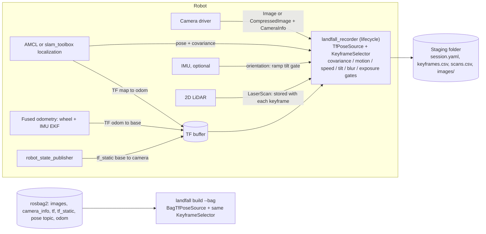
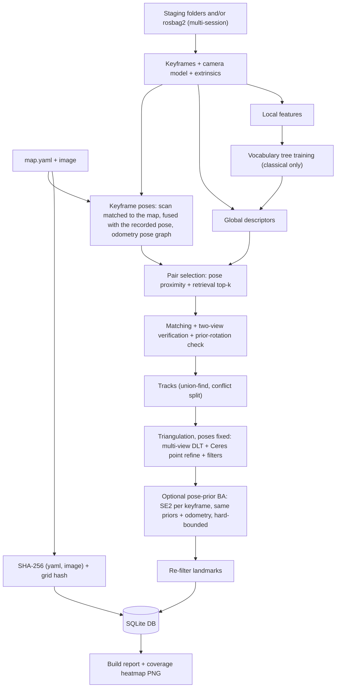
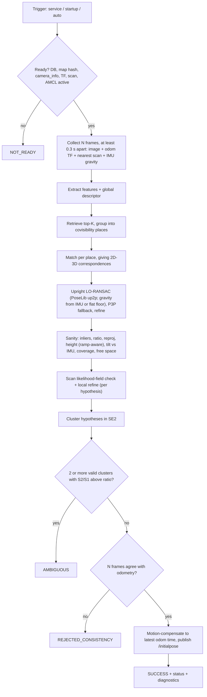

# Landfall — v1.0 Implementation Plan

Date: 2026-10-29 · Repo: `github.com/ali-pahlevani/Landfall` (public, 1 commit) · Status: APPROVED (rev 3), revised (rev 4: V1–V13; rev 5: V14–V22; rev 6: V23–V29; rev 7: V30–V37; rev 8: V38–V45; rev 9: V46–V51; rev 10: V52–V55)

**Review decisions folded into this revision (2026-10-29):**

| # | Decision |
|---|---|
| D1 | No paid or non-commercial component anywhere. The only closed-source pieces are NVIDIA's CUDA/cuDNN/TensorRT, used solely by the optional GPU path (documented, §8). Ubuntu's Ceres → SuiteSparse (GPL parts) stays confined to the offline builder (documented). |
| D2 | Odometry comes **only** from the `odom→base` TF, the same one AMCL uses. The recorder doesn't subscribe to an odometry topic. Recommended fusion: **robot_localization's EKF (`ekf_node`)** over wheel + IMU (see D12). |
| D3 | **IMU gravity (optional):** when an IMU is present, its orientation supplies gravity for the upright solver, the tilt check, ramp-aware height and LiDAR checks, and the recorder's ramp gate (§7.18). |
| D4 | Distros unchanged: Humble + Jazzy required; Lyrical allowed-failure until green, then promoted. |
| D5 | Calibration: only what's necessary. A startup DB-vs-TF extrinsics check plus an extrinsics **health monitor** (detection only, never correction) (§7.19). |
| D6 | Methods are the field-standard ones (§7.0). The GPU preset becomes ALIKED + LightGlue, falling back to XFeat + LighterGlue if ALIKED's ONNX export fails. |
| D7 | First release is **v1.0.0** (your decision). 1.0 promises stable interfaces, so the plan earns it with an interface-freeze review and a **field-validation milestone on your forklift (M8)**; v1.0.0-rc.1 comes first (§11.1). |
| D8 | All other recommendations from rev 1's open questions are accepted. |
| D9 | **You do all git commits and pushes.** I stop after every milestone with a report and a suggested split into conventional commits (messages + files). GitHub CI runs on your push. I only use read-only git (`status`, `diff`). |
| D10 | Disk: I ask you to free space whenever a step needs it (first likely at M0's Jazzy/Lyrical images); I never delete anything myself. |
| D11 | GPU: CPU-only release gate. The GPU path ships labeled **experimental** (not covered by 1.0 validation) unless cuDNN is installed for testing. |
| D12 | Fusion recommendation: **robot_localization `ekf_node`** (EKF; ROS 1's `ekf_localization_node`), over its UKF and over `fuse`. It's Nav2's documented odometry-smoothing setup, available on all three distros, and light enough for a CPU-only PC. UKF adds compute for no gain on planar wheel + IMU. `fuse` isn't released for Humble. Gravity (roll/pitch) comes separately from the IMU's orientation, because the EKF in `two_d_mode` discards roll/pitch: the driver's own AHRS output if present, else `imu_complementary_filter` (BSD-3). |
| D13 | Field target: **your forklift, industrial mini PC, no GPU** (assumed x86_64). It gets the `classical` and `learned_cpu` presets, and real-robot timings and validation come from it (M8). |
| D14 | (2026-11-05) Forklift work, meaning M8 and the open items of §14 and R25–R27, starts only once M1–M7 are done and a real dataset is to be tested. |

**Revisions after approval** (rev 4, 2026-10-30; found while implementing M0 and M1, sections below updated):

| # | Change | Why |
|---|---|---|
| V1 | BT.CPP v3/v4 is chosen from the Nav2 version (< 1.2.0: v3), not from which BT.CPP package is found (§9) | Humble machines can have both BT.CPP packages installed |
| V2 | `bond::Bond` is always owned by a `shared_ptr` (§9) | bondcpp 4.4 (Lyrical) calls `shared_from_this()` in `start()` |
| V3 | Lyrical-only `nav2_common` build dependency in `landfall_nav2` (T-004) | Nav2 1.5.2 exports it from `nav2_behavior_tree` without declaring it |
| V4 | clang-format/clang-tidy 18 come from Jazzy's apt packages in the lint image, not a pip wheel (§8, §12) | same binary locally and in CI |
| V5 | Header guards use single underscores (`LANDFALL_X_HPP_`) | clang-tidy flags double underscores as reserved identifiers |
| V6 | Docker scripts reuse the dependency images and install newly added rosdep keys in the throwaway container (`scripts/in_container.sh`) | a rebuilt dependency layer costs ~1.7 GB per distro |
| V7 | ament's cppcheck skips itself on every distro (2.7, 2.13, 2.19); clang-tidy 18 is the static analyzer | ament_cmake_cppcheck behaviour |
| V8 | DB schema v1: poses stored as the 3×4 matrix (12×f64), `maps.grid` holds the occupancy grid as PNG, no WAL (§6) | bit-exact round trips; tolerant map comparison at runtime; WAL files break read-only opening |
| V9 | Map loader reproduces both nav2_map_server pixel rules: Humble (channel average, strict thresholds) and Jazzy/Lyrical (grayscale, inclusive thresholds, transparency = unknown) (§6) | the two releases produce different grids for color/transparent images |
| V10 | PoseLib is compiled by our own CMake target from the pinned tarball (hidden symbols, not installed); `LANDFALL_USE_SYSTEM_POSELIB` and `FETCHCONTENT_SOURCE_DIR_LANDFALL_POSELIB` for offline builds | PoseLib's own CMake installs/exports itself and forces a build type |
| V11 | PnP strategies are an enum (`pnp.solver`), not an `IPoseSolver` interface; `IPoseSource` (M2), `IHypothesisVerifier` (M4) and the backend registry (M2) arrive with their first users; `util/thread_pool` with the builder (M2) | no interface without a consumer |
| V12 | FAISS dropped from v1.0 (§8) | exact search over 10⁴ keyframes takes ~1 ms; not in Ubuntu 24.04 |
| V13 | Lyrical promoted to required in CI at the end of M1 (D4) | green on every run since M0 |

**Revisions in M2** (rev 5, 2026-10-30; sections below updated):

| # | Change | Why |
|---|---|---|
| V14 | The map loader reproduces GraphicsMagick's grayscale exactly (16-bit quanta, rounded Rec. 601 luma, truncated to 8 bit) and Humble's quantum-truncated channel average (§6) | M2's map_server parity test found V9's approximation (OpenCV's BGR2GRAY) 6-251 cells off on color/RGBA maps; the new rule matches GraphicsMagick 1.3.42 for all 2^24 colors |
| V15 | Two-view verification uses PoseLib's 5-point LO-RANSAC (Sampson error, 4 px) and, below 5 cm of prior baseline, a rotation-only 2-point LO-RANSAC (§7.4) | PoseLib is already linked and seeded deterministically; the builder only needs inliers and the rotation for the 5° prior check |
| V16 | `ba.prior_std_xy` / `ba.prior_std_yaw_deg` (0 = recorded covariance + floors, the default) (§4.5, §7.6) | AMCL reported ~5× its actual error in simulation; whitening priors with it let BA move keyframes up to 5 cm away from the truth |
| V17 | Recorder parameters are read-only (set at startup); new ones: `camera_info.topic`, `imu.frame`, `gating.speed_window`, `tf_timeout`, `bond.enabled`, `autostart` (§4.5) | simulated IMUs (and some drivers) use frame ids that aren't TF frames; standalone use needs autostart |
| V18 | Simulation assets live in `landfall_bringup/sim/` (TurtleBot 4 description with a 640 × 480 camera and Gazebo ground truth, recording scripts, routes, parameters) and run in `docker/Dockerfile.sim`; the simulator packages are not declared dependencies | nav2_bringup's TB4 launch starts Gazebo without `--headless-rendering`; recording runs only in the simulation image |
| V19 | The fixture bag is cut by `landfall_tools/fixtures/depot_fixture.py` in two steps: export on Jazzy, write with Humble's rosbag2 (§12) | Humble's rosbag2 cannot read Jazzy's metadata (version 9); every newer reader reads Humble's |
| V20 | Ground-truth evaluation (`landfall/eval/trajectory.hpp`, in landfall_core) and `evaluate_poses` (landfall_benchmark) arrive in M2 instead of M7 | M2's acceptance compares recorded poses with Gazebo's ground truth |
| V21 | BoW global descriptors are stored as blob type 3 (sparse u32/f32 pairs); the schema (v1) is unchanged | the vocabulary has up to 10^5 words, a vector holds ~10^3 |
| V22 | Deferred: generated `docs/parameters.md` (T-005, with the relocalizer in M3) and the optional BA extrinsics refinement (T-006) | the recorder's parameters are documented in `docs/recording.md`; nothing needs extrinsics refinement yet |

**Revisions in M3** (rev 6, 2026-10-31, V29 on 2026-11-05; sections below updated):

| # | Change | Why |
|---|---|---|
| V23 | The relocalizer's *configure* succeeds without a usable database or map; every request then answers NOT_READY with the reason, and `/diagnostics` reports an error (§4.2) | a broken Landfall database must not stop AMCL's lifecycle manager (one localization bringup) |
| V24 | Relocalizer topics: `camera_info.topic` parameter (as the recorder, V17), `map` set by remapping; `autostart` for the executable; `query.max_keypoints` dropped, queries use the database's own feature settings (§4.5) | the backend check refuses any other feature configuration |
| V25 | `docs/parameters.md` is printed by `test_parameters_doc --print` (`scripts/update_parameters_doc.sh`); the same test is the CI freshness check (§4.5, §12; T-005 done) | the nodes' own declarations are the source, no separate dump tool |
| V26 | The startup extrinsics check treats `base → camera` as static when `/tf_static` alone connects the two frames, and skips otherwise (§7.19) | tf2 doesn't expose whether a transform is static; the forklift's camera rides the fork carriage (§14) |
| V27 | `landfall query` emulates node requests on a bag (`--frames N`) and writes one CSV row per request; `evaluate_poses --queries` scores them against ground truth (§4.2) | one code path (`queryBagImages`) for the CLI and the tests |
| V28 | M3's query set: the fixture's images that are not database keyframes (it has no separate query segment), plus cross-session queries between the two full depot drives (run 1 ↔ run 2) | the fixture's two windows drive the same stretch in opposite directions; both feed the build |
| V29 | (2026-11-05, your decision on the M3 report) M3's two accuracy criteria (≥ 90 % success within 0.25 m / 5°, no published pose off by more than 0.5 m) are measured at the end of M4, with LiDAR verification, on the cross-session depot drives (run 1 ↔ run 2, requests of 3 frames); CI keeps the fixture regression test (no wrong pose, at least 20 of 35 frames correct) (§11) | the depot looks alike rotated 180°: vision alone published 1 mirror pose in 156 requests, which only the LiDAR check of M4 can stop |

**Revisions in M4** (rev 7, 2026-11-05; sections below updated):

| # | Change | Why |
|---|---|---|
| V30 | A scan **violation** is a beam that continues at least `violation_margin` (0.15 m) through non-occupied cells after the last occupied cell it crosses (exact grid traversal) (§7.12) | the rule "crosses an occupied cell up to 0.15 m before its endpoint" also flagged beams that end inside a thick map obstacle: a median of 11 % violations at the *true* poses of the depot drives, more than the 5 % allowed |
| V31 | Scan check defaults from the depot drives: `scan_check.min_hit_ratio` **0.85** (was 0.60), `scan_check.refine_pose` **false** (was true) (§4.5, §7.12) | on the two depot drives (every scan at its true pose and at 20 wrong poses 0.5–5 m away, 213,240 wrong poses in all) a hit-ratio threshold of 0.60 accepted 344 wrong poses, 0.70 accepted 110, 0.80 accepted 9 and 0.85 none, while the true poses accepted stayed at 10,652 of 10,662 (10,653 at 0.60). The window's best pose (a 2.5 cm, 1° grid) was less accurate than vision's: 3-frame cross-session requests published poses 2.1 / 1.9 cm off (median; p95 6.2 / 5.5 cm) with refinement, 1.3 / 1.1 cm (p95 3.5 / 2.5 cm) without |
| V32 | `ambiguity.max_score_ratio` defaults to **0**: any second valid place (all vision and LiDAR checks passed, ≥ `sanity.min_inliers`) makes the frame AMBIGUOUS, whatever its score (§4.5, §7.11) | a competitor that passes the LiDAR check is a real alternative; in the depot's mirrored halves the wrong place out-scored the right one in 8 of 20 ambiguous frames (M3), so the score ratio says nothing about which one is right |
| V33 | New relocalizer parameters: `scan_check.topic` (as `camera_info.topic`, V24); `extrinsics_monitor.max_linear_speed` / `extrinsics_monitor.max_angular_speed` (0.2 m/s / 0.1 rad/s), the "robot is slow" gate of §7.19; `extrinsics_monitor.period` range [1, 3600] s (was [5, 3600]) (§4.5) | time-sync error and the localization's lag look like a camera offset while the robot moves; tests and shadow runs can sample every second |
| V34 | The monitor's samples are full dry-run requests (the node's `consistency.num_frames`, every check). Only a SUCCESS adds a sample (from its latest frame that passed the speed gate), they never publish `~/status`, and a service request preempts them instead of being answered BUSY (the startup and auto triggers wait while any request runs) (§7.19) | the shadow log (M8) must measure the requests a robot really runs; a sample from a rejected request may come from a wrong place; a Nav2 BT's request must not fail because a background sample happens to run |
| V35 | `IHypothesisVerifier` (V11) stays deferred to Stage 3: the scan verifier is the only verifier, and the localizer calls it for every hypothesis that passed the sanity checks (§4.1) | no interface without a second implementation |
| V36 | `bag.scan_topic` in the builder config (default `/scan`): `landfall query` checks scans as the node does. `evaluate_scan_check` (landfall_benchmark) runs the scan check on a recording at the true poses and at wrong ones (§4.2, §11) | M4's acceptance numbers come from recordings with ground truth (fixture, depot drives) |
| V37 | Tests: the extrinsics monitor and the odometry-consistency rejection are tested in-process (`test_relocalizer_node`, TF tampered there); the auto-trigger launch test closes the loop with AMCL scattered by `reinitialize_global_localization`. CI posts build errors and failing tests as public check annotations (`scripts/ci_build_test.sh`) (§12) | the in-process harness controls TF and timing exactly; the launch test shows the trigger stops because AMCL became confident, not only because of the cooldown; GitHub job logs need a login |

**Revisions in M5** (rev 8, 2026-11-06; sections below updated where marked):

| # | Change | Why |
|---|---|---|
| V38 | The learned backends live in `landfall_core_onnx`, built only with ONNX Runtime and linking it privately (no ONNX Runtime header installed). `buildMap` and `LocalizationMap::load` take a `BackendRegistry`; `landfall_ros` registers the ONNX backends when `landfall_core::landfall_core_onnx` exists (one registry per process). The registry gains global descriptors (§4.1). Options `runtime.models_dir` / `runtime.provider` / `runtime.threads` say how a backend runs and stay out of its identity; the model file's SHA-256 is part of it (`BackendId::model_sha256`, `backends.model_sha256`), and a database refuses a missing or different model | the runtime library stays free of ONNX Runtime; a database must be relocalized with exactly the models it was built with |
| V39 | ONNX Runtime from `ONNXRUNTIME_ROOT`, then `onnxruntime_vendor`, then the system; minimum C API 20 (1.20). `onnxruntime_vendor` becomes a `<depend>` of `landfall_core`, so the learned backends build by default on every distro and architecture; the release archive's own CMake config is not used (it points at `lib64/` and `include/onnxruntime/`, which the archive lacks) (§8) | the vendor is in rosdistro for Humble, Jazzy and Lyrical, amd64 and arm64; `LANDFALL_WITH_ONNXRUNTIME=OFF` still builds the classical path alone |
| V40 | GPU preset: XFeat-4096 + LighterGlue + MegaLoc, as the fallback planned. The ALIKED export check fails: ONNX Runtime 1.23.2 and 1.24.3 have no `DeformConv` kernel. LighterGlue is deferred (T-008; `mnn` meanwhile). MegaLoc uses upstream's own ONNX file, pinned on Hugging Face, rather than a Landfall export (§10) | upstream publishes `megaloc.onnx` (MIT); the GPU path is experimental (D11) |
| V41 | Export: EigenPlaces' network is built from torchvision in the script (upstream's constructor runs CosPlace's code through `torch.hub` only to initialize weights the checkpoint replaces; `load_state_dict(strict=True)` checks the architecture). The Python tooling pins torch 2.6.0, the first release whose `torch.load(weights_only=True)` is not open to CVE-2025-32434 | the exports load downloaded checkpoints |
| V42 | Parity: export scripts write parity files (images and the Python reference outputs) that the C++ test `test_onnx_parity` checks against the M5 bars. Synthetic ONNX models and parity files, made by `landfall_tools/export/synthetic.py` without trained weights, are committed test data (about 175 KB), so CI tests the ONNX path, and the C++ post-processing against torch's own `grid_sample`, without models. XFeat's post-processing follows PyTorch's arithmetic: bit-exact on images that need no resize | the real models are not in the repository (§10) |
| V43 | (2026-11-06) Model export and publication (T-007) wait for your decision: running the pinned upstream model code and loading the downloaded checkpoints was blocked by this session's permission policy. `landfall_tools/models.yaml` pins every upstream file; the exported files' SHA-256 come with the export | the decision to run third-party code is yours |
| V44 | CI: a Jazzy job without ONNX Runtime; flake8 for `landfall_tools` in the policies job (findings as annotations); `actions/checkout` and `actions/upload-artifact` move to v7 (Node 24) (§12) | M5's "full suite with ORT OFF and ON"; Node 20 is deprecated on GitHub's runners |
| V45 | Parameters: `backend.models_dir` and `backend.execution_provider` (read-only) as planned; `backend.num_threads` also sets ONNX Runtime's threads. Builder keys `backend.models_dir`, `backend.execution_provider` (not stored in the database: they describe the machine) and `global.*` (options of a learned global backend); `landfall build` / `query` take `--models-dir` and `--execution-provider` (§4.5) | the content hash must not depend on where the models are |

**Revisions in M6** (rev 9, 2026-11-07; sections below updated where marked):

| # | Change | Why |
|---|---|---|
| V46 | `ReLocalize` is a behavior tree action of its own (`BT::StatefulActionNode` with an rclcpp client), not a `BtServiceNode` subclass (§3, §9). It creates its client without waiting: a missing service fails the node when ticked (status UNAVAILABLE after `wait_for_service_timeout`). Its default `server_timeout` is the request's `timeout` + 10 s, or 20 s; a BUSY answer is asked again every 0.5 s while that lasts | Nav2's `BtServiceNode` waits for the service when the tree is created and throws without it, which fails the tree and the navigator's activation; the relocalizer comes up under the localization's lifecycle manager, whose order relative to the navigation's isn't fixed. Nav2's 20 ms default server timeout is far below a relocalization; BUSY happens when the startup relocalization is still running |
| V47 | A robot that starts without a pose gets its first one from the relocalizer's startup trigger (launch argument `startup_relocalization`), not from the behavior tree; the tree's `Fallback[IsLocalized, RetryUntilSuccessful[ReLocalize]]` covers an uncertain pose (§11 M6) | Nav2 1.2 and later refuse a NavigateToPose goal while the robot pose (map->odom) is unavailable, and the costmaps don't activate without it, so no tree runs until AMCL has a pose |
| V48 | Example trees: one per Nav2 release (`behavior_trees/{humble,jazzy,lyrical}/`), each that release's `navigate_to_pose_w_replanning_and_recovery.xml` with the relocalization added, installed under one name for the Nav2 the package is built against; tree ID `NavigateToPoseWithRelocalization` (§3, §9). Both relocalization steps look around: `ReLocalize` (timeout 2.5 s), and after a failure `Spin` 45° and again, from up to eight headings (§7.10's view diversity). After a relocalization the tree waits 1 s for AMCL's map->odom, clears both costmaps, and in the recovery plans the path again from the new pose | Nav2's default trees differ in more than the XML format (Jazzy's selectors and error-code gates, Lyrical's path validation), so `.xml.in` templates of one tree can't serve all three. Lyrical's navigator registers every tree of its `bt_search_directories` by ID, so the ID must differ from Nav2's. In the M6 simulation run, the recovery's single attempt failed twice after a kidnap: the robot stood at an angle the database had no views from (5 of 40 inliers). With the look-around, the recovery relocalized, but navigation then failed on the old path and on obstacles the costmaps had marked while the pose was wrong |
| V49 | Nav2 overlays: `landfall_bringup/params/nav2_<distro>.yaml` (`plugin_lib_names`) and the example tree (`default_nav_to_pose_bt_xml`) reach Nav2's nodes through `set_parameters_from_file` and `set_parameter` around nav2_bringup's `navigation_launch.py` (`navigation.launch.xml`), beneath the user's `params_file`. On Humble the user's file must list `landfall_nav2_bt_nodes` itself. `localization.launch.xml` replaces nav2_bringup's `localization_launch.py` (map_server, amcl, landfall_relocalizer under one manager). nav2_bringup is not a dependency (§9) | ROS 2 launch gives such parameters to the nodes it starts before their own parameter file (checked on all three distros), and XML `set_parameter` mangles list values. Humble's parameter files list every plugin, which then wins. nav2_bringup depends on the simulators |
| V50 | `IsLocalized` subscribes to the pose topic when the tree is loaded, transient-local by default (`latched`) | AMCL publishes `amcl_pose` latched and only on filter updates; Nav2's own condition nodes subscribe on their first tick since Jazzy, and would miss a still robot's last pose |
| V51 | Tests: `landfall_nav2`'s tests run on isolated ROS domains (`ament_add_ros_isolated_gtest`); `landfall_bringup`'s launch tests run their nodes in a namespace. The CI job that fetches the learned models sets `LANDFALL_REQUIRE_MODELS`, so `test_onnx_parity` fails instead of skipping them (§12) | colcon tests packages in parallel, and these serve `landfall_relocalizer/relocalize` or start nodes named like `landfall_ros`'s tests'. Lyrical's isolation (rmw test fixture) has no launch-test form, namespaces work everywhere |

**Revisions in M7** (rev 10, 2026-11-07; sections below updated where marked):

| # | Change | Why |
|---|---|---|
| V52 | (2026-11-07, your decision on the M6 report) **Kidnap watchdog** in the relocalizer (§4.5, §7.15, new §7.20): background checks, dry-run requests of its own every `kidnap_watchdog.period` (10 s) plus the extrinsics monitor's, that pass every check are compared with the localization's pose at their stamp; `kidnap_watchdog.confirmations` (2) disagreeing ones in a row (beyond 1 m or 20°) start a normal relocalization that publishes (trigger `watchdog`), at most once per `kidnap_watchdog.cooldown` (30 s). Off by default. The checks are not relocalizations: never on `~/status`, in the shadow log | Nav2 notices a wrong pose only when the robot can't move: after the M6 kidnaps the robot drove on a wrong pose for 1 to 6 minutes, while in run 2 the monitor's dry run had already placed it 9 cm from the truth, with AMCL confidently 8 m and 180° off |
| V53 | The kidnap benchmark (§11 M7, `docs/benchmark.md`): `kidnap_runner` (landfall_benchmark) moves the robot with Gazebo's `set_pose` (ros_gz_bridge's `SetEntityPose`) and turns it through `cmd_vel`; Nav2 runs idle. Placements: positions uniform over free cells at least 0.4 m from obstacles and within 1 m of a keyframe of the database (the recorded area), uniform headings, at least 2 m from the previous one, from a fixed seed, so that every method meets the same placements. Landfall: requests of 2.5 s from up to 8 headings 45° apart, as the example tree; AMCL: `reinitialize_global_localization` and two turns on the spot, a pose claimed below σxy 0.5 m (the auto trigger's limit). Success: AMCL within 0.25 m / 5° after a turn on the spot (estimate and ground truth compared at the estimate's stamp); wrong: a pose published (or claimed) beyond 0.5 m or 10°; time to localize: from the first request to the published answer, turns included. `summarize_benchmark` writes the tables, with 95 % Clopper-Pearson upper bounds of the wrong-pose rate. Development runs used seeds 2026 and 7; the reported results use seed 2027, which no change was made against | the simulation reaches every placement exactly and repeatably; turning on the spot is what the example tree does; a robot acts on AMCL's pose once AMCL reports itself confident |
| V54 | Benchmark conditions: world variants of the depot (`landfall_bringup/sim/worlds/`): `lighting` (the hall lights dimmer and warmer, a low sun), `added_objects` (nine stacks of goods off the recorded lanes) and the stress test `crates_removed` (the crate stacks along most lanes gone, which the map and the database still have). "Same session" and "different session" are measured offline on the two recorded drives (`landfall query` of run 1's images that are no keyframes against run 1's database, of run 2's against run 1's: M4's protocol): live in the simulation, every placement is a new session of the same rendering | a simulated building renders the same in every session; light and moved goods are what changes between real sessions |
| V55 | **Scan alternatives** (§4.5, §7.11, §7.12): once a pose has passed every check, the relocalizer searches where else in the map the LiDAR scan fits (every heading at the free cells of a 0.25 m grid, the best 40 refined). If the scan fits at least `scan_check.alternative_margin` (0.01, in hit ratio less violation ratio) better at another place (beyond 1 m or 30°), the frame is AMBIGUOUS: vision found the wrong one of two places that look alike. `scan_check.check_alternatives` (on). `evaluate_scan_check` gains `--symmetry`, `--sweep` and `--alternatives`; `sample_placements` prints a seed's placements | The benchmark's first development run (seed 2026, before this check) published 2 wrong poses in 100 placements: the mirror images of the robot's pose through the depot's centre (23 m, 180° off), where the recording had seen the mirror place from that direction but not the true one, and the LiDAR check passed them (hit 0.935, violations 0.036). Within 0.5 m and 6° of the exact mirror pose, some pose passes the LiDAR check for 20 % of the scans at 200 kidnap placements, and no threshold separates them: 0.97 / 0.02 still passed 3.3 % while rejecting 7 % of the true poses. Compared with each other they separate: at 1,927 true poses no place fitted better (the best alternative was at least 0.015 worse), at 347 worst-case mirror poses the true pose fitted better (by 0.006 at least, by 0.01 or more for 99 %). With the check, cross-session single-frame requests lost their one mirror pose per direction at the same successes, and the wrong placement that reproduced in the simulation answered AMBIGUOUS. A margin above 0 keeps identical twins (aisles) to vision. Cost: about 20 ms per frame that found a pose (16 threads) |
| V56 | (2026-11-11, your decision on the warehouse test report) **Keyframe poses from scan matching and odometry** (§1 A3, §4.5, §5, §7.1, §7.6): the recorder stores each keyframe's LiDAR scan (the one nearest its image, moved to the image's stamp with odometry; `scan.topic`, `scan.max_time_offset`) and its odometry pose; staging format 2 (`scans.csv`, odometry columns; format 1 still reads); `landfall build --bag` takes both from the bag. The builder first matches every scan to the map near the recorded pose (correlative search, ±1 m / ±6°, refined to 2.5 mm; covariance from the hit beams' surface normals plus the likelihood-weighted spread over the search window, so a near-equal second fit makes the match uncertain that way), fuses it with the recorded pose (where both agree within the 99 % chi-square, trusted at 2 cm / 0.5° in the directions the scan confirms and at most 0.3 m / 3° where it can't check; at 0.3 m / 3° where the scan contradicts it), and solves a pose graph with odometry links between consecutive keyframes (2 cm + 3 % of the distance, 0.5° + 10 % of the turn, Cauchy); pair selection, triangulation and the BA start from it, the BA keeps the same priors and links, a scan prior's bounds widen to 3 standard deviations. Keyframe flags `kFlagScanMatched`, `kFlagScanUnmatched`; report section "Keyframe poses"; builder keys `poses.*`, `bag.scan_max_time_offset` | In the URDF Maker warehouse AMCL was 14 cm (median) and 44 cm (90th percentile) off, up to 80 cm along the aisles, while reporting 7.5 cm, and its covariance gate passed frames 40 cm off (p90); 71 % of the tracks failed triangulation. The same drive's keyframes with true poses relocalized 59 % more often with three times the accuracy (2.8 vs 8.6 cm median). A3 ("prior poses carry cm-level error") and the 10 cm / 2° bounds assumed a localization this robot doesn't have; a good localization (the depot simulation, 1.4 cm) keeps its accuracy through the agreement test |
| V61 | (2026-11-14, fix 5 of the warehouse report, checked on the depot as well) **The inliers a pose needs depend on what the LiDAR tells apart** (§4.5, §7.9, §7.12): `sanity.min_inliers_unique` (20): a pose with 20 to 39 inliers stands where the scan fits every other place (beyond 1 m or 30°) at least `scan_check.unique_margin` (0.05) worse and no place within 1 m almost as well (the build's matcher window, ±1 m and ±6°: the best fit at the pose, a second one at least 15 cm away at least 1 nat worse), else REJECTED_SCAN_CHECK; with such a winner any other valid place competes. `scan_check.max_twin_support` (0.5): a pose whose inliers come for more than that share from keyframes the build flagged (flag 8) is AMBIGUOUS, in every scan mode. `sanity.min_inlier_ratio` 0.25 → 0.1. `landfall query` writes the measures (and the node's dump); the twin test runs for weak winners only (about 40 ms) | Warehouse (the protocol drive's database, the 904 sweep frames): plain lower thresholds gained (20 inliers, ratio 0.1: 22.8 → 30.1 % right) with 4 wrong poses: the 2 in the doubled-wall aisles (0.52 and 0.56 m, 70 and 58 inliers) and 2 at 39 inliers (0.51 m there, 6.6 m along a repeating wall). Measured for every winner (floor 15): the 67 weak winners without a twin were all right, each with a gap of at least 0.05; the 3 wrong weak ones all had a twin. The error grew with the share of inliers matched in flagged keyframes: median 3.5 cm and at most 22 cm at half or less (256 poses), median 26 cm and up to 0.56 m at 0.9 or more (19 poses, among them the 3 wrong ones V55 lets through); the query's own twin test missed one wrong pose (its scan fitted the wrong place 1.04 nats better: the map is wrong there), so the share decides alone, majority as the limit. Result: 27.3 % right, 0 wrong, median 3.4 → 3.1 cm; look-around 85 → 75 of 113 places (north 59 → 61, doubled-wall south 26 → 14). Depot cross-session requests 98.7 and 98.2 % (98.6 and 98.2), no wrong pose; no depot keyframe is flagged. Kidnap benchmark, M7's database and placements: unmapped goods 46 → 52 %, removed crates 68 → 76 %, no wrong pose, no success lost |
| V60 | (2026-11-13, fix 4 of the warehouse report, checked on the depot as well) **Coverage measure and driving protocol** (§7.17, `docs/recording.md` "Where to drive"): the build measures the floor the robot can reach (free, at least `coverage.clearance` from obstacles, by default the 5th percentile of the keyframes' clearance, connected 8-way to the drive) every 0.25 m, and which of 8 heading sectors (centred on the compass directions) a keyframe holding ≥ 40 landmarks sees from within 1 m. The report, `landfall build` and `report.json` give the shares of that floor with a view, with views in two or more directions, and of its positions × headings; `coverage.png` shades it (red none, yellow one direction, blue two or more) instead of the heading rose; the build warns when less than `coverage.target` (0.8) has a view. The protocol: every aisle both ways, open floor in lanes ≤ 2 m apart both ways, full turns on the spot (0.2 rad/s) at aisle ends, junctions, every 4-5 m and where the robot stops, then the red parts. The turning-odometry warning (V59) now needs the turns more than a quarter above the setting, so the measured value stays quiet. An operating-area mask stays open (T-012) | The rule, from the warehouse sweep (T-011's map) and the depot benchmark: requests with such a view succeeded 72-83 % of the time, without one 4-12 %; 3 of 177 successes came from farther than 2 m or 45°; a look-around relocalized 67-90 % of the places seen in one direction, 94-95 % of those seen in two or more, 15 % of the others. A 70-minute protocol drive of the warehouse (1.1 km, 30 turns, 2,658 keyframes): a view on 82 % of the 886 m² (T-011's route: 32 %), two or more directions on 53 % (14 %); single requests 9.3 → 22.8 % right, look-around 48 → 85 of 113 places (open north 19 → 59 of 66), median error 5.2 → 3.4 cm; the rule held on the new map (71 % / 9 %; places with no, one, two or more directions 8 of 28, 24 of 29, 53 of 56). Two directions fell short of the route's predicted 87 % because 31 % of the keyframes (headings onto open floor or distant walls) hold fewer than 40 landmarks: counting every keyframe gives 77 %, but a view only 85 % instead of 82 %, hence the target on the floor with a view, which driving reaches. In the southern aisles, where the map draws walls twice (T-011), the keyframes stay off along the aisle (median 17.5 cm, max 57 cm; those around the two below 0.51-0.55 m, all flagged), the look-around didn't gain (29 → 26 of 47), and two requests were relocalized 0.52 and 0.56 m off (70 and 58 inliers, scan hit ratio 0.99 and 0.98: the scan fits both places): wrong poses 0 → 2; T-011's map had 12 of 25 successes there 25-50 cm off. The measured turn error as the setting (0.22 m/rad) changed nothing (3 wrong). Refusing poses where at least half the keyframes within 2 m are flagged would have removed both, at 22 of 206 right ones: proposed for fix 5 |
| V59 | (2026-11-13, T-011 of the warehouse report, checked on the depot as well) **Turns, the recorded pose where the scan can't tell, and two self-checks** (§4.5, §7.6): `poses.odom_std_xy_per_rad` (0.1 m per radian turned) adds to an odometry link's position std. `poses.disagreement_std_xy` 0.3 → 1 m: the recorded pose where the scan contradicts it, doesn't match or can't tell a direction (the localization uses the same scans and map, so it is no better there). The scan matcher reports its window's best other fit (a separate maximum at least 15 cm away, refined) and how much worse it fits; the build flags keyframes whose second place fits within 1 nat (flag 8, orange on the coverage map, a warning above 5 %) and measures the odometry against consecutive precise, unambiguous scan matches (the straight-step error, and the per-radian turn error beyond it from the chi-square median), warning when the turn error exceeds the setting (by more than a quarter since V60). Choosing between the two places stays open (T-011) | In the warehouse's doubled-wall aisles 229 of 594 keyframes' scans fit a second place 25-50 cm along the aisle within 1 nat. With the right place every time the keyframes would be 1.2 cm (median) / 6 cm (p90) off, but AMCL picked it 120 times of 229 and the better fit 128; odometry is 0.7 cm per 0.5 m straight step but slips about 0.2 m per radian turned (50 cm in U-turns), and every aisle is entered and left through turns. Chains, a Viterbi over the places, multi-place priors and scan-to-scan links (0.8 cm at turns) chose no better than AMCL. What the build did wrong: AMCL, up to 0.94 m off there, pulled keyframes along the aisle where the ambiguous scan is uncertain, and U-turns were trusted like straight steps. Now: wrong poses 3 → 0 (the former ones within 0.43 m), median 7.3 → 5.2 cm, success 9.6 → 9.3 % of the sweep frames, keyframe p90 29.3 → 24.0 cm; the self-checks find the 229 keyframes and the robot's 0.19 m/rad slip without ground truth. Depot (TurtleBot 4, 0.015 m/rad): unchanged, 98.2-98.6 % success, 0 wrong, keyframes 1.0 cm (median). The turn default lies far above the differential drive's and below the skid steer's: too high costs little where scans pin the poses, too low lets a slipping turn drag them; the check tells a robot that needs more |
| V58 | (2026-11-12, fix 3 of the warehouse report) **Floor mask** (§4.5, §7.2): every local feature backend takes `floor_mask_distance` (builder key `features.floor_mask_distance`, 5 m unless set, 0 = off) and detects no keypoint where the pixel's ray meets the floor (base z = 0) nearer than that to the camera, from the camera model and the base→camera TF at the image's stamp (`ILocalFeatures::extract` takes both). The distance is part of the local backend's stored configuration, written only when set (older databases keep theirs, without a mask), so queries hide the same floor. ORB's and SIFT's cell shares follow the unmasked area; XFeat drops masked maxima before its top-k. The build report and `landfall build` give the features per keyframe and the share of the image the mask hid | Seen from a robot, the floor's texture changes shape with every viewpoint: in the warehouse it held about 72 % of the ORB keypoints and under 1 % of the landmarks. On fix 2's warehouse recording (camera 0.33 m up, 43 % of the image hidden): 15,039 landmarks instead of 8,701, inconsistent tracks 30 % instead of 71 %, success 6.4 % -> 9.6 % of the 904 sweep frames (3 m: 9.5 %, 7.6 m: 9.0 %, 12 m: 8.1 %); with true keyframe poses 6.1 % -> 9.2 %, no wrong pose (also at 25 inliers). With AMCL's poses 3 of the new successes are 0.51-0.52 m off, in the southern aisles where the nearby keyframes are 0.45-0.55 m off (median; T-011): fix 2's database localized 9 frames there, up to 0.46 m off; with true poses and the mask, 15, none more than 11 cm off. Depot fixture: 1,232 landmarks instead of 940 |
| V57 | (2026-11-11, fix 2 of the warehouse report) **No covariance gate for frames with a scan** (§4.5, §7.1, §7.6): `gating.covariance` (recorder parameter and builder key; `without_scan` by default, `always`, `never`): a frame that comes with a LiDAR scan skips the localization-covariance gate, since the build matches it to the map; frames without one are gated as before (`tf_only`: never). A keyframe whose scan doesn't match the map gets the recorded pose at 0.3 m / 3° (as a contradicted one), so odometry carries it. Where the scan agrees, the recorded pose's std grows with the square of the scan's in each direction (σ²/2 cm, at most 0.3 m) instead of equalling it | In the URDF Maker warehouse the AMCL gate dropped 41 % of the frames, those it passed were still 40 cm off at the 90th percentile, and its gaps broke the odometry chains (the 57 s gap where AMCL was 19 cm off). The same route without the gate: 594 keyframes instead of 372, 8,698 landmarks instead of 5,376, relocalization success 4.1 % -> 6.4 % of the 904 sweep frames (true poses: 6.1 %), no wrong pose. The admitted frames are where AMCL was worst (23 cm median); counted at the scan's own std along the scan's weak direction AMCL pulled poses halfway to it (6.9 cm where the scan was 2.8 cm off); with the square rule, north of the aliased aisles the keyframes are 2.6 cm off (median) instead of 3.5 |

---

## 1. Executive summary and explicit assumptions

**Context.** Nav2 robots on AMCL need an initial pose at startup and after kidnapping. AMCL's global
localization fails exactly where 2D scans look alike (aisles, corridors). Cameras disambiguate those places.
Landfall is a CPU-capable, permissively licensed, monocular **visual relocalizer** that works on the user's
**existing 2D map in AMCL's `map` frame**. It proposes a pose from vision, **verifies it with LiDAR and
odometry**, and publishes `/initialpose` only when every check passes. Misses are acceptable; wrong poses are not.

**How it works.**
1. **Record** keyframes (image + camera pose in `map`) while AMCL or slam_toolbox localization is confident. This runs live (lifecycle recorder) or offline from a rosbag2.
2. **Build** a SQLite map database offline with a C++ CLI. It computes global descriptors and local features, matches pairs selected by pose and retrieval, triangulates with poses held fixed, and optionally runs a bounded pose-prior BA. The map hash is stored so the relocalizer can refuse a different map.
3. **Query** online, triggered by a service, at startup, or by AMCL degrading. It retrieves top-K keyframes, matches 2D–3D, and solves with an upright PoseLib LO-RANSAC (gravity from the IMU when present, else from the flat-floor extrinsics), falling back to P3P. It then runs sanity checks, multi-frame odometry consistency, hypothesis clustering for ambiguity, and a LiDAR likelihood-field check. The pose is motion-compensated before `/initialpose` is published.
4. **Two backend families behind one interface set.** The **classical** family (ORB + our own vocabulary tree; any CPU down to a Pi 5) is the default. The **learned** family (ALIKED + LightGlue or XFeat, with MegaLoc/EigenPlaces) runs on ONNX Runtime and is a compile-time option.
5. **Nav2 integration:** a BT plugin for BT.CPP v3 and v4, example BTs, launch files, and a lifecycle-ordering guide. A **kidnap benchmark** produces the README results table.
6. **Operational health:** a startup extrinsics check and a low-rate extrinsics health monitor warn when the camera has moved on its mount. They detect only and never auto-correct.

**Explicit assumptions** (each one can be overridden in §14):

| # | Assumption |
|---|---|
| A1 | Ground robot (reference field robot: a forklift). `base_footprint` lies on the floor (map z = 0). The camera should sit on the fixed chassis or overhead guard. If it rides on a moving part (mast/carriage), that joint must be in TF: base→camera is looked up **at each image stamp**, never assumed static. Camera height and tilt come from TF (URDF). Flat floor by default. **With an IMU**, the robot can relocalize while standing on a ramp (gravity from the IMU), but ramps are **not mapped**: a 2D map has no elevation, so the recorder skips tilted keyframes. Multi-level buildings are out of scope. |
| A2 | Intrinsics are calibrated and published in `CameraInfo` (plumb_bob, rational_polynomial, or equidistant). Rolling shutter is ignored. Image stamps are near exposure time; a configurable offset is provided. |
| A3 | Recording happens while a localization (AMCL, slam_toolbox) runs. Its poses are not trusted as they are (V56): each keyframe's LiDAR scan is matched to the map, consecutive keyframes are tied by odometry, and the recorded pose counts fully only where its scan agrees with it. |
| A4 | A `LaserScan` is available. Scan verification is **required** by default; camera-only mode is an explicit opt-in. |
| A5 | One database is bound to one occupancy map (verified by hash). One camera per database in v1.0; the schema allows several. |
| A6 | Default base frame is **`base_footprint`** (Nav2 AMCL default on all three distros, verified). The spec says `base_link`; a floor-plane frame is needed for the camera-height check. The frame is configurable. |
| A7 | Python appears only in `landfall_tools` (model export, plotting; `COLCON_IGNORE`d) and in **launch_testing test files**, which the spec requires. Launch files are **XML** (verified: Humble's XML frontend exposes `node`, `node_container`, `load_composable_node`, `set_parameter`, `set_remap`). |
| A8 | The reference simulation platform is **Jazzy + Gazebo Harmonic + TurtleBot 4** (`nav2_minimal_tb4_sim`). The TB3 minimal sim has **no RGB camera** (depth only, verified). |
| A9 | v1.0 ships as source plus Docker images. A ROS buildfarm (bloom) release can follow in 1.x. |
| A10 | The repo is relicensed **MIT → Apache-2.0** in M0. The existing `LICENSE` is MIT © 2026 Ali Pahlevani. |
| A11 | Odometry comes only from the `odom→base` TF. Recommended: robot_localization `ekf_node` fusing wheel (or steer + drive encoders on a forklift) + IMU yaw rate. Wheel-only is supported. IMU-only is not: it can't provide translation, and Nav2/AMCL need odometry anyway. |
| A12 | The IMU is optional: `sensor_msgs/Imu` with a valid orientation (roll/pitch) from the driver's own filter or the BSD-3 `imu_complementary_filter`, plus a static base→IMU transform. |
| A13 | The first release is **v1.0.0**, preceded by v1.0.0-rc.1 (§11.1). |
| A14 | The forklift publishes a `LaserScan` usable for verification (one topic, e.g. the one AMCL uses, possibly merged from several scanners), `CameraInfo`-calibrated images, and the TF chain above. Confirmed from its workspace in M3, with three caveats (R25–R27); what is still unknown is listed in §14, to confirm by M8. |

---

## 2. Environment findings (probed 2026-10-29, read-only)

| Item | Finding | Consequence |
|---|---|---|
| OS / HW | Ubuntu 22.04.5, kernel 6.8, x86_64 i7-13620H (10C/16T), 15 GiB RAM, 8 GiB swap | Humble is native; Jazzy and Lyrical run in Docker |
| **Disk** | **13 GB free of 246 GB (95 % used)** | **Blocker-level.** 3 distro images + sim + build caches need roughly 20–25 GB (§13 R8; you free space on request, D10) |
| ROS | Only `/opt/ros/humble` (desktop + navigation2 1.1.20, nav2_bringup, slam_toolbox 2.6.10, BT.CPP v3 3.8.7, rosbag2 0.15.16 + mcap plugin, image_transport 3.1.13, cv_bridge 3.2.1, diagnostic_updater 4.0.7, bondcpp 4.1.4, tf2_ros 0.25.20, launch_testing) | Host `LD_LIBRARY_PATH` includes other workspaces (`decomp_ws`, `livox_ws`), so **all verification builds run in clean Docker** |
| Gazebo on host | gz-harmonic 1.0.0 + `ros-humble-ros-gzharmonic` (non-default pairing), ignition-fortress 1.0.3. No TB3/TB4 sims installed (available via apt) | Not used for verification; sims run in Docker |
| Tooling | colcon (core 0.21.0), rosdep, vcs, bloom, git-lfs, CMake 3.22.1, GCC 11.4, clang-tidy 14. **No** clang-format, ninja, ccache, or `gh` | Lint uses pinned versions in Docker/CI, not host tools |
| Docker | 29.6.1, user in `docker` group, `nvidia` runtime registered (nvidia-container-toolkit 1.19.1). Local: `ros:humble-ros-base-jammy` plus about 9 GB of unrelated images | GPU containers work for the sim's camera rendering |
| GPU | RTX 4050 Laptop 6 GB (CC 8.9), driver 595.84, CUDA toolkit 12.6. **No cuDNN, no TensorRT** | ORT CUDA EP can't be validated without cuDNN 9; GPU path ships experimental (D11) |
| Python (host) | 3.10, torch 2.5.1, torchvision 0.20.1, onnx 1.17.0, onnxruntime 1.20.0, numpy 2.2.6, opencv-python 4.10 | Model export is possible on the host (run inside a venv) |
| Repo | `LICENSE` (**MIT**), 15-byte README, GitHub's C++ `.gitignore` template (lacks `install/`, `log/`). Remote is public | Relicense and update `.gitignore` in M0 |

**Ecosystem facts verified online (rosdistro, packages.ros.org, upstream sources):**
- **Lyrical Nav2 binaries are available now**: `ros-lyrical-navigation2` 1.5.2 on packages.ros.org for resolute amd64 and arm64 (built 2026-09-21), plus `nav2-minimal-tb3/tb4-sim` 1.3.0, slam_toolbox 2.10.0, BT.CPP 4.10.0. The Tier-2 gate condition is met; Lyrical is promoted once our CI is green on it (D4).
- Lyrical **does** require C++20 for ROS-linked code: `ament_cmake_ros_core::ament_ros_defaults` sets `cxx_std_20`, and rclcpp links it. Humble and Jazzy rclcpp use `cxx_std_17`.
- **`onnxruntime_vendor`** (ros-controls, Apache-2.0) is in rosdistro for Humble, Jazzy, and Lyrical. It downloads the official **ORT 1.24.3 CPU** tarball for x86_64 and aarch64 at build time, with **no hash check** (their TODO). So ORT *is* now rosdep-installable for CPU. Ubuntu 26.04 additionally ships `libonnxruntime-dev` 1.23.2. Latest upstream ORT is 1.31.1 (2026-10-26), with x64, x64-gpu_cuda12, x64-gpu_cuda13, and aarch64 tarballs.
- Official `ros:{humble,jazzy,lyrical}-ros-base` Docker images exist for amd64 and arm64. GitHub-hosted **arm64 runners** (`ubuntu-22.04-arm`, `ubuntu-24.04-arm`) are free for public repos (GA since 2025-08).

---

## 3. Repository tree and package responsibilities

```
Landfall/
├── LICENSE (Apache-2.0)  NOTICE  README.md  CHANGELOG.md  THIRD_PARTY_LICENSES.md  CONTRIBUTING.md
├── .clang-format  .clang-tidy  .gitignore  .gitattributes  .pre-commit-config.yaml
├── .github/workflows/  ci.yml  lint.yml  docker.yml  nightly.yml
├── docker/             Dockerfile (ARG ROS_DISTRO; deps/build/runtime stages)  Dockerfile.sim  README.md
├── scripts/            docker_ci.sh <distro>  format.sh  tidy.sh  check_todos.sh  fetch_models.sh
├── docs/               PLAN.md  TODO.md  architecture.md  parameters.md  database.md  recording.md
│                       tuning.md  troubleshooting.md  models.md  benchmark.md  nav2_integration.md
│                       sensors.md (odometry fusion, IMU, extrinsics guide)  field_validation.md (M8 protocol)
├── landfall_core/      (ament_cmake; NO rclcpp) C++ library + gtests
│   ├── cmake/          FindONNXRuntime.cmake  landfall_core-extras.cmake (helpers: landfall_link_package,
│   │                   landfall_set_cxx_standard)  PoseLib.cmake (FetchContent, pinned URL+SHA256)
│   ├── include/landfall/
│   │   ├── types.hpp camera_model.hpp registry.hpp
│   │   ├── interfaces/  global_descriptor.hpp local_features.hpp matcher.hpp pose_solver.hpp
│   │   │                retrieval_index.hpp pose_source.hpp hypothesis_verifier.hpp
│   │   ├── features/    orb.hpp sift.hpp vocab_tree.hpp bow_descriptor.hpp matchers.hpp
│   │   ├── geometry/    triangulation.hpp upright_pnp.hpp pnp.hpp refinement.hpp two_view.hpp gravity.hpp
│   │   ├── db/          database.hpp schema.hpp migrations.hpp
│   │   ├── query/       localizer.hpp clustering.hpp sanity.hpp consistency.hpp decision.hpp
│   │   │                extrinsics_monitor.hpp
│   │   ├── grid/        occupancy_grid.hpp map_loader.hpp likelihood_field.hpp scan_verifier.hpp
│   │   ├── record/      keyframe_selector.hpp image_quality.hpp
│   │   ├── build/       pair_selection.hpp tracks.hpp pose_prior_ba.hpp map_builder.hpp report.hpp
│   │   ├── onnx/        session.hpp xfeat.hpp global_onnx.hpp lightglue.hpp   (only if ORT)
│   │   ├── util/        sha256.hpp thread_pool.hpp rng.hpp
│   │   └── compat/      ceres.hpp opencv.hpp
│   ├── src/ …  test/ …
├── landfall_msgs/      msg/RelocalizationResult.msg RelocalizationScores.msg Hypothesis.msg RecorderStatus.msg
│                       srv/Relocalize.srv
├── landfall_ros/       lifecycle nodes (components) + `landfall` CLI + ROS glue
│   ├── include/landfall/ros/  recorder_node.hpp relocalizer_node.hpp image_input.hpp tf_pose_source.hpp
│   │                          imu_gravity_source.hpp
│   │                          bag_reader.hpp params.hpp conversions.hpp
│   │                          compat/{cv_bridge,rosbag2,qos}.hpp
│   ├── src/ …   test/ (gtest + launch_testing)   test/fixtures/depot_small/ (≤5 MB bag + map)
├── landfall_nav2/      BT plugins: ReLocalize (action, V46), IsLocalized (condition)
│   ├── include/landfall/nav2/compat/bt.hpp   behavior_trees/<distro>/*.xml → one installed (V48)
├── landfall_bringup/   launch/*.launch.xml  params/*.yaml (incl. per-distro Nav2 overlays)  rviz/  sim/
├── landfall_benchmark/ C++ kidnap runner node, scenario YAMLs, sim adapter (ros_gz services), metrics
└── landfall_tools/     COLCON_IGNORE'd Python project: export/*.py, models.yaml (manifest+SHA-256),
                        install_onnxruntime.sh, plot_benchmark.py, requirements.txt (pinned)
```

| Package | Responsibility | Depends on |
|---|---|---|
| `landfall_core` | Pure C++. Libraries: **`landfall_core`** (runtime: types, cameras, features, vocab tree, retrieval, matching, PoseLib solvers, query pipeline, grid/scan verification, decision policy, SQLite DB, map loader, SHA-256); **`landfall_core_build`** (offline: pair selection, tracks, triangulation refinement, pose-prior BA, report; links **Ceres**); **`landfall_core_onnx`** (optional, ORT). Exported targets `landfall_core::*` | Eigen, OpenCV (core, imgproc, imgcodecs, features2d, calib3d), SQLite3, yaml-cpp, PoseLib (static, private), Ceres (build lib only), ORT (optional), FAISS (optional) |
| `landfall_msgs` | Interfaces (§4.3) | geometry_msgs, builtin_interfaces |
| `landfall_ros` | `RecorderNode`, `RelocalizerNode` (lifecycle, components), `landfall` CLI (`build`, `inspect`, `verify`, `migrate`, `report`, `query`), ROS↔core glue, compat headers | core, msgs, rclcpp(_lifecycle/_components), tf2_ros, tf2_eigen, cv_bridge, rosbag2_cpp (+ storage plugins), diagnostic_updater, bondcpp, nav2_msgs, sensor/nav/visualization msgs |
| `landfall_nav2` | `ReLocalize` BT action node, `IsLocalized` BT condition, example BT XMLs (one per Nav2 release, V48) | msgs, nav2_behavior_tree, behaviortree_cpp(_v3), nav2_ros_common (Lyrical) |
| `landfall_bringup` | XML launch files, params, RViz config, sim wrappers, per-distro Nav2 param overlays | ros, nav2 (exec only) |
| `landfall_benchmark` | Kidnap runner (C++ node), scenarios, CSV output | core, msgs, ros_gz_interfaces (Jazzy+) |
| `landfall_tools` | Python model export, model manifest, ORT install script, benchmark plotting. **Never a runtime dependency** (colcon ignores it) | torch etc. (pinned) |

Deviation from the spec: Dockerfiles live in top-level `docker/` instead of `landfall_bringup`. They build
the whole workspace and are CI infrastructure, not a ROS package's installable content.

---

## 4. Interface specification

### 4.1 Core C++ interfaces (namespace `landfall`)

```cpp
struct Features { std::vector<Keypoint> kps; cv::Mat desc; DescriptorType type; };     // u8 bin | f32 | f16
class ILocalFeatures   { virtual Features extract(const cv::Mat& gray) const = 0; virtual BackendId id() const = 0; };
class IGlobalDescriptor{ virtual GlobalDescriptor compute(const cv::Mat& img, const Features* f) const = 0; virtual BackendId id() const = 0; };
class IMatcher         { virtual Matches match(const Features& q, const Features& db) const = 0; };
class IPoseSolver      { virtual std::optional<PoseSolution> solve(const Corr2D3D&, const CameraModel&, const GroundPrior&) const = 0; };
class IRetrievalIndex  { virtual void build(...)=0; virtual std::vector<Candidate> search(const GlobalDescriptor&, int k) const = 0; };
class IPoseSource      { virtual std::optional<StampedPose> poseAt(int64_t t_ns) = 0; };   // recording (live TF, bag TF; Stage 4: VIO)
class IHypothesisVerifier { virtual Verification verify(const Hypothesis&, const VerifyContext&) = 0; }; // scan (v1.0); Stage 3: mono-depth rays
class IGravitySource   { virtual std::optional<GravitySample> gravityInBase(int64_t t_ns) = 0; };  // flat floor | IMU orientation
class ExtrinsicsMonitor { void addSample(const Pose3& T_map_cam_visual, const Pose3& T_map_cam_tf); OffsetEstimate estimate() const; }; // detection only
class Localizer        { FrameResult localize(const QueryFrame&); };   // stateless per frame; reused by Stage-2 continuous localizer
class DecisionPolicy   { Decision decide(const std::vector<FrameResult>&, const OdomDeltas&); };
```
`BackendRegistry` uses explicit registration (`registerBuiltinBackends()`, `onnx::registerBackends()`), with no
static-init tricks. A `BackendId` is name + version + canonical-config SHA-256, stored in the DB, and the
relocalizer refuses a DB built with different backends.

### 4.2 Nodes

| Node (component class) | Default name | Kind | Purpose |
|---|---|---|---|
| `landfall::ros::RelocalizerNode` | `landfall_relocalizer` | lifecycle, component + exe `relocalizer_node` | Query pipeline, `/initialpose` |
| `landfall::ros::RecorderNode` | `landfall_recorder` | lifecycle, component + exe `recorder_node` | **Active = recording** into a staging folder |
| `landfall` CLI | — | executable (landfall_ros) | `build`, `inspect`, `verify`, `migrate`, `report`, `query` (offline query of a bag against a DB) |
| `landfall_benchmark::KidnapRunner` | `kidnap_runner` | node | Benchmark orchestration |
| BT plugins `ReLocalize`, `IsLocalized` | — | library `landfall_nav2_bt_nodes` | Nav2 BT |

Lifecycle: `configure` loads and validates params, opens the DB **read-only**, checks schema and backends,
and builds indices. `activate` creates subscriptions, starts the bond, and arms startup and auto triggers.
`deactivate` cancels an in-flight query (BUSY → abort) and resets publishers. `cleanup` releases the DB.
A long query runs on a **worker thread** and answers through rclcpp's deferred-response service callback
(verified present in Humble). Image, scan, and odometry callbacks therefore keep flowing even in a
single-threaded component container.

### 4.3 Messages and services (`landfall_msgs`)

```
# srv/Relocalize.srv
uint8   num_frames   # 0 = node default (consistency.num_frames)
float32 timeout      # s, 0 = node default (query.timeout)
bool    dry_run      # run every check, never publish
---
landfall_msgs/RelocalizationResult result

# msg/RelocalizationResult.msg   (also published latched on ~/status)
uint8 SUCCESS=0
uint8 AMBIGUOUS=1
uint8 NO_MATCH=2
uint8 REJECTED_SANITY=3
uint8 REJECTED_SCAN_CHECK=4
uint8 REJECTED_CONSISTENCY=5   # proposed addition: multi-frame/odometry disagreement
uint8 NOT_READY=6              # DB/map/TF/camera_info/scan/AMCL not ready, map mismatch
uint8 BUSY=7                   # proposed addition: a query is already running
builtin_interfaces/Time stamp
uint8   status
string  trigger                # service | startup | auto | watchdog (V52)
string  message
bool    published
geometry_msgs/PoseWithCovarianceStamped pose     # filled ONLY when status == SUCCESS
landfall_msgs/RelocalizationScores scores        # inliers, inlier_ratio, reproj_px, height_err_m, tilt_err_deg,
                                                 # coverage, ambiguity_ratio, scan_hit_ratio, scan_violation_ratio,
                                                 # consistency_trans_m, consistency_rot_deg, frames_used, elapsed_s
landfall_msgs/Hypothesis[] hypotheses            # diagnostics, best first: pose, cluster_id, inliers,
                                                 # keyframe_ids[], stage_reached, rejection_reason
# msg/RecorderStatus.msg: session, frames_seen, keyframes, rejections per reason, last keyframe pose
```

### 4.4 Topics, services, QoS

| Node | Name (default) | Type | Dir | QoS |
|---|---|---|---|---|
| both | `image` / `image/compressed` (param `image.topic`, `image.transport`) | sensor_msgs/Image / CompressedImage | sub | SensorData (best effort, depth 5) |
| both | `camera_info` | sensor_msgs/CameraInfo | sub | SensorData (matches reliable publishers too) |
| relocalizer | `scan` (`scan_check.topic`) | sensor_msgs/LaserScan | sub | SensorData |
| relocalizer | `map` | nav_msgs/OccupancyGrid | sub | reliable + **transient_local**, depth 1 |
| relocalizer | `amcl_pose` (`auto_trigger.pose_topic`: auto trigger, extrinsics monitor, kidnap watchdog) | geometry_msgs/PoseWithCovarianceStamped | sub | reliable, volatile (matches AMCL's latched and slam_toolbox's volatile publishers) |
| recorder | `amcl_pose` (`pose_source.covariance_topic`) | PoseWithCovarianceStamped | sub | reliable, volatile |
| recorder | `scan` (`scan.topic`, V56) | sensor_msgs/LaserScan | sub | SensorData |
| both | `imu` (optional, `imu.topic`) | sensor_msgs/Imu (orientation only) | sub | SensorData |
| both | `/tf`, `/tf_static` | tf2_msgs/TFMessage | sub | tf2_ros defaults. `odom→base` is the **only** odometry input; there is no odometry topic |
| relocalizer | `/initialpose` (`output.topic`) | PoseWithCovarianceStamped | pub | reliable, volatile, depth 1 (compatible with AMCL on all 3 distros and slam_toolbox, verified) |
| relocalizer | `~/status` | landfall_msgs/RelocalizationResult | pub | reliable, transient_local, depth 1 |
| recorder | `~/status` | landfall_msgs/RecorderStatus | pub | reliable, transient_local, depth 1 |
| both | `~/markers` | visualization_msgs/MarkerArray | pub | reliable, depth 1 |
| relocalizer | `~/debug_image` | sensor_msgs/Image | pub | default; rendered only when it has subscribers |
| both | `/diagnostics` | diagnostic_msgs/DiagnosticArray | pub | diagnostic_updater |
| both | `/bond` | bond/Status | pub/sub | bondcpp (for nav2_lifecycle_manager) |
| relocalizer | `~/relocalize` | landfall_msgs/srv/Relocalize | srv | — |
| relocalizer | `/set_initial_pose` (`output.service`, service mode) | nav2_msgs/srv/SetInitialPose | client | AMCL serves the relative name `set_initial_pose` on all 3 distros (verified in M3), i.e. `/set_initial_pose` for an AMCL in the root namespace |
| relocalizer | `/<amcl_node>/get_state` | lifecycle_msgs/srv/GetState | client | refuse (NOT_READY) if AMCL isn't `active` |
| recorder | `~/set_paused` | std_srvs/SetBool | srv | pause while driving through unwanted areas |

### 4.5 Parameters

All parameters are declared with `ParameterDescriptor` (description, ranges, `read_only` for structural ones),
with string-enum and cross-parameter validation in `add_on_set_parameters_callback`. Thresholds can change
at runtime and apply to the next request. `docs/parameters.md` is **generated** from the declared descriptors
by a small dump tool, and CI fails if it is stale.

**Relocalizer**

| Name | Type | Default | Range / values | Notes |
|---|---|---|---|---|
| `database_path` | string | "" | existing file | read-only while active |
| `map_yaml` | string | "" | optional path | if set, YAML and image SHA-256 must match the DB |
| `require_map_match` | bool | true | — | `/map` grid (data, size, resolution, origin) must match the DB |
| `frames.global` / `frames.odom` / `frames.base` | string | map / odom / base_footprint | — | |
| `frames.camera` | string | "" | "" = CameraInfo frame_id | |
| `image.topic` / `image.transport` | string | image / raw | raw, compressed | |
| `image.time_offset` | double | 0.0 | [-0.5, 0.5] s | added to image stamps |
| `tf_timeout` | double | 0.2 | [0, 5] s | |
| `gravity.source` | string | auto | auto, imu, flat_floor | auto = IMU when a fresh sample exists, else flat floor |
| `imu.topic` / `imu.max_age` | string / double | imu / 0.1 | — / [0.01, 1] s | orientation (roll/pitch) only |
| `imu.max_angular_rate` | double | 0.1 | [0, 2] rad/s | gravity is used only while nearly still |
| `gravity.ramp_tilt_deg` | double | 1.5 | [0.5, 15] | IMU tilt above this means "on a ramp" |
| `backend.execution_provider` | string | cpu | cpu, cuda, tensorrt | learned only |
| `backend.num_threads` | int | 0 | [0, 64] | 0 = hardware concurrency |
| `backend.models_dir` | string | "" | — | "" = `$LANDFALL_MODELS_DIR` or `~/.local/share/landfall/models` |
| `query.top_k` | int | 10 | [1, 100] | |
| `query.timeout` | double | 10.0 | [1, 120] s | whole request, including frame accumulation |
| `query.max_keypoints` | int | 2000 | [100, 10000] | |
| `matching.ratio` | double | 0.8 | [0.5, 1.0] | binary descriptors (+ mutual check) |
| `matching.min_cosine` | double | 0.82 | [0, 1] | float descriptors (MNN) |
| `pnp.solver` | string | upright_then_p3p | upright, p3p, upright_then_p3p, opencv | |
| `pnp.max_reproj_error_px` | double | 0 | [0, 50] | 0 = auto (1 % of image width) |
| `pnp.max_iterations` / `pnp.success_prob` | int / double | 10000 / 0.9999 | [100, 1e6] / [0.9, 0.999999] | |
| `sanity.min_inliers` | int | 40 | [6, 10000] | |
| `sanity.min_inliers_unique` | int | 20 | [6, 10000] | fewest inliers where the LiDAR scan tells the place apart (V61) |
| `sanity.min_inlier_ratio` | double | 0.1 | [0, 1] | 0.25 before V61 |
| `sanity.max_mean_reproj_error_px` | double | 0 | [0, 20] | 0 = auto (0.5 × PnP threshold) |
| `sanity.max_height_error` | double | 0.10 | [0.01, 1] m | camera height vs extrinsics (flat floor) |
| `sanity.max_floor_elevation` | double | 0.0 | [0, 5] m | height tolerance while on a ramp; 0 = ramp queries rejected until you set your ramp's rise |
| `sanity.max_tilt_error_deg` | double | 3.0 | [0.5, 30] | roll/pitch from vision vs IMU (vs extrinsics without an IMU) |
| `sanity.min_inlier_coverage` | double | 0.15 | [0, 1] | fraction of an 8×6 image grid holding inliers |
| `sanity.require_free_space` | bool | true | — | base pose must be on a known-free map cell |
| `consistency.num_frames` | int | 3 | [1, 10] | |
| `consistency.min_frame_interval` | double | 0.3 | [0, 5] s | |
| `consistency.max_translation_error` | double | 0.15 | [0.01, 2] m | solved relative motion vs odometry |
| `consistency.max_rotation_error_deg` | double | 5.0 | [0.5, 45] | |
| `ambiguity.cluster_radius` / `ambiguity.cluster_angle_deg` | double | 0.5 / 15 | [0.05, 5] m / [1, 180] | |
| `ambiguity.max_score_ratio` | double | 0.0 | [0, 1] | S2/S1 at or above this ⇒ AMBIGUOUS (if S2 ≥ min_inliers); 0: any valid competitor (V32) |
| `scan_check.mode` | string | required | required, optional, disabled | |
| `scan_check.topic` | string | scan | — | sensor_msgs/LaserScan (V33) |
| `scan_check.max_time_offset` | double | 0.5 | [0, 5] s | scan vs image stamp |
| `scan_check.max_range` | double | 10.0 | [0.5, 100] m | |
| `scan_check.hit_tolerance` | double | 0.10 | [0.01, 1] m | |
| `scan_check.min_hit_ratio` | double | 0.85 | [0, 1] | among beams ending in known space (V31) |
| `scan_check.max_violation_ratio` | double | 0.05 | [0, 1] | beams continuing ≥ 0.15 m beyond an occupied cell (V30) |
| `scan_check.min_known_ratio` / `scan_check.min_valid_beams` | double / int | 0.5 / 60 | [0, 1] / [10, 1e5] | |
| `scan_check.search_radius` / `scan_check.search_angle_deg` | double | 0.10 / 3.0 | [0, 0.5] m / [0, 10] | local refinement window |
| `scan_check.refine_pose` | bool | false | — | publish the window's best scan pose instead of vision's (V31) |
| `scan_check.check_alternatives` | bool | true | — | search where else the scan fits; a clearly better place makes the frame AMBIGUOUS (V55) |
| `scan_check.alternative_margin` | double | 0.01 | [0, 0.5] | how much better (hit ratio less violation ratio) it must fit elsewhere (V55) |
| `scan_check.unique_margin` | double | 0.05 | [0, 1] | how much worse it must fit at every other place for `sanity.min_inliers_unique` (V61) |
| `scan_check.max_twin_support` | double | 0.5 | [0, 1] | a larger share of inliers from keyframes the build flagged makes the frame AMBIGUOUS; 1: never (V61) |
| `output.mode` | string | topic | topic, service | |
| `output.topic` / `output.service` | string | /initialpose / /set_initial_pose | — | |
| `output.amcl_node` | string | amcl | "" disables the check | require AMCL to be `active` |
| `output.std_xy` / `output.std_yaw_deg` | double | 0.25 / 5.0 | [0.01, 5] m / [0.1, 90] | published covariance |
| `output.compensate_motion` | bool | true | — | |
| `startup.enabled` | bool | false | — | |
| `startup.delay` / `startup.max_attempts` / `startup.retry_interval` | double / int / double | 2.0 / 3 / 5.0 | [0, 60] / [1, 100] / [0, 300] | |
| `auto_trigger.enabled` | bool | **false** | — | |
| `auto_trigger.pose_topic` | string | amcl_pose | — | |
| `auto_trigger.max_std_xy` / `auto_trigger.max_std_yaw_deg` | double | 0.5 / 15 | [0.05, 10] m / [1, 180] | |
| `auto_trigger.duration` / `auto_trigger.cooldown` | double | 5.0 / 30.0 | [0, 600] / [0, 3600] s | |
| `debug.publish_image` / `debug.publish_markers` | bool | true / true | — | |
| `debug.dump_dir` | string | "" | — | saves query frames and results for offline tuning |
| `bond.enabled` | bool | true | — | heartbeat for nav2_lifecycle_manager |
| `extrinsics_check.warn_translation` / `extrinsics_check.warn_rotation_deg` | double | 0.01 / 0.5 | [0.001, 1] m / [0.1, 10] | startup: DB extrinsics vs current TF (WARN only) |
| `extrinsics_monitor.enabled` | bool | true | — | detection only; never changes any transform |
| `extrinsics_monitor.period` | double | 60 | [1, 3600] s | one dry-run request while AMCL is confident (V33, V34) |
| `extrinsics_monitor.max_amcl_std_xy` | double | 0.05 | [0.01, 1] m | confidence gate for taking a sample |
| `extrinsics_monitor.max_linear_speed` / `extrinsics_monitor.max_angular_speed` | double | 0.2 / 0.1 | [0, 5] m/s / [0, 5] rad/s | speed gate for taking a sample (V33) |
| `extrinsics_monitor.min_samples` | int | 10 | [3, 1000] | median over a sliding window |
| `extrinsics_monitor.warn_translation` / `extrinsics_monitor.warn_rotation_deg` | double | 0.02 / 1.0 | [0.001, 1] m / [0.1, 10] | WARN on `/diagnostics` (ERROR at 2.5×) |
| `kidnap_watchdog.enabled` | bool | **false** | — | background checks of the localization's pose; relocalizes when they keep disagreeing (V52, §7.20) |
| `kidnap_watchdog.period` | double | 10 | [1, 3600] s | one dry-run check (read-only) |
| `kidnap_watchdog.max_translation` / `kidnap_watchdog.max_rotation_deg` | double | 1.0 / 20 | [0.1, 10] m / [1, 180] | a check further from the localization disagrees |
| `kidnap_watchdog.confirmations` | int | 2 | [1, 10] | disagreeing checks in a row (the monitor's count too) |
| `kidnap_watchdog.cooldown` | double | 30 | [0, 3600] s | between the watchdog's relocalizations |
| `shadow.log_path` | string | "" | — | if set, every non-publishing query (the monitor's and the watchdog's checks, `dry_run`) is appended to a CSV with AMCL's pose; field validation (M8) |

**Recorder**

| Name | Type | Default | Range / values |
|---|---|---|---|
| `output_dir` / `session_name` | string | `~/.local/share/landfall/sessions` / "" (timestamp) | — |
| `frames.*`, `image.topic`, `image.transport`, `image.time_offset`, `tf_timeout` | as relocalizer | | |
| `camera_info.topic` | string | camera_info | — |
| `image.format` / `image.jpeg_quality` | string / int | png / 95 | png, jpg / [50, 100] |
| `pose_source.type` | string | tf_with_covariance | tf_with_covariance, tf_only (e.g. Cartographer) |
| `pose_source.covariance_topic` / `pose_source.max_covariance_age` | string / double | amcl_pose / 5.0 s | — / [0, 60] |
| `gating.max_std_xy` / `gating.max_std_yaw_deg` | double | **0.05 m / 2.0°** | [0.001, 1] / [0.1, 45] |
| `gating.covariance` (V57) | string | without_scan | without_scan, always, never (frames the covariance gate applies to; the build matches frames with a scan to the map) |
| `gating.min_translation` / `gating.min_rotation_deg` | double | **0.5 m / 15°** | [0, 10] / [0, 180] |
| `gating.max_linear_speed` / `gating.max_angular_speed` | double | 0.6 m/s / 0.5 rad/s | [0, 5] (computed from the `odom→base` TF) |
| `gating.speed_window` | double | 0.2 s | [0.05, 2] (odometry window of the speed gate) |
| `gravity.source`, `imu.topic`, `imu.max_age` | as relocalizer | | |
| `imu.frame` | string | "" | "" = the messages' `frame_id` |
| `gating.max_tilt_deg` | double | 1.5 | [0.5, 15] (IMU only; skips keyframes on ramps) |
| `quality.min_sharpness` | double | 60 | [0, 1e5] (Laplacian variance at 640-px width) |
| `quality.min_mean_intensity` / `quality.max_mean_intensity` / `quality.max_saturated_fraction` | int / int / double | 30 / 225 / 0.20 | [0, 255] / [0, 255] / [0, 1] |
| `max_keyframes` | int | 0 (unlimited) | [0, 1e7] |
| `scan.topic` / `scan.max_time_offset` (V56) | string / double | scan / 0.2 s | "" = none / [0, 1] |
| `bond.enabled` / `autostart` | bool | true / false | autostart: the `recorder_node` executable configures and activates itself |

All recorder parameters are read-only: set at startup (V17).

**Builder** (YAML config for `landfall build`; same `KeyframeSelector` gating keys when reading a bag)

| Key | Default | Key | Default |
|---|---|---|---|
| `backend.local` | orb (orb, sift, xfeat, aliked) | `triangulation.max_reprojection_px` | 0 = auto (0.6 % width) |
| `backend.global` | bow (bow, megaloc, eigenplaces, boq) | `triangulation.min_angle_deg` | 2.0 |
| `backend.matcher` | auto (ratio/MNN; lighterglue, lightglue) | `triangulation.min_track_length` | 3 |
| `features.max_keypoints` | 2000 (ORB) / 2048 (XFeat) | `triangulation.depth_range` | [0.2, 30] m |
| `features.grid` | 8×6 bucketing | `triangulation.min_height` | −0.05 m (rejects floor reflections) |
| `features.floor_mask_distance` (V58) | 5.0 m (0: off; stored with the local backend, queries apply it) | | |
| `vocab.branching` / `vocab.depth` | 10 / 5 | `ba.enabled` | true |
| `pairs.max_distance` / `pairs.max_angle_deg` | 6.0 m / 60° | `ba.max_shift_xy` / `ba.max_shift_yaw_deg` | 0.10 m / 2.0° (hard bounds) |
| `pairs.retrieval_k` / `pairs.max_per_keyframe` | 10 / 25 | `ba.loss` / `ba.loss_scale_px` | cauchy / 2.0 |
| `pairs.min_inliers` | 20 | `ba.prior_floor_xy` / `ba.prior_floor_yaw_deg` | 0.02 m / 0.5° |
| `pairs.max_rotation_deviation_deg` | 5.0 (vs prior) | `db.prune_unobserved_features` | true |
| `pairs.max_epipolar_error_px` | 4.0 | `db.global_dtype` | f16 |
| `pairs.min_baseline` | 0.05 m (below: rotation-only model) | `db.covisibility_min_shared` | 5 |
| `ba.prior_std_xy` / `ba.prior_std_yaw_deg` | 0 / 0 (0 = recorded covariance + floors) | `ba.max_iterations` | 50 |
| `poses.scan_matching` / `poses.search_xy` / `poses.search_yaw_deg` (V56) | true / 1.0 m / 6° | `poses.recorded_std_xy` / `poses.recorded_std_yaw_deg` | 0.02 m / 0.5° (scan agrees; in the directions it confirms) |
| `poses.beam_sigma` / `poses.hit_tolerance` / `poses.min_hit_ratio` | 0.05 m / 0.10 m / 0.6 | `poses.disagreement_std_xy` / `_yaw_deg` / `poses.agreement_chi2` | 1.0 m (V59) / 3° / 11.34 |
| `poses.min_beams` / `poses.effective_beams` / `poses.max_range` | 60 / 40 / 0 (scanner's) | `poses.odom_std_xy` (+ `_per_m`) / `poses.odom_std_yaw_deg` (+ `_per_rad`) | 0.02 m (+3 %) / 0.5° (+10 %) |
| `poses.odom_std_xy_per_rad` (V59) | 0.1 m per radian turned | `coverage.clearance` / `coverage.target` (V60) | 0 (= from the recording) / 0.8 (report and warning only) |
| `poses.odometry` / `poses.odom_max_step` | true / 2.0 m | `poses.prior_loss_scale` / `bag.scan_max_time_offset` | 3σ / 0.2 s |
| `ba.max_reprojection_px` | 0 = 0.75 × triangulation threshold (post-BA re-filter) | `threads` / `seed` | 0 (all cores) / 42 |
| `bag.*` | topics, frames, pose source, IMU, time offset of `--bag` inputs (`docs/recording.md`) | `retrieval.pca_dim` | (M5, learned globals) |

### 4.6 TF frames

| Frame | Source | Used for |
|---|---|---|
| `map` | AMCL / slam_toolbox (map→odom) | recording poses; output frame of `/initialpose` |
| `odom` | fused odometry (odom→base), recommended: robot_localization `ekf_node` over wheel + IMU | motion compensation, multi-frame consistency, scan↔image alignment. **The relocalizer needs only odom→base**, not map→odom, so it works before AMCL has a pose |
| `base_footprint` (`frames.base`) | URDF | robot pose; floor plane (z = 0) |
| camera optical frame | `CameraInfo.header.frame_id`; TF **looked up at each image stamp** (static mount, or a moving mount modeled by a joint, e.g. a forklift mast) | extrinsics base→camera (REP-103 optical: z forward, y down) |
| laser frame | `LaserScan.header.frame_id`, static TF | scan verification |
| IMU frame (optional) | `Imu.header.frame_id`, static TF | gravity direction (roll/pitch only; yaw ignored, so no magnetometer needed) |

The relocalizer never publishes TF.

---

## 5. Data-flow diagrams







---

## 6. Database schema (SQLite, file `*.landfall.db`)

`PRAGMA application_id = 0x4C444641` ('LDFA'), `PRAGMA user_version = <schema>` (starts at **1**),
`foreign_keys = ON`. Rollback journal (no WAL, so read-only opening never needs `-wal`/`-shm` files); bulk writes go through transactions. The relocalizer opens with `SQLITE_OPEN_READONLY`. Poses are stored as row-major 3×4 `[R | t]` (12×f64) so they round-trip bit-exactly.

| Table | Columns (key ones) | Notes |
|---|---|---|
| `meta` | `key TEXT PK, value TEXT` | schema_version, landfall_version, created_utc, git_sha, builder_config (YAML), build_report (JSON), content_sha256, frames |
| `maps` | `id, yaml_sha256, image_sha256, grid_sha256, resolution, origin_x, origin_y, origin_yaw, width, height, yaml_text, grid BLOB (PNG, value + 1)` | grid hash covers data + size; resolution/origin compared numerically (1e-6); the stored grid allows a tolerant cell-by-cell comparison with `/map` (map_server versions differ, see V9) |
| `cameras` | `id, frame_id, model, width, height, intrinsics BLOB(f64), distortion BLOB(f64), T_base_cam BLOB(12×f64)` | |
| `sessions` | `id, name, source (bag/staging path), pose_source, started_ns, notes` | multi-day / multi-lighting |
| `keyframes` | `id, session_id FK, camera_id FK, stamp_ns, x, y, yaw (prior), cov BLOB(3×3 f64), rx, ry, ryaw (refined), T_map_cam BLOB, flags, quality TEXT(JSON), thumbnail BLOB (JPEG ≤160 px)` | index `(session_id)` |
| `backends` | `id, role CHECK(global/local/matcher/vocabulary), name, version, model_sha256, config TEXT, config_sha256` | relocalizer refuses mismatches |
| `local_features` | `PK(keyframe_id, backend_id), num, keypoints BLOB(num×5 f32: x, y, size, angle, score), desc_dtype, desc_dim, descriptors BLOB` | one row per keyframe (COLMAP-style blobs); WITHOUT ROWID; loaded lazily for top-K only |
| `global_descriptors` | `PK(keyframe_id, backend_id), dim, dtype, data BLOB` | f16 by default; BoW stored sparse |
| `landmarks` | `id, x, y, z, track_length, mean_reproj_px, max_angle_deg, descriptor BLOB` | representative descriptor kept for Stage 2 |
| `observations` | `PK(keyframe_id, keypoint_idx), landmark_id FK` | WITHOUT ROWID; index `(landmark_id)` |
| `covisibility` | `PK(kf_a, kf_b), shared` | query-time place grouping |
| `vocabulary` | `backend_id PK, k, depth, data BLOB` | classical |
| `pca` | `backend_id PK, mean BLOB, components BLOB, out_dim` | optional |

**Versioning and migration.** `user_version` is the single source of truth. Migrations are an ordered list
of `vN→vN+1` steps (SQL + optional C++), each in one transaction, run **only** by `landfall migrate`, which
backs up the file first. The relocalizer never migrates: a version mismatch yields NOT_READY with an
actionable message. A DB newer than the binary is refused. `landfall verify` runs `PRAGMA integrity_check`,
recomputes `content_sha256`, and (with `--map`) checks the map hashes. Builds are deterministic: fixed RNG
seeds give the same input → same content hash.

---

## 7. Algorithms, default thresholds, and rationale

**7.0 Provenance: every stage is a field-standard method.** Nothing here is novel; the engineering is in combining these methods and in the safety gating.

| Stage | Method | Where it's standard |
|---|---|---|
| Pipeline | Retrieval → local matching → 2D–3D → PnP in RANSAC | hloc (Sarlin et al., CVPR 2019), the reference visual-localization pipeline |
| Classical retrieval | Vocabulary tree + TF-IDF bag of words (Nistér & Stewénius 2006) | DBoW2 in ORB-SLAM2/3, VINS-Mono, RTAB-Map |
| Classical features | ORB (SIFT optional) | ORB: robotics default (ORB-SLAM); SIFT: COLMAP default |
| Learned retrieval | MegaLoc, EigenPlaces | top permissively licensed performers on place-recognition benchmarks |
| Learned features / matcher | ALIKED + LightGlue (GPU), XFeat (CPU) | LightGlue is the standard learned matcher (successor to SuperGlue) |
| Matching | Lowe ratio + mutual nearest neighbour | universal |
| Pair verification | Essential matrix in RANSAC/MAGSAC | COLMAP, OpenCV |
| Triangulation with known poses | Multi-view DLT + refinement, filtered by reprojection, ray angle, track length | COLMAP `point_triangulator`, which hloc uses for this exact case |
| Bundle adjustment | Ceres with pose priors and bounds | COLMAP (Ceres), GTSAM-style priors |
| Pose | P3P / upright 2-point (Kukelova 2010) in LO-RANSAC (Chum 2003), via PoseLib | P3P + LO-RANSAC everywhere; upright 2-point whenever gravity is known (VIO, AR) |
| LiDAR verification | Likelihood field + beam "see-through" test + small correlative search (Olson 2009) | AMCL's sensor model; Cartographer / slam_toolbox scan matching |
| Temporal check | Multi-frame consistency vs odometry | ORB-SLAM loop-closure consistency |
| Blur | Variance of Laplacian | the most common blur metric |

Deviations from "most common" are license-driven. SuperPoint weights are non-commercial, NetVLAD has no license, and DBoW2 carries an extra license clause, so we reimplement the same algorithm. The decision thresholds (ambiguity ratio, scan hit ratio, …) are engineering defaults that the M7 benchmark tunes.

**7.1 Keyframe gating (recorder and offline builder share `KeyframeSelector`).**
- Camera pose = `T_map_base(t_img) · T_base_cam(t_img)`, both from TF at the image stamp. A camera on a moving part (e.g. a forklift mast) therefore works if its joint is published. Frames are rejected on any TF lookup or extrapolation failure.
- Gates:
  - Covariance (latest pose message, age ≤ 5 s): σxy < 0.05 m, σyaw < 2° (spec defaults). Only frames without a LiDAR scan by default (V57): the build matches a frame with a scan to the map (7.6), which checks its pose better than the localization's own covariance.
  - Motion since the last keyframe: ≥ 0.5 m or ≥ 15°.
  - Speed, computed from the `odom→base` TF over the last 0.2 s: ≤ 0.6 m/s and ≤ 0.5 rad/s. This bounds time-sync error: 20 ms → 1.2 cm / 0.6°.
  - Tilt (IMU only) ≤ 1.5°: no keyframes on ramps. A 2D pose has no elevation, so landmarks would land at wrong heights. Flat areas above and below a ramp are each self-consistent.
  - Sharpness: variance of Laplacian ≥ 60 on grayscale rescaled to 640 px width.
  - Exposure: mean intensity in [30, 225], saturated fraction ≤ 0.2.
- Rejections are counted per reason and published.
- Caveat: AMCL's particle covariance is a self-estimate. It is often > 0.05 m even when accurate (too strict) and can be overconfident in corridors. The rejection statistics and the BA consistency check (7.6) expose this; the tuning guide covers it. In the URDF Maker warehouse AMCL drifted up to 80 cm along aisles while reporting under 10 cm, so the build no longer takes the recorded poses as they are (V56, §7.6).

**7.2 Local features.**
- **ORB** (OpenCV): detect 2× budget, then 8×6 grid bucketing to 2000 keypoints (uniform coverage helps PnP conditioning). scale 1.2, 8 levels, FAST 20 with per-cell retry at 7, 256-bit descriptors.
- **SIFT** (OpenCV ≥ 4.4 main module; patent expired) is optional.
- **XFeat**: export only the dense network to ONNX. NMS, top-k (2048), and bilinear descriptor sampling run in C++. This avoids dynamic-shape and top-k export problems. Descriptors are 64-D, L2-normalized, stored as f16.
- **Floor mask (V58)**, every backend: no keypoint where the pixel's ray meets the floor (base z = 0) nearer than `features.floor_mask_distance` (5 m) to the camera, computed per image from the camera model and the base→camera TF at its stamp (rays on an 8-px grid, interpolated). ORB's and SIFT's cell shares follow the unmasked area; XFeat drops masked maxima before its top-k. The distance is part of the local backend's stored configuration, so queries hide the same floor.

**7.3 Global descriptors.**
- **Classical BoW:** our own hierarchical vocabulary tree (k = 10, L = 5, k-means++ seeding, k-majority for binary descriptors), trained on the map's own descriptors (subsample ≤ 1 M). TF-IDF weighting, L1-normalized vectors, inverted file, DBoW-style L1 score.
  - Rationale: the in-domain vocabulary needs no external data. DBoW2/DBoW3 carry a non-standard "notify the author on redistribution" clause, and ORB-SLAM's ORBvoc is GPL-3.0.
- **Learned:** a generic ONNX global backend driven by a manifest (input size, normalization, output dim). MegaLoc (322×322 → 8448-D), EigenPlaces (ResNet-18 → 512-D or ResNet-50 → 2048-D).

**7.4 Pair selection and matching (build).**
- Candidate pairs: camera centers ≤ 6 m apart with optical axes ≤ 60° apart, plus retrieval top-10 (catches cross-session revisits). Capped at 25 per keyframe.
- Matching: Lowe ratio 0.8 + mutual check (binary), or MNN with cosine ≥ 0.82 (XFeat reference default). Optional LightGlue/LighterGlue.
- Geometric verification: PoseLib 5-point LO-RANSAC on Sampson error ≤ 4 px, refined on the inliers (a rotation-only 2-point LO-RANSAC when the prior baseline is < 5 cm) (V15). Require ≥ 20 inliers.
- Pairs whose estimated relative rotation deviates > 5° from the prior are rejected. Such deviation flags a wrong match set or a bad prior.

**7.5 Tracks and triangulation (poses fixed).**
- Union-find over verified matches. Tracks with two keypoints from one keyframe are split or dropped.
- Multi-view DLT on normalized bearings, then Ceres point-only refinement (Huber 1 px).
- Filters:
  - Reprojection ≤ auto (≈ 3.8 px at 640 px; drop the observation and re-triangulate).
  - Max ray angle ≥ 2°, which bounds depth uncertainty.
  - Track length ≥ 3, positive depth in every view, depth in [0.2, 30] m.
  - z ≥ −0.05 m. Shiny-floor reflections triangulate below the floor.

**7.6 Keyframe poses and pose-prior BA (BA optional, default on; V56).**
- Keyframe poses first. A keyframe with a scan: the scan is matched to the map near the recorded pose (correlative search ±1 m / ±6° on the likelihood field, every beam up to the scanner's range, refined to 2.5 mm / 0.025°). Its covariance is the hit beams' geometry (each constrains the pose along the surface normal it hit: tight across a corridor, loose along it) plus the fit's spread over the whole search window: every pose weighted by its likelihood (beams with Cauchy errors, counted as 40 independent ones; the best fit's own neighbourhood is left to the normals). A second fit nearly as good tens of centimetres away (shelf legs repeating along an aisle, a wall the map has twice) thus makes the match uncertain in that direction. A match with under 60 % of its beams within 10 cm of an obstacle, or with its best fit on the window's edge, is refused (flag `kFlagScanUnmatched`); the recorded pose then counts at 1 m / 3° as a contradicted one (V57, V59), so odometry carries the keyframe. The matcher also reports its window's best other fit (a separate maximum at least 15 cm away) and how much worse it fits; within 1 nat the keyframe is flagged `kFlagScanAmbiguous` (V59).
- Fusion with the recorded pose: where they agree within the 99 % chi-square (3 DoF) of both uncertainties, the recorded pose counts at 2 cm / 0.5° in the directions the scan confirms: along each principal direction of the scan's covariance at 2 cm where the scan is that precise, its standard deviation growing with the square of the scan's elsewhere (σ²/2 cm, at most 1 m; V57, V59), and in heading at the scan's own standard deviation between 0.5° and 3°. A localization's error along a corridor is thus neither taken as 2 cm nor averaged in at the scan's weight. Where the scan contradicts it, at 1 m / 3°, which fills in only what neither the scan nor the odometry can tell.
- Limit (T-011): where one scan fits two positions equally well, nothing in a recording reliably tells which is right (V59); the build keeps such keyframes on one of them without the localization dragging them further, and flags them.
- Self-checks (V59): the odometry against consecutive precise, unambiguous scan matches (straight-step error; per-radian turn error beyond it, from the chi-square(2) median), with a warning when turns err more than a quarter above `poses.odom_std_xy_per_rad` (V60: a setting at the measured value stays quiet).
- Pose graph: these priors (whitened, Huber at 3σ) and odometry links between consecutive keyframes of a session (`odom → base` at both stamps; 2 cm + 3 %/m + 0.1 m per radian turned (V59), 0.5° + 10 % of the turn; Cauchy; steps over 2 m unlinked). Pair selection, the prior-rotation check, triangulation and the BA start from its poses.
- BA parameters: per-keyframe **SE(2)** base pose (x, y, θ), with extrinsics fixed (ground-robot model: 3 DoF, no manifold needed) and free landmarks.
- Residuals: reprojection (Cauchy, 2 px), the same priors (a keyframe without a scan: recorded covariance, floors 2 cm / 0.5°, or `ba.prior_std_*` when the localization misreports its covariance, V16) and the same odometry links.
- Ceres `SetParameterLower/UpperBound` hard bounds (available in 2.0 and 2.2) enforce |Δx|, |Δy| ≤ 0.10 m and |Δθ| ≤ 2° around a recorded prior, and at least 3 standard deviations around a scan prior: "never move poses far from their priors" holds by construction.
- Keyframes that hit a bound are flagged (`keyframes.flags`) and reported. Landmarks are re-filtered at a tighter threshold.
- A mean shift > 2 cm triggers a warning (the gauge is anchored by priors, so the frame is preserved).
- Optional extrinsics refinement (off): SO(3) via quaternion **manifold** → exercises the Ceres compat layer. Deferred (T-006, V22).

**7.7 Query retrieval and matching.**
- Top-K = 10 by cosine (Eigen brute force; f16 storage, f32 compute) or BoW score.
- Retrieved keyframes are grouped into **places** by covisibility (≥ 15 shared landmarks) or proximity (≤ 2 m, ≤ 45°). 2D–3D correspondences are merged per place, as in hloc, giving more inliers and one hypothesis per place.
- Matching parameters are as in 7.4, deduplicated to one correspondence per query keypoint and per landmark.
- Only DB features that have landmarks are stored (`prune_unobserved_features`), which shrinks the DB 3–5×.

**7.8 Pose estimation.**
- Gravity in the camera frame is `g_cam = R_cam_base · g_base`, with `g_base` from the IMU when available (7.18), else the flat-floor value (0, 0, −1). We use PoseLib 2.0.5 `up2p(x, X, g_cam, g_world, …)` (verified signature) as the minimal solver in a custom estimator plugged into `poselib::ransac<Estimator>` (verified template: `sample_sz`, `num_data`, `generate_models`, `score_model`, `refine_model`).
- The LO step is a 4-DoF (yaw + t) Gauss-Newton refinement with Cauchy loss. Threshold = 1 % of image width (6.4 px at 640), up to 10 k iterations, success probability 0.9999, fixed seed.
- Fallback when the upright model fails: PoseLib P3P LO-RANSAC (6-DoF).
- Final: PoseLib 6-DoF `bundle_adjust` (Cauchy) on inliers. It is intentionally unconstrained so the sanity checks can *measure* height and tilt drift.
- `OpenCvPnpSolver` (`solvePnPRansac` + `UsacParams`/SQPnP, present in OpenCV 4.5.4, verified) serves as a fallback backend and as a test cross-check.
- Output SE(2) = projection of `T_map_cam · T_cam_base`.

**7.9 Sanity checks** (any failure ⇒ hypothesis rejected):
- Height: |z − z_expected| ≤ 0.10 m on flat floor. While the IMU reports a ramp, the check becomes |z − z_expected| ≤ `max_floor_elevation` (default 0, so ramp queries are rejected until configured).
- Roll/pitch from vision vs the IMU (vs extrinsics without an IMU) ≤ 3°. With an IMU, this also detects a camera that tilted on its mount.
- Inliers ≥ 40, or ≥ 20 where the LiDAR scan tells the place apart (§7.12, V61); ratio ≥ 0.1 (0.25 before V61). Mean inlier reprojection ≤ 0.5 × threshold.
- Inlier coverage ≥ 15 % of an 8×6 grid. This guards against a single poster or one repetitive patch.
- The base pose is on a known-free map cell. A robot cannot be inside a wall, and this check also works in camera-only mode.

**7.10 Multi-frame consistency.**
- Collect N = 3 frames ≥ 0.3 s apart (more apart if the robot moves) within `query.timeout`.
- For frames i < j: `H_i ⊕ Δodom_ij` vs `H_j` must agree within 0.15 m / 5°, using the winning place cluster in every frame.
- Final pose = robust mean of all `H_i` propagated to the latest frame via odometry.
- A stationary robot still gives a repeatability check. The BT may run Nav2 `Spin` first for view diversity; the node never commands motion.
- Fewer than N valid frames before timeout ⇒ the deepest failure status (below).
- Odometry is the `odom→base` TF, ideally robot_localization `ekf_node` over wheel + IMU. IMU yaw rate keeps spin-in-place and tight forklift turns consistent. Wheel-only odometry works but may need a larger `max_rotation_error_deg` because wheels slip during spins.

**7.11 Hypothesis clustering and ambiguity.**
- Per frame, cluster place hypotheses in SE(2) (0.5 m / 15°). Score = inliers.
- Scan verification runs on the top clusters **before** the ambiguity decision, so a visually similar competitor that fails LiDAR is not a competitor.
- AMBIGUOUS if the second-best *valid* cluster has S2 ≥ `min_inliers` and S2/S1 ≥ `ambiguity.max_score_ratio` (default 0: any such cluster, V32). Then nothing is published.
- Also AMBIGUOUS if the scan fits another place clearly better than the winner's pose (V55, §7.12): vision found one of two places that look alike, and the right one may never have competed (not retrieved, or recorded from elsewhere).
- Limitation, documented: in geometrically *and* visually identical aisles both clusters pass. The result is AMBIGUOUS (a miss, never a wrong pose).

**7.12 Scan verification ("vision proposes, LiDAR verifies").**
- From `/map`: an occupied mask (≥ 65), an unknown mask (−1), and an L2 distance transform (`cv::distanceTransform`) capped at 1 m. This is the likelihood field.
- The scan nearest the image (≤ 0.5 s) is propagated to the hypothesis via odometry and transformed with `base→laser`. Valid beams are those inside [range_min, min(range_max, 10 m)].
- Per beam: an endpoint in unknown space is excluded. A **hit** is an endpoint within 0.10 m of an occupied cell. A **violation** is a ray that continues at least 0.15 m through non-occupied cells after the last occupied cell it crosses (exact grid traversal), i.e. "seeing through a wall" (V30).
- Accept if: valid beams ≥ 60, known ratio ≥ 0.5, hit ratio ≥ 0.85 (V31), violation ratio ≤ 0.05.
- Evaluation runs over a local search window (±0.10 m at 2.5 cm steps × ±3° at 1° steps, about 570 poses, < 50 ms). The best pose can replace vision's (`scan_check.refine_pose`, off by default, V31).
- Rationale: dynamic obstacles produce *short* readings (misses, tolerated up to 15 %) but never violations. AMCL's own field (σ = 0.2, 2 m) is looser on purpose; ours is a stricter gate.
- On a ramp (IMU tilt > 1.5°): beam endpoints are projected with the IMU tilt, and beams that hit the floor or ramp (projected endpoint height < 0.05 m) are dropped. Expect more misses on ramps, which is safe.
- Limitation, documented: lengthwise error in featureless corridors is weakly constrained by LiDAR. Vision coverage and multi-frame checks carry it.
- **Scan alternatives** (V55): after a pose passes, the scan is fitted everywhere else: every heading (5° steps) at the free cells of a 0.25 m grid (coarser on large maps, at most 12,000 positions), scored on 40 beams with a slowly falling distance score, the best 40 refined (±0.2 m, ±3°) and fully scored. Fit = hit ratio − violation ratio. A place beyond 1 m or 30° that fits at least `scan_check.alternative_margin` (0.01) better makes the frame AMBIGUOUS. The LiDAR alone cannot reject a building's look-alike places reliably (20 % of near-mirror poses pass in the depot), but the right place fits better than the wrong one; identical twins fit alike and stay vision's to decide.
- **What the scan tells apart** (V61): at the winning pose, the gap to the best alternative above (fit there less fit there) and a twin test within 1 m on the build's scan matcher (±1 m, ±6°): the scan's best fit at least 15 cm from the pose, or a second fit at least 15 cm away within 1 nat of the best. A pose with `sanity.min_inliers_unique` (20) to 39 inliers stands only with a gap ≥ `scan_check.unique_margin` (0.05) and no twin (else REJECTED_SCAN_CHECK), and then any other valid place is a competitor. A pose whose inliers come for more than `scan_check.max_twin_support` (0.5) from keyframes the build flagged (flag 8: their scan fitted a second place within 1 m) is AMBIGUOUS, twin or not: along it their poses rest on odometry, and where the map is wrong the scan may prefer the wrong place.

**7.13 Decision policy.**
- Readiness failure ⇒ NOT_READY. A running query ⇒ BUSY.
- Any frame with an ambiguous valid set ⇒ **AMBIGUOUS** (safety first).
- No frame yields a valid hypothesis ⇒ the deepest stage reached across top hypotheses: NO_MATCH (no solve with min inliers) < REJECTED_SANITY < REJECTED_SCAN_CHECK.
- Frames disagree ⇒ REJECTED_CONSISTENCY.
- Otherwise SUCCESS. Publish unless `dry_run`.
- Every threshold errs toward misses.

**7.14 Publishing.**
- `T_map_base(t_pub) = T_map_base(t_img) · T_odom_base(t_img)⁻¹ · T_odom_base(t_pub)`, where t_pub is the latest available odometry TF. Stamp = t_pub, frame = `map`.
- Covariance: diagonal σxy = 0.25 m, σyaw = 5° (AMCL reads xx, xy, yy, yaw-yaw).
- Topic mode requires ≥ 1 subscriber and AMCL `active` (via `get_state`), else NOT_READY. Service mode calls AMCL's `SetInitialPose` for delivery confirmation.
- AMCL also compensates stamped-in-the-past poses internally (verified in `handleInitialPose`). slam_toolbox does not, which is why we compensate ourselves.

**7.15 Triggers.**
- **Service:** `~/relocalize`.
- **Startup** (off by default): after activation, wait until ready, then up to 3 attempts 5 s apart.
- **Auto** (off by default): σxy > 0.5 m or σyaw > 15° from `amcl_pose` continuously for 5 s ⇒ trigger, with a 30 s cooldown, skipped while busy. AMCL publishes `amcl_pose` only on filter updates, so this uses last-value semantics.
- **Watchdog** (off by default, V52): background checks keep disagreeing with a localization that may well be confident ⇒ trigger (§7.20).

**7.16 AMCL interplay** (verified in source, all three distros):
- AMCL subscribes to `initialpose` once configured. A pose received while **inactive** is stored and applied **on activation**, *unless* `set_initial_pose: true`, whose parameter pose wins.
- `always_reset_initial_pose: true` makes AMCL discard the last pose on (re)activation and wait. This is the recommended pairing with Landfall startup relocalization.
- Recommended ordering: put `landfall_relocalizer` **after `amcl`** in `lifecycle_manager_localization.node_names`. Startup relocalization then begins only once AMCL is active (our node supports bonds).
- AMCL publishes no map→odom until it has a pose. Landfall doesn't need it.

**7.17 Build report.**
- Counts: keyframes, landmarks, mean track length, mean observations per keyframe, % keyframes with ≥ 100 landmarks.
- BA shift histogram and flagged keyframes.
- Coverage (V60): the floor the robot can reach (free, at least `coverage.clearance` from obstacles, by default the 5th percentile of the keyframes' clearance, connected to the drive), sampled every 0.25 m; each of 8 heading sectors counts as seen at a position when a keyframe with ≥ 40 landmarks lies within 1 m and looks within the sector. Reported: the share of that floor with a view in some direction, in two or more, and of its positions × headings; the build warns below `coverage.target` (80 % of that floor with a view in some direction). PNG over the occupancy grid: that floor shaded by the number of directions seen (red none, yellow one, blue two or more), keyframes with heading arrows, landmarks.
- Outputs `report.md` + `report.json` + `coverage.png`.

**7.18 Gravity source (IMU optional).**
- `gravity.source: auto` uses the IMU when a sample ≤ 0.1 s old exists, else the flat-floor assumption.
- `g_base` = IMU orientation (roll/pitch only; yaw is ignored, so no magnetometer is needed) rotated by the static base→IMU TF.
- A sample is used only while the robot is nearly still (|ω| ≤ 0.1 rad/s), because orientation filters are disturbed by acceleration. Relocalization happens stationary or slowly anyway; otherwise the node waits for a still moment within `query.timeout`.
- "On a ramp" means IMU tilt > 1.5°. Effects:
  - height check switches to `max_floor_elevation`;
  - LiDAR beams are projected with the tilt;
  - the recorder skips keyframes.
- Rationale: on a 5–10° ramp, the flat-floor assumption feeds the upright solver a gravity off by the ramp angle. That breaks the 2-point model or forces the P3P fallback. IMU gravity keeps it correct. Consumer IMU roll/pitch (~0.5–1°) is well within the 3° tilt tolerance.
- Recommended orientation source: the IMU driver's own filter, or `imu_complementary_filter` (BSD-3). Not `imu_filter_madgwick`, which is GPL-3.0. Either way it's a separate process, never linked.

**7.19 Extrinsics health (detection only, never correction).**
- **Startup check:** compare the `T_base_cam` stored in the DB with the current TF. WARN on `/diagnostics` if they differ by > 1 cm or > 0.5°. This catches a DB built for another robot or URDF. The map itself stays valid; the operator should simply know. If base→camera isn't static (camera on a moving joint), the check is skipped and the monitor below covers it.
- **Health monitor:**
  - Every 60 s, while AMCL is confident (σxy ≤ 0.05 m), run a full request **without publishing** (V34). A service request preempts it.
  - Each successful request yields the camera pose from vision and the camera pose predicted by AMCL + TF, taken from its latest frame where the robot was slow (≤ 0.2 m/s, ≤ 0.1 rad/s, V33). Their difference is one sample of extrinsic error.
  - A median over ≥ 10 samples raises WARN past 2 cm / 1° and ERROR past 5 cm / 2.5°.
- **Why necessary:** a camera rotated left or right (yaw) on its mount passes the height and tilt checks. With an IMU, roll/pitch shifts already show up through the tilt check. The monitor is the only thing that catches yaw and position shifts before success rates silently drop.
- Recalibration stays a human URDF change. Cost: about one 0.2 s query per minute on x86.

**7.20 Kidnap watchdog (V52; off by default).**
- AMCL can stay confident on a wrong pose after a kidnap, and Nav2 notices only when the robot can't move: until then it drives blind (M6).
- Every `kidnap_watchdog.period` (10 s), while the localization has a pose, whatever its reported uncertainty, the relocalizer runs a full request without publishing: a background check, which gives way to any other request, like the extrinsics monitor's (V34).
- A check that passes every test (SUCCESS) is compared with the localization's pose at the check's stamp (TF map → base). Beyond `max_translation` (1 m) or `max_rotation_deg` (20°) it disagrees; within both it agrees. The extrinsics monitor's checks count too. Checks that find no pose say nothing.
- After `confirmations` (2) disagreeing checks in a row, with no agreeing one between them, a normal relocalization starts (trigger `watchdog`), and publishes only if every check passes again; at most once per `cooldown` (30 s). A pose published by any request restarts the count.
- The risk is a needless relocalization of a right localization. It takes two checks and a third request that pass every check and agree with the LiDAR, but not with AMCL; and what it publishes still passed every check. The benchmark measures the time to detect a kidnap and the needless relocalizations while the localization is right (V53).
- Cost: one query every 10 s, a few percent of one core on x86.

**Timing budget (x86, classical, per frame):** extraction ~15 ms, retrieval < 5 ms, matching 10 places ~100 ms, RANSAC ~30 ms, scan check ~40 ms. About 0.2 s per frame and ~1–1.5 s for N = 3 with spacing. Pi 5 is estimated ~3–4× slower, which is acceptable (robustness over speed).

---

## 8. Dependencies (all verified on 2026-10-29 unless marked)

| Name | Purpose | License | Humble (22.04) | Jazzy (24.04) | Lyrical (26.04) | Obtained via |
|---|---|---|---|---|---|---|
| Eigen | linear algebra | MPL-2.0 (file-level; headers unmodified) | 3.4.0 | 3.4.0 | 3.4.0 | apt / rosdep `eigen` |
| OpenCV (core, imgproc, imgcodecs, features2d, calib3d only) | images, ORB/SIFT, geometry | Apache-2.0 | 4.5.4 | 4.6.0 | 4.10.0 | apt / rosdep `libopencv-dev` |
| Ceres | triangulation refinement, BA (**builder library only**) | BSD-3 (Ubuntu build links SuiteSparse, which has LGPL/GPL parts, see R9) | 2.0.0 | 2.2.0 | 2.2.0 | apt / rosdep `libceres-dev` |
| SQLite3 | database | public domain | 3.37.2 | 3.45.1 | 3.46.1 | apt / rosdep `sqlite3` |
| yaml-cpp | map YAML, builder config, staging metadata | MIT | 0.7.0 | 0.8.0 | 0.8.0 | apt / rosdep `yaml-cpp` |
| PoseLib | up2p / P3P, LO-RANSAC, refinement | BSD-3 | 2.0.5 | 2.0.5 | 2.0.5 (apt `libposelib` also exists) | **FetchContent** (pinned URL + SHA256, static PIC, private); `LANDFALL_USE_SYSTEM_POSELIB` option |
| ONNX Runtime | learned backends (optional) | MIT | vendor 1.24.3 CPU | vendor 1.24.3 CPU | apt 1.23.2 / vendor 1.24.3 | `FindONNXRuntime.cmake`: `ONNXRUNTIME_ROOT` (custom/GPU builds) → `onnxruntime_vendor` (rosdep, CPU, x64 and aarch64) → system. `install_onnxruntime.sh` (SHA-256 verified; x64 CPU, x64 CUDA 12, aarch64) |
| ~~FAISS~~ | dropped from v1.0 (V12) | MIT | 1.7.2 | not in noble | 1.13.2 | — |
| NVIDIA CUDA / cuDNN / TensorRT | optional GPU execution providers | **closed-source, free of charge** (NVIDIA license) | user-installed | user-installed | user-installed | never required; the default build and CPU path don't use them; unavoidable on Jetson |
| robot_localization (`ekf_node`) / imu_complementary_filter | **recommended, not dependencies**: odometry fusion (EKF), IMU orientation (only if the IMU driver has none) | Apache-2.0 / BSD-3 (avoid `imu_filter_madgwick`: GPL-3.0) | 3.5.4 / imu_tools 2.1.6 | 3.8.3 / 2.1.6 | 3.10.0 / 2.2.2 | apt; set up per `docs/sensors.md` |
| GoogleTest | unit tests | BSD-3 | 1.11.0 | 1.14.0 | 1.17.0 | ament_cmake_gtest |
| rclcpp, rclcpp_lifecycle, rclcpp_components | nodes | Apache-2.0 | 16.0.x | 28.1.x | 32.0.x | rosdep |
| tf2_ros, tf2_eigen, tf2_geometry_msgs | TF | BSD | 0.25.x | 0.36.x | 0.45.x | rosdep |
| cv_bridge | image conversion | Apache-2.0 / BSD | 3.2.1 (`.h` only) | 4.1.0 (`.hpp` only) | 4.1.0 (`.hpp` only) | rosdep |
| rosbag2_cpp + storage_default_plugins + storage_mcap | offline builder | Apache-2.0 | 0.15.x | 0.26.x | 0.33.x | rosdep |
| diagnostic_updater | diagnostics | BSD-3 | 4.0.7 | 4.2.7 | 4.4.7 | rosdep |
| bondcpp | nav2_lifecycle_manager bond | BSD-3 | 4.1.4 | 4.2.0 | 4.4.0 | rosdep |
| nav2_msgs, nav2_behavior_tree (+ nav2_util / nav2_ros_common) | AMCL service, BT plugin | Apache-2.0 | 1.1.20 | 1.3.14 | 1.5.2 (apt) | rosdep |
| BehaviorTree.CPP | BT plugin | MIT | v3 3.8.7 (`behaviortree_cpp_v3`) | v4 4.10.0 (`behaviortree_cpp`) | v4 4.10.0 | rosdep |
| sensor/geometry/nav/visualization/lifecycle msgs, std_srvs | interfaces | Apache-2.0 | ✓ | ✓ | ✓ | rosdep |
| ament_cmake_ros (`ament_ros_defaults`) | C++20 on Lyrical | Apache-2.0 | — | — | ✓ | rosdep |
| launch_testing(_ament_cmake), ament_lint_auto/common | tests, lint | Apache-2.0 | ✓ | ✓ | ✓ | rosdep (test_depend) |
| nav2_amcl, nav2_map_server, nav2_lifecycle_manager | integration-test **peers** (never linked) | LGPL-2.1+ (AMCL) / Apache-2.0 / BSD | 1.1.20 | 1.3.14 | 1.5.2 | rosdep (test/exec only) |
| Gazebo + ros_gz | sims, benchmark | Apache-2.0 | Fortress (ros_gz 0.244) / Classic 11 | Harmonic (ros_gz 1.0.25) | Jetty (gz-sim 10.5.0 via gz_sim_vendor 0.4.6; ros_gz 3.0.x) | apt (sim image only) |
| nav2_minimal_tb4_sim / turtlebot4_simulator | sim robot | Apache-2.0 | tb4_simulator 1.0.3 (Fortress) | minimal_tb4_sim 1.0.1 | minimal_tb4_sim 1.3.0 | apt (sim image only) |
| Fuel assets | sim worlds | Depot **CC-BY-4.0**; warehouse shelves **CC-BY-NC-4.0 / CC-BY-NC-ND-4.0**; barrier and person CC0 | | | | runtime download; NC renders **never committed** |
| Python tools: torch, torchvision, onnx, onnxruntime, numpy, matplotlib, pandas | export and plots only | BSD / Apache / MIT / PSF-style | | | | `landfall_tools/requirements.txt` (pinned) |
| clang-format / clang-tidy 18 | lint (dev only) | Apache-2.0 with LLVM exception | | | | Jazzy apt `clang-format`/`clang-tidy` 18.1.3 in the lint image (V4) |

**License hygiene rules.** Only permissive, linked runtime dependencies. GPL/LGPL components appear only as
separate processes (AMCL, slam_toolbox, any user-chosen IMU filter) or as transitive system libraries of the **offline builder**
(SuiteSparse via Ubuntu's Ceres). The online relocalizer does **not** link Ceres. OpenCV is linked by explicit
module list (no videoio/highgui, which pull ffmpeg/GTK). The only closed-source components are NVIDIA's, and only in the optional GPU path. Everything goes into `THIRD_PARTY_LICENSES.md`.

---

## 9. Distro compatibility matrix and compat strategy

| Area | Humble | Jazzy | Lyrical | Concrete strategy (each verified by compiling on all distros in CI) |
|---|---|---|---|---|
| Ubuntu / GCC / CMake | 22.04 / 11.4 / 3.22 | 24.04 / 13.2 / 3.28 | 26.04 / 15.2 / **4.2** | `cmake_minimum_required(VERSION 3.22)` (CMake 4 dropped < 3.5 compat; PoseLib needs 3.10, OK). Strict warnings; GCC 15 catches missing includes |
| C++ standard | 17 | 17 | **20** (`ament_ros_defaults`) | `landfall_set_cxx_standard()`: link `ament_cmake_ros_core::ament_ros_defaults` if present, else `cxx_std_17`. Extra CI job builds Jazzy with `CMAKE_CXX_STANDARD=20` |
| BT.CPP | v3 3.8.7 | v4 4.10.0 | v4 4.10.0 | CMake picks the BT.CPP package from the Nav2 version (< 1.2.0: `behaviortree_cpp_v3`) and sets `LANDFALL_BTCPP_V4` (V1). `compat/bt.hpp` switches headers. `ReLocalize` is a `BT::StatefulActionNode` with its own client (V46; `BtServiceNode` throws when its service is missing at tree creation). Registration via `BT_REGISTER_NODES`, library `landfall_nav2_bt_nodes` |
| Nav2 BT internals | `rclcpp::Node` on blackboard | `rclcpp::Node` | **`nav2::LifecycleNode`**, `nav2::ServiceClient` | `compat/bt.hpp`: `RosNode` is `nav2::LifecycleNode` from Nav2 1.4 (CMake decides from the Nav2 version); clients and subscriptions through rclcpp's free functions on the node's interfaces (`create_client` takes an rmw QoS profile in rclcpp 16, an `rclcpp::QoS` from 28) |
| BT XML | `<root main_tree_to_execute>` | `BTCPP_format="4"` | `BTCPP_format="4"` | one tree per release, from its own default tree (V48), one installed name. A gtest loads it with all of Nav2's plugins and ours on each distro |
| bt_navigator `plugin_lib_names` | must list **all** plugins | built-ins auto-loaded; list only ours | same as Jazzy | per-distro param overlays `params/nav2_{humble,jazzy,lyrical}.yaml`, chosen by `$ROS_DISTRO`, given beneath the user's file (V49) |
| Nav2 CMake exports | no targets (vars only) | no targets | `ament_export_targets` | `landfall_link_package(tgt PUBLIC pkg)`: `pkg::pkg` or `${pkg}_TARGETS` if present, else `${pkg}_INCLUDE_DIRS/_LIBRARIES`. **Never `ament_target_dependencies`** (CI grep gate) |
| Ceres | 2.0.0 (LocalParameterization) | 2.2.0 (Manifold only) | 2.2.0 | `compat/ceres.hpp`: `setQuaternionManifold()`, `setSubsetManifold()` behind a `CERES_VERSION` ≥ 2.1 check. Unit-tested on both; the main BA uses SE(2) + bounds (no manifold) |
| OpenCV | 4.5.4 | 4.6.0 | 4.10.0 | restrict to APIs present in 4.5.4 (USAC `UsacParams`, SQPnP, SIFT verified); explicit component list |
| cv_bridge header | `cv_bridge.h` only | `cv_bridge.hpp` only | `.hpp` only | `compat/cv_bridge.hpp` with `__has_include` |
| image_transport | 3.1.13: `rclcpp::Node*` + `rmw_qos_profile_t` | 5.1.8: same | 6.4.10: `RequiredInterfaces` + `rclcpp::QoS` | Lifecycle nodes can't use it on Humble/Jazzy, so `ImageInput` subscribes raw `Image` or `CompressedImage` directly (decoded by `cv::imdecode`, compressed_image_transport-compatible). Other transports via `image_transport republish`. Lyrical-native path → TODO |
| rosbag2 | `time_stamp`; default sqlite3 | `recv_timestamp`/`send_timestamp`; default mcap | same as Jazzy | `compat/rosbag2.hpp` detection-idiom accessor. exec_depend on sqlite3 + mcap storage plugins. Header stamps used for timing |
| tf2_ros headers | `.hpp` and `.h` | both | both | use `.hpp` everywhere (no shim) |
| bondcpp | ctor(LifecycleNode::SharedPtr) | same (4.2.0) | same (4.4.0), but `start()` needs the Bond in a `shared_ptr` | always `std::make_shared<bond::Bond>` (V2); probed on every distro |
| diagnostic_updater | `template<NodeT>` ctor (verified) | expected same | expected same | direct use; compile-probed on every distro in M0 |
| AMCL | `initialpose` topic (SystemDefaults) + `set_initial_pose` srv | same | topic (nav2 QoS) + srv | publisher reliable/volatile/depth 1, compatible with all |
| Gazebo + TB sims | Fortress (TB4 sim 1.0.3), Classic (TB3) | Harmonic: nav2_minimal_tb4_sim (depot, warehouse) | Jetty: nav2_minimal_tb4_sim 1.3.0 | reference = Jazzy. Lyrical uses the same launch. Humble demo via turtlebot4_ignition_bringup (best effort, not CI). Run-tested only in M6 (availability verified now) |
| ORT | none in apt | none in apt | apt 1.23.2 | Find module order above. Minimum supported ORT 1.20. Uses only the stable C++ API. EP setup isolated in `onnx/session.cpp` (CUDA EP moved to a plugin model in 1.30+) |
| clang-format/tidy | 14 | 18 | 21 | pinned v18 in a dedicated lint job; never per-distro |

---

## 10. Model and backend shortlist (code AND weights checked)

| Role | Candidate | Code license | Weights | Notes | Verdict |
|---|---|---|---|---|---|
| Local | **XFeat** | Apache-2.0 | in repo, no separate license ⇒ repo license | 64-D, CPU real-time at VGA; trained on MegaDepth + COCO-20k (COCO terms); no official ONNX (upstream PR open) ⇒ we export the dense net | ✅ **learned CPU local**; GPU fallback |
| Local | **ALIKED** | BSD-3 | in repo (BSD-3) | more accurate than XFeat, official LightGlue weights; deformable conv ⇒ ONNX `DeformConv` (opset 19) support in ORT to be verified in M5 | ✅ **preferred GPU local feature** (subject to the M5 export check) |
| Local | DISK / DeDoDe | Apache-2.0 / MIT | ok | heavier | ⏸ not in v1.0 |
| Local | SuperPoint (Magic Leap) | non-commercial | non-commercial | — | ❌ |
| Matcher | MNN + ratio / cosine | ours | — | CPU default | ✅ default |
| Matcher | LightGlue (ALIKED/DISK) | Apache-2.0 | Apache-2.0 (README: SuperPoint excluded) | GPU | ✅ **GPU matcher** (with ALIKED) |
| Matcher | LighterGlue (XFeat) | Apache-2.0 (XFeat repo) | trained by XFeat authors, repo license | ~3× faster than LightGlue; export via adapted LightGlue-ONNX (Apache-2.0) code | ✅ optional (GPU) |
| Matcher | SuperGlue | non-commercial | — | — | ❌ |
| Global | **MegaLoc** | MIT | HF `gberton/MegaLoc` (repo MIT) | DINOv2 backbone (Apache-2.0), 322², 8448-D. **Training data undisclosed and non-redistributable**: provenance risk, documented | ✅ **default learned global (GPU/x86)** |
| Global | EigenPlaces / CosPlace | MIT | torch.hub releases | ResNet-18 512-D … ResNet-50 2048-D; CPU-friendly; SF-XL street imagery | ✅ learned CPU option |
| Global | BoQ | MIT | torch.hub | 16384-D (R50) / 12288-D (DINOv2): heavy storage | ✅ allowed, not default |
| Global | SALAD | **GPL-3.0** | — | copyleft | ❌ |
| Global | NetVLAD / MixVPR | **no LICENSE file found** upstream (checked main/master) | research weights | unclear | ❌ |
| Global | DINOv3-based | custom DINOv3 license (not OSI-approved; re-check if ever needed) | — | — | ❌ |
| Classical | ORB (+ grid) / SIFT | OpenCV Apache-2.0 | — | ORB unpatented; SIFT patent expired 2020 | ✅ default classical |
| Classical | own vocabulary tree | Apache-2.0 (ours) | trained per map | — | ✅ |
| Classical | DBoW2 / DBoW3 / ORBvoc | BSD + notify clause / GPL-3.0 | — | non-standard / copyleft | ❌ |

**Presets:**
- `classical` (**default**, Pi 5 class): ORB-2000 + BoW + ratio.
- `learned_cpu`: XFeat-2048 + EigenPlaces-R18-512 + MNN.
- `learned_gpu`: ALIKED + LightGlue + MegaLoc. If ALIKED's ONNX export fails in M5, it falls back to XFeat-4096 + LighterGlue + MegaLoc.

Models are never committed. `landfall_tools/models.yaml` pins upstream commit, URL, license, and the SHA-256 of each exported ONNX. `scripts/fetch_models.sh` downloads them from GitHub Release assets and verifies them (§14, resolved).

---

## 11. Milestones and acceptance criteria

Working agreement for every milestone:
- Implement, then build and test in clean Docker on **Humble and Jazzy (+ Lyrical)** with `scripts/docker_ci.sh`.
- Fix. **No git writes by me:** the report ends with a suggested split into small conventional commits (message + files) for you to commit and push. GitHub CI results come from your push; I read them from the public Actions page.
- Report with **actual output** (test logs, timings, sizes), deviations, and the next step. Then pause.
- Every TODO links to `docs/TODO.md`; `check_todos.sh` enforces this.
- A wrong plan gets a proposed PLAN.md update, never a silent divergence.

| M | Scope | Acceptance criteria (measured, reported verbatim) |
|---|---|---|
| **M0** Skeleton | Apache-2.0 relicense (+ NOTICE), `.gitignore`, 7 package skeletons, CMake helpers, `.clang-format`/`.clang-tidy`, Dockerfile (ARG distro) + `docker_ci.sh`, GH Actions (build/test matrix, lint), TODO.md, README stub, THIRD_PARTY_LICENSES skeleton. **Compat probes**: tiny compiled tests for cv_bridge shim, rosbag2 timestamp accessor, bond + diagnostic_updater with `LifecycleNode`, BT v3/v4 detection + BtServiceNode subclass compile, Ceres manifold shim, `landfall_link_package` on Nav2 | `colcon build && colcon test` green in Docker for humble + jazzy (lyrical attempted, result reported); compat probes pass on each; CI green on GitHub for humble + jazzy after your push; no `ament_target_dependencies` (grep gate); image sizes reported |
| **M1** Core | types/cameras (plumb_bob, rational, equidistant), SHA-256, SQLite DB v1 + migration framework, map loader (map_server semantics) + grid hash, ORB + bucketing, vocab tree + BoW + inverted index, brute-force retrieval (+ FAISS opt), matchers, multi-view DLT + Ceres refine + filters, upright PoseLib LO-RANSAC + P3P + refine, OpenCV fallback, sanity/clustering/consistency/decision logic, likelihood field + scan verifier, Ceres compat, gravity utilities (IMU / flat floor) + ramp-aware sanity logic, extrinsics-offset robust estimator | Synthetic gtests: triangulation (10 views, 0.5 px noise) median 3D error < 1 cm at 3 m; upright PnP (50 % outliers, 1 px noise, 1000 trials) ≥ 99.5 % within 2 cm / 0.2°; P3P fallback same with 2° tilt; upright PnP with IMU-style gravity on a synthetic 6° ramp same accuracy; ramp height/tilt logic covered; injected outliers (> 4 px) 100 % filtered; DB round-trip bit-exact + version-mismatch + read-only; BoW recall@1 ≥ 0.95 on synthetic places; scan verifier: true pose hit ≥ 0.9, 0.5 m offset rejected, through-wall violation detected; decision table covers every status. ASan/UBSan job clean |
| **M2** Recorder + builder | `ImageInput`, `TfPoseSource`/`BagTfPoseSource` (IPoseSource), `KeyframeSelector` (TF-based speed, IMU tilt gate), recorder lifecycle node + staging writer, `landfall build/inspect/report/verify/migrate`, report + coverage heatmap. **Sim bag**: Jazzy + nav2_minimal_tb4_sim depot, AMCL localized, both-direction route; fixture ≤ 5 MB (sqlite3, compressed images, readable on Humble) + recorded `ros2 bag record` command in docs | On a ~5 min depot drive: ≥ 150 keyframes, mean track length ≥ 3.5, post-BA reprojection RMS ≤ 1.5 px, BA shifts ≤ 3 cm; recorder keyframe poses vs Gazebo GT ≤ 5 cm / 1°; map loader equals nav2_map_server's `/map` (integration test); build deterministic (same content hash twice); fixture builds in CI < 60 s |
| **M3** Relocalizer | lifecycle node, DB/map checks, query pipeline (single frame first), sanity, `/initialpose` with motion compensation, service (deferred response), `~/status`, diagnostics, debug image, markers, startup trigger, bond, AMCL state check, IMU gravity input, startup extrinsics check, component registration | Fixture query regression in CI (no wrong pose); success ≥ 90 % (≤ 0.25 m / 5° vs GT) and **0** published poses with error > 0.5 m are measured with M4 (V29); NOT_READY paths (no DB, map mismatch, no camera_info, no TF, AMCL inactive) and BUSY tested; launch_test: AMCL converges after our `/initialpose`; lifecycle transitions + composition tested; latency logged |
| **M4** Safety layer | scan verification in-node, multi-frame consistency, ambiguity with LiDAR-filtered competitors, auto-trigger state machine, ramp-aware LiDAR projection, extrinsics health monitor (diagnostics only) | Injected wrong poses (0.5–5 m) rejected 100 %; true poses accepted ≥ 95 %; synthetic odometry inconsistency ⇒ REJECTED_CONSISTENCY; duplicated-region DB ⇒ AMBIGUOUS, never wrong SUCCESS; auto-trigger fires once and honors cooldown (launch_test); monitor flags an injected 2° yaw / 3 cm camera offset and stays silent on unmodified data; synthetic ramp queries never yield a wrong SUCCESS; M3's criteria on the cross-session depot drives (run 1 ↔ run 2, 3-frame requests): success ≥ 90 % and **0** published poses off by more than 0.5 m (V29) |
| **M5** Learned (optional build) | FindONNXRuntime, `LANDFALL_WITH_ONNXRUNTIME=AUTO\|ON\|OFF`, XFeat (dense ONNX + C++ post-proc), ALIKED + LightGlue (export check; fallback XFeat + LighterGlue), generic ONNX global (MegaLoc, EigenPlaces), MNN; export scripts, `models.yaml`, `fetch_models.sh`, license audit doc | Parity vs PyTorch: keypoints ≤ 0.5 px for ≥ 95 %, descriptor and global cosine ≥ 0.999; full suite passes with ORT **OFF** and ON (vendor CPU); compiles against Lyrical apt ORT 1.23.2; learned vs classical on fixture reported; CUDA EP verified **only if** cuDNN is available (else marked unverified + TODO) |
| **M6** Nav2 | `ReLocalize` + `IsLocalized` BT nodes, example BTs (startup: `Fallback[IsLocalized, RetryUntilSuccessful[ReLocalize]]` before navigation; recovery: `RoundRobin[ReLocalize, ClearCostmaps, Spin, Wait, BackUp]`), XML launch files (+ `startup_relocalization:=true`), per-distro Nav2 overlays, `docs/nav2_integration.md` (lifecycle order, AMCL params, server_timeout > query.timeout) | All XMLs load on all distros (gtest); Jazzy sim: unknown start pose ⇒ startup relocalization ⇒ AMCL converges ⇒ NavigateToPose succeeds (logs); kidnap ⇒ recovery runs ReLocalize first ⇒ success; Humble TB4/Fortress demo attempted, outcome reported |
| **M7** Benchmark + release | kidnap runner (teleport via `ros_gz_interfaces/SetEntityPose`, verified to exist on Humble, Jazzy and Lyrical; V53), scenarios: same session / different session / lighting / moved objects (procedural world variants; V54), baselines: AMCL global localization (`reinitialize_global_localization` + spin), Landfall classical and learned; the relocalizer's kidnap watchdog (V52); CSV + plots + Markdown report; README results table, all docs (incl. `docs/sensors.md`, `docs/field_validation.md`), CHANGELOG, interface-freeze review, **v1.0.0-rc.1** (tagged by you) | ≥ 100 placements per scenario-condition on depot (+ warehouse locally, NC assets not redistributed); metrics: success (≤ 0.25 m / 5° after AMCL converges), time-to-localize, **FP** (published pose error > 0.5 m or > 10°) with 95 % Clopper-Pearson upper bound, miss rate; target observed FP = 0; the watchdog's time to detect a kidnap and its needless relocalizations reported; docs complete; frozen-interface list (msgs, params, DB schema v1) recorded in CHANGELOG |
| **M8** Field validation + v1.0.0 | **Your forklift, CPU-only mini PC** (you run it; I supply procedures in `docs/field_validation.md` and the analysis tooling). (1) Record ≥ 3 sessions (different days/lighting, driven as V60 says: every aisle both directions, open floor in lanes ≤ 2 m apart, turns on the spot) and build the DB until its report meets the coverage target. (2) **Shadow mode**: the extrinsics monitor's non-publishing queries, sped up to every 10 s and logged with AMCL's confident pose (`shadow.log_path`), over ≥ 8 operating hours. (3) ≥ 50 active relocalizations at varied spots: `dry_run` first, then live with AMCL reset. (4) Timings on the mini PC. Then fix and tune, and you tag **v1.0.0** | **0** wrong poses (error > 0.5 m or > 10° vs AMCL's confident pose) across shadow (≈ 2,900 queries) + active trials, reported with a 95 % upper bound; success and miss rates reported; median classical query ≤ 3 s on the mini PC; no crashes or leaks over the soak; any threshold changes recorded |

Rough size: M0 S · M1 L · M2 M · M3 M · M4 M · M5 L · M6 M · M7 L · M8 M (calendar time depends on forklift access).

### 11.1 Release versioning

- Semantic versioning. **The first public release is v1.0.0** (your decision). 1.0 promises that messages/services, parameters and the DB schema won't change incompatibly without a 2.0. A DB schema change in 1.x always ships with a migration (§6).
- How the plan earns the 1.0 label:
  - **v1.0.0-rc.1 at M7:** simulation benchmark done, docs done, interface-freeze review done (every public msg field, parameter name/default and DB table listed in CHANGELOG as the frozen surface).
  - **v1.0.0 at M8:** validated on your forklift (CPU-only) with zero observed wrong poses. Only bug fixes and threshold tuning happen between rc.1 and 1.0.0.
- **Covered by the 1.0 guarantees:** `classical` and `learned_cpu` presets on x86_64; Humble and Jazzy, plus Lyrical once promoted.
- **Shipped but labeled experimental** (not field-validated, so outside the 1.0 guarantees): `learned_gpu` / CUDA / TensorRT, and arm64 performance (CI-built and tested, no hardware timings).
- After 1.0: a buildfarm (bloom) release in 1.x; Stage 2–4 features arrive as minor versions behind new, additive interfaces.
- Tags and releases are created by you.

---

## 12. Test and CI plan

- **Unit (gtest, `landfall_core`):** synthetic geometry (triangulation, upright and P3P PnP, BA bounds), DB round-trip and migrations, SHA-256 vectors, map loader modes (trinary, scale, raw, negate), vocabulary tree, scan verifier, sanity/clustering/consistency/decision tables, Ceres compat, gravity and ramp logic (synthetic tilted poses), extrinsics-offset estimator, all with fixed seeds.
- **ROS gtest (`landfall_ros`, `landfall_nav2`):**
  - Parameter validation (invalid values rejected).
  - Lifecycle transitions, raw and compressed decoding.
  - rosbag2 reading on bags **written in-test** with `rosbag2_cpp::Writer`, so no binaries are needed for unit tests.
  - Motion-compensation math, BT XML loading, BT node against a mock service.
- **Integration (launch_testing, Python test files only):**
  - Fixture playback + recorder.
  - Relocalizer + nav2_map_server + nav2_amcl + playback → service call → status and pose-error assertions, then AMCL convergence.
  - Auto-trigger.
  - Extrinsics monitor with an injected camera offset (TF tampered in the test).
  - IMU gravity path, using the TB4 sim's IMU if it is bridged (checked in M2), else synthetic `Imu` messages.
- **Fixture:** `landfall_ros/test/fixtures/depot_small/` (≤ 5 MB rosbag2 **sqlite3**, written by Humble's rosbag2 so every distro reads it (V19), plus nav2_bringup's depot map, Apache-2.0, attributed). Depot assets are CC-BY-4.0, attributed in THIRD_PARTY_LICENSES.
- **CI (GitHub Actions, container jobs on `ros:<distro>-ros-base`; one script shared with local `docker_ci.sh`):**
  - Build + test amd64: humble ✔ required, jazzy ✔ required, lyrical `continue-on-error` until promoted (D4).
  - arm64 (`ubuntu-22.04-arm` / `ubuntu-24.04-arm`): humble + jazzy build + core tests (classical path).
  - Variants on jazzy: ORT ON (onnxruntime_vendor) + ORT OFF; forced C++20; ASan + UBSan (core tests).
  - Lint: clang-format 18 (Jazzy apt, V4), clang-tidy 18 (compile_commands), ament_lint_auto minus uncrustify/cpplint (via `AMENT_LINT_AUTO_EXCLUDE`, verified on Humble), flake8 for tools, `check_todos.sh`, `ament_target_dependencies` gate, `parameters.md` freshness.
  - Docker: build images per distro on main/tags (CI runs on your pushes; publishing images to GHCR is your choice).
  - Nightly (allowed failure): Jazzy headless sim smoke test.
  - ccache via actions/cache; models cached by SHA-256 for the ORT job.
- **Verification protocol per milestone:** `scripts/docker_ci.sh humble|jazzy|lyrical` → paste the `colcon test-result --verbose` summary. Sims and benchmarks run locally in the GPU Docker sim image; logs are attached to the report.

---

## 13. Risks and mitigations

| # | Risk | Mitigation |
|---|---|---|
| R1 | Repetitive scenes (identical aisles): vision picks the wrong place | LiDAR-filtered ambiguity test (§7.11), scan alternatives: a place the scan fits better makes the frame ambiguous (V55), multi-frame consistency, coverage check; misses preferred; warehouse world in benchmark |
| R2 | Lighting changes (day/night, sim lights) | multi-session DBs, learned backends, CLAHE option for ORB; dedicated benchmark condition |
| R3 | Prior pose quality (AMCL self-reported covariance, time sync) | keyframe scans matched to the map and an odometry pose graph (V56), speed gating, bounded BA with flagging, `image.time_offset`, tuning guide |
| R4 | Wrong extrinsics (height or tilt) | sanity checks reject; P3P fallback reveals tilt in diagnostics; calibration guide; optional extrinsics refinement |
| R5 | ORT on arm64/Jetson (GPU) | CPU aarch64 via vendor or tarball; Jetson GPU needs a source build or NVIDIA-provided libs: documented, not CI-tested; classical is the default for Pi 5 |
| R6 | BT.CPP v3/v4 and Nav2 BT API churn (Lyrical `nav2::LifecycleNode`) | own nodes on BT.CPP's and rclcpp's stable APIs (V46); one tree per release; load tests with Nav2's plugins on every distro |
| R7 | Lyrical toolchain drift (GCC 15, CMake 4.2, Python 3.14) | allowed-failure until green; strict warnings; promotion criterion (D4) |
| R8 | **Host disk 13 GB free** | ros-base images only; one sim image (Jazzy); per-distro build dirs pruned; I ask you to free space when needed (D10) |
| R9 | License: model training-data provenance (MegaLoc undisclosed, XFeat MegaDepth/COCO); NC Fuel assets in the warehouse world; Ubuntu Ceres → SuiteSparse GPL parts | document in `docs/models.md`; never commit NC renders; Ceres confined to the offline builder library; explicit OpenCV modules |
| R10 | Sim-to-real gap (clean renders, 320×240 TB4 camera) | benchmark uses a TB4 description variant with a 640×480 camera (derived, Apache-2.0); real-robot validation on your forklift (M8) |
| R11 | Dynamic environments / moved furniture | scan check tolerates short readings; multi-session DB; benchmark condition |
| R12 | LiDAR-degenerate corridors (lengthwise error invisible to scans) | inlier coverage + multi-frame; documented limitation; corridor scenario |
| R13 | Pi 5 memory/latency for large DBs | lazy per-keyframe feature loading, f16 descriptors, pruned features, inverted index; profiling in M3/M5 |
| R14 | AMCL interplay surprises (`set_initial_pose` override, inactive storage) | AMCL state check before publishing; lifecycle ordering via the localization lifecycle manager; documented (§7.16) |
| R15 | Bag compatibility across distros (metadata version, mcap vs sqlite3) | fixture in sqlite3 and re-recorded or converted on Humble; read tests on all distros |
| R16 | GPU EP validation impossible without cuDNN 9 / TensorRT | CPU EP is the release gate; GPU marked "verified" only when actually run; otherwise experimental (D11) |
| R17 | Gazebo service APIs differ by version (Fortress/Harmonic/Jetty) | benchmark reference = Jazzy; sim adapter behind an interface; Humble benchmark not supported |
| R18 | CI time (Nav2 + deps install per job) | ccache + apt caching; optional prebuilt CI images on GHCR (your choice) |
| R22 | Forklift: camera on the mast/carriage, or loads on the forks blocking camera or LiDAR | recommend a chassis / overhead-guard mount; per-stamp base→camera TF handles modeled moving mounts; blocked views give misses (safe); field-checked in M8 |
| R23 | Forklift odometry: steered-wheel slip on dusty floors, tight turns | EKF with IMU yaw rate (D12); consistency thresholds tunable; logged in shadow mode |
| R24 | 1.0 promise vs limited field data (one robot, one site) | rc.1 before 1.0.0; shadow-mode volume (thousands of queries) plus active trials; GPU and arm64 labeled experimental; frozen surface listed explicitly |
| R25 | Forklift: TF places the camera from the *raw, relative* fork encoder (`forks_joint`); the calibrated height (`bias − forks_joint`) exists only on `/forks_bias`, so the camera's TF height is off by an offset that changes with every power-up and e-stop | wrong camera heights corrupt recorded landmarks and fail the height check; fix on the forklift side (publish the calibrated joint position to TF) before recording; until then record and query with the forks at a fixed, verified height |
| R26 | Forklift: the camera driver stamps images with `now()` when publishing, not at exposure | measure the latency and set `image.time_offset` for recorder and relocalizer; the speed gate bounds the remaining error |
| R27 | Forklift: its `localization_monitor` also seeds AMCL (saved pose, scan-matching relocalization) | two writers of `/initialpose` must not race; integration decided before M8 (proposal: the monitor calls Landfall with `dry_run` and stays the only writer) |
| R19 | IMU orientation quality or mounting misalignment (false tilt rejections) | gravity used only while nearly still; 3° tolerance vs ~0.5–1° typical AHRS error; IMU-vs-vision tilt logged; `auto` falls back to flat floor when the IMU is stale |
| R20 | Ramps: relocalization on a ramp relies on landmarks mapped from nearby flat areas; ramps themselves are unmapped | documented; long ramps produce misses, not wrong poses; proper 3D mapping is Stage 4 |
| R21 | Extrinsics monitor false warnings from AMCL's own error | confidence gate (σ ≤ 5 cm), median over ≥ 10 samples, WARN-only; thresholds validated in M4 |
| R28 | The kidnap watchdog relocalizes a right localization | off by default; two disagreeing checks in a row and a fresh request, each passing every check including the LiDAR; a cooldown; needless relocalizations measured in the benchmark (V52, V53) |

---

## 14. Decisions and remaining open questions

**Resolved** (rev-1 recommendations accepted, plus the review decisions D1–D13):
- Names: "Landfall", the `landfall_*` packages, C++ namespace `landfall`, nodes `landfall_relocalizer` / `landfall_recorder`.
- Relicense MIT → Apache-2.0 (+ NOTICE) in M0.
- Backends: `classical` is the shipped default. `learned_cpu` = XFeat + EigenPlaces-R18. `learned_gpu` = ALIKED + LightGlue + MegaLoc (fallback XFeat + LighterGlue).
- Models: exported ONNX files as GitHub Release assets with SHA-256 checks; local export as fallback.
- Sim: reference Jazzy + `nav2_minimal_tb4_sim` (depot committed, warehouse local-only), a derived TB4 with a 640×480 camera for benchmarks, Lyrical on the same packages, Humble demo best-effort.
- Monocular only in v1.0.
- Distros: Humble + Jazzy required; Lyrical allowed-failure, promoted once green (target: end of M1).
- XML launch files. Python only in `landfall_tools` and launch_testing tests.
- Status enum adds `REJECTED_CONSISTENCY` and `BUSY`; a shared `RelocalizationResult` message.
- `/initialpose` topic by default, with an optional AMCL `set_initial_pose` service mode.
- Raw/compressed images subscribed directly.
- Benchmark baseline: AMCL global localization only; ≥ 100 placements × 4 conditions.

- Git: you make every commit, push, tag and release; I stop after each milestone with a suggested commit split (D9).
- Disk: I ask you to free space when a step needs it (D10).
- GPU: CPU-only release gate; GPU path experimental (D11).
- Field robot: your forklift with a CPU-only industrial mini PC (D13, M8).
- Version: **v1.0.0**, with rc.1 at M7 (D7, §11.1).
- Fusion: robot_localization `ekf_node`, and IMU orientation from the driver or `imu_complementary_filter` (D12).

**The forklift** (read on 2026-10-31 from its workspace, `autofork_ws` branch `deploy`; re-check before M8):

| Item | What the stack has | Consequence for Landfall |
|---|---|---|
| Computer, distro | one mini PC (x86_64, Intel USB host), ROS 2 Humble, Fast DDS | Humble build; CPU model and RAM still unknown |
| Base frame | `chassis_link` is the root; no `base_footprint`. From the wheel geometry the floor is ~4 cm below it | `frames.base: chassis_link`; the height check and `triangulation.min_height` use that plane as z = 0 |
| Localization | Nav2 AMCL (likelihood_field_prob) on `scan/navigation`, plus the stack's own `localization_monitor`: restores the last pose per map, scores AMCL against the scan, and does scan-matching global relocalization (`/localization/relocalize`), seeding AMCL itself | Landfall must not race it for `/initialpose`: see R27 and the M8 proposal in the M3 report |
| LiDAR | Pepperl+Fuchs R2000 at 1.83 m on the mast, `scan/navigation` (frame `lidar_nav_link`, best effort); 3 SICK safety scanners merged separately | the scan check (M4) uses `scan/navigation`. Maps are 0.1 m per cell, so `scan_check.hit_tolerance` must be at least one cell |
| Maps | trinary PGMs at 0.1 m: factory 90 × 49 m, sensata 112 × 22 m, workshop 20 × 14 m | databases of several thousand keyframes; lazy feature loading (R13) matters |
| Camera | Vzense/Scepter RGB-D, color 640 × 480 at 15 fps: `/camera/image_raw` (bgr8, reliable), `/camera/image_raw/compressed` (JPEG q70, 5 Hz), `/camera/camera_info` (factory plumb_bob), frame `RGBD_camera_optical_link` | raw transport for queries; stamps need `image.time_offset` (R26) |
| Camera mount | on `forks_link`, the carriage of the prismatic `forks_joint`, looking along the forks; a pallet on the forks hides it | per-stamp TF (A1) handles the motion, but see R25; relocalization only unloaded |
| Odometry | tricycle_controller + robot_localization `ekf_node` (two_d_mode; wheel vx and yaw rate, gated IMU yaw rate) → `/odom/fused`, TF `odom → chassis_link` | exactly D12 |
| IMU | WitMotion, published without orientation (`raw_include_orientation: false`) | `gravity.source: auto` falls back to the flat floor; enable orientation if ramps matter |
| Still unknown | CPU model and RAM; ramps or dock levelers (rise); lighting changes; which aisles repeat | ask before M8 |
