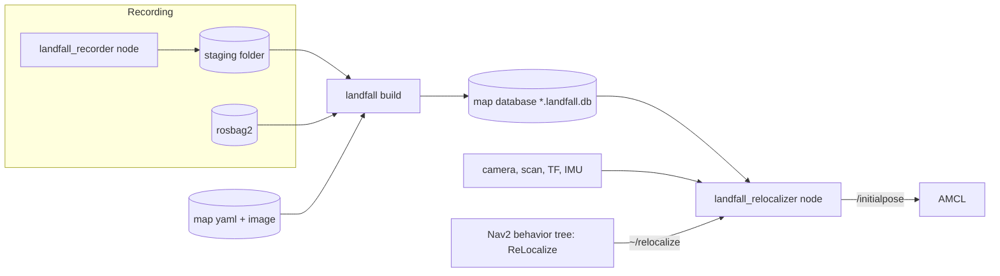

# Architecture

Landfall gives a robot running AMCL its pose from a camera: it records views while the robot is
well localized, builds a map database of them in AMCL's `map` frame, and later localizes camera
images against it, checks the result with the LiDAR and odometry, and publishes it to AMCL. This
page is the map of the code; the design and its reasons are in `PLAN.md` (§3 to §7).

## Data flow

1. **Recording** (`docs/recording.md`): the recorder node keeps camera images whose pose AMCL
   (or slam_toolbox) knows well, with their poses, in a staging folder; or a bag holds the same
   topics.
2. **Building** (`landfall build`): features and global descriptors of every keyframe, pairs of
   keyframes that see the same place, matches, tracks, landmarks triangulated with the poses fixed,
   an optional bounded bundle adjustment, and the database: one SQLite file bound to the map by its
   hashes (`docs/database.md`).
3. **Relocalizing** (`docs/relocalization.md`): on a request (service, startup, automatic, kidnap
   watchdog) the relocalizer localizes a few camera frames against the database, checks each pose
   (sanity, LiDAR scan, ambiguity, whether the scan fits another place better, odometry
   consistency across frames) and publishes the pose only if all checks pass.
4. **Navigating** (`docs/nav2_integration.md`): Nav2's behavior tree asks for a relocalization
   before navigating when AMCL is uncertain, and as its first recovery.

## Packages

| Package | What | Libraries and executables |
|---|---|---|
| `landfall_core` | Everything that is not ROS: geometry, features, the database, the query pipeline, the map builder | `landfall_core` (runtime), `landfall_core_build` (offline builder, links Ceres), `landfall_core_onnx` (learned backends, only with ONNX Runtime) |
| `landfall_msgs` | `Relocalize.srv`, `RelocalizationResult`, `RelocalizationScores`, `Hypothesis`, `RecorderStatus` | |
| `landfall_ros` | The nodes and the command line tool | `landfall_ros_common`, components `landfall_recorder` and `landfall_relocalizer` (also as executables `recorder_node`, `relocalizer_node`), CLI `landfall` (`build`, `inspect`, `report`, `verify`, `migrate`, `query`) |
| `landfall_nav2` | Behavior tree nodes `ReLocalize`, `IsLocalized`, and an example tree per Nav2 release | plugin library `landfall_nav2_bt_nodes` |
| `landfall_bringup` | Launch files, parameters, the per-distro Nav2 overlays, the simulation setup | |
| `landfall_benchmark` | Evaluation against a simulator's ground truth, the kidnap benchmark | `evaluate_poses`, `evaluate_scan_check`, `kidnap_runner`, `summarize_benchmark` |
| `landfall_tools` | Python, not a ROS package: model export, fetching the models, the test fixture | |

The online path never links Ceres (the builder's library does) nor ONNX Runtime unless the
learned backends are in use (`docs/models.md`).

## `landfall_core`

| Directory | Contents |
|---|---|
| `types.hpp`, `camera_model.hpp` | poses, camera models (plumb_bob, rational_polynomial, equidistant) |
| `registry.hpp`, `backend_options.hpp`, `interfaces/` | the backends' interfaces and their explicit registry (classical built in, ONNX registered by `landfall_core_onnx`) |
| `features/` | ORB and SIFT with grid bucketing, the vocabulary tree (bag of words), retrieval, matchers |
| `onnx/` | XFeat, EigenPlaces and MegaLoc on ONNX Runtime |
| `geometry/` | PoseLib's solvers (upright 2-point with gravity, P3P) in LO-RANSAC, two-view verification, gravity |
| `build/` | pair selection, tracks, triangulation, the pose-prior bundle adjustment, the build report |
| `db/` | the SQLite schema, migrations, blob codecs |
| `grid/` | the map loader (nav2_map_server's rules), the likelihood field, the scan verifier and its search for other places the scan fits |
| `query/` | the per-frame localizer, sanity checks, clustering and ambiguity, odometry consistency, the decision, the auto trigger, the extrinsics monitor, the kidnap watchdog |
| `record/` | keyframe gating, image quality, the staging folder |
| `eval/` | ground-truth trajectories and error statistics |
| `util/` | SHA-256, JSON, a thread pool |

The query pipeline per frame (`query/localizer.hpp`): retrieve the top keyframes, group them into
places, match each place's landmarks, solve, check the pose (sanity), check it against the scan,
cluster the hypotheses and decide whether the frame is ambiguous: two places pass, or the scan fits
another place of the map clearly better than the winner's. `query/decision.hpp` then decides
a request from its frames.

## The relocalizer node

A lifecycle node (`landfall_ros/src/relocalizer_node.cpp`). *Configure* opens the database
read-only and builds the localizer; a missing or unusable database doesn't fail the transition,
every request answers `NOT_READY` with the reason (AMCL's lifecycle manager must not stall on
Landfall). *Activate* subscribes the camera and starts a worker thread.

Requests run one at a time on the worker thread and answer the service through its deferred
response, so sensor callbacks keep flowing in a single-threaded container. A second request meanwhile
is answered `BUSY`, except that background checks (the extrinsics monitor's and the kidnap
watchdog's dry runs) give way to any other request. Each request collects its frames from the
camera callback, with the scan nearest each image and the odometry at its stamp, localizes them,
decides, and publishes the pose moved to the latest odometry.

## The recorder node

A lifecycle node (`landfall_ros/src/recorder_node.cpp`): *active* means recording. Each image passes
the gates (localization uncertainty, motion since the last keyframe, speed, IMU tilt, sharpness,
exposure); a keyframe's image and pose go to the session's staging folder.

## Compatibility

One source tree builds on Humble, Jazzy and Lyrical (C++17, and C++20 on Lyrical). The differences
are behind small headers: `landfall_ros/include/landfall/ros/compat/` (cv_bridge, rosbag2, QoS),
`landfall_core/include/landfall/compat/ceres.hpp`, `landfall_nav2/include/landfall/nav2/compat/bt.hpp`
(BehaviorTree.CPP 3 and 4, Nav2's node types). PLAN §9 lists them.
