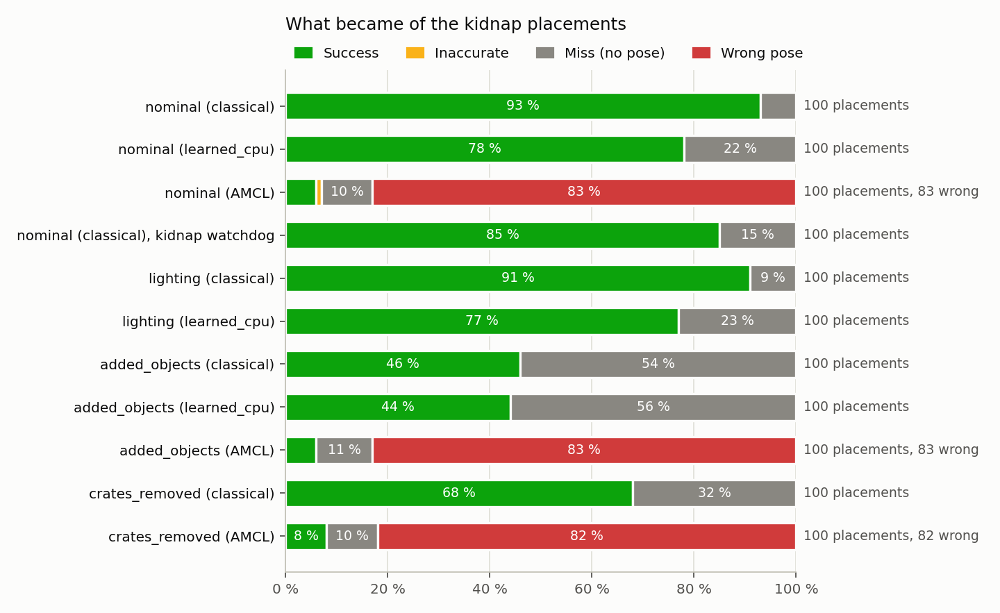
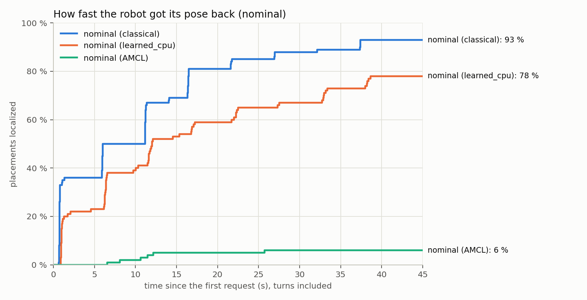

# Kidnap benchmark

How well does a robot get its pose back after it was moved without its localization knowing (a
"kidnap")? The benchmark measures it in simulation for Landfall, for AMCL's own global
localization, and for Landfall's kidnap watchdog. The numbers in the README come from here.

Everything here runs in the TurtleBot 4 depot simulation (Gazebo Harmonic, Jazzy; PLAN A8). The
field validation on a real robot is PLAN M8 (`docs/field_validation.md`).

## Setup

- **World**: nav2_bringup's depot (30 x 15 m: brick walls with roller doors, pillars, posts, a
  mezzanine, two rows of crate stacks), and three variants of it (`landfall_bringup/sim/worlds/`):
  - `lighting`: the two hall lights dimmer and warmer (65 % and 35 %), a low sun casting shadows.
    The images are about a quarter darker.
  - `added_objects`: nine stacks of goods (0.5 to 1.6 m high) on the open floor, off the recorded
    lanes. The camera and the LiDAR see them, the map doesn't.
  - `crates_removed`, a stress test: the crate stacks along most lanes are gone, while the map and
    the database still have them. The LiDAR sees through where the map is occupied.
- **Robot**: the TurtleBot 4 with Landfall's 640 x 480 camera (`sim/urdf/landfall_tb4.urdf.xacro`).
- **Database**: the first M2 recording drive (`docs/recording.md`): the depot's lanes driven both
  ways, 419 keyframes; `classical` (ORB, bag of words) and `learned_cpu` (XFeat, EigenPlaces)
  databases of the same drive. Every condition uses them unchanged.
- **Localization**: Landfall's `localization.launch.xml` with the simulation's AMCL parameters
  (`sim/params/localization_depot_sim.yaml`: 500 to 2000 particles, the likelihood field model)
  and the relocalizer's defaults (`sim/params/relocalizer_depot_sim.yaml`). Nav2 runs, idle.

## Protocol

`kidnap_runner` (landfall_benchmark) runs the placements one after the other, in one simulation.
At the start, the relocalizer's startup relocalization gives AMCL its first pose. In
`added_objects` it finds none: two of the new stacks stand about 3 m from the spawn pose, and the
LiDAR check refused every pose there. After 90 s (`startup_wait`) the runner then gives AMCL the
true pose; the start isn't measured. Then, for each placement:

1. **Placement.** The robot is moved with Gazebo's `set_pose` to a position drawn uniformly from
   the free cells at least 0.4 m from obstacles and within 1 m of a keyframe (the area the
   recording covered), with a uniform heading, at least 2 m from the previous placement. AMCL
   keeps the pose it had. The placements come from a fixed seed, so every method and condition
   meets the same 100. The results use seed 2027; the development runs (below) used 2026 and 7,
   and nothing was changed against seed 2027's placements (`sample_placements` prints them).
2. **Getting the pose back**, by method:
   - `landfall`: a request to the relocalizer (2.5 s); if it publishes nothing, the robot turns 45°
     and asks again, from up to eight headings, as the example behavior tree does
     (`docs/nav2_integration.md`).
   - `amcl`: AMCL's global localization (`reinitialize_global_localization`), then two full turns
     on the spot while AMCL updates. AMCL claims a pose when its reported standard deviation drops
     below 0.5 m (the relocalizer's auto trigger limit).
   - `watchdog`: nothing is called. The robot turns slowly (0.1 rad/s) where it stands, and the
     relocalizer's kidnap watchdog (default settings: a check every 10 s, two disagreeing checks
     in a row) has 90 s to notice and relocalize.
3. **AMCL converges.** After a published pose, the robot turns once on the spot so that AMCL's
   filter settles on it.
4. **Scoring** against Gazebo's ground truth, each estimate at its own stamp:
   - **success**: AMCL's estimate within 0.25 m and 5° at the end;
   - **wrong**: a published pose, or the pose AMCL claims, off by more than 0.5 m or 10°;
   - **inaccurate**: a pose published or claimed that is neither;
   - **miss**: nothing published (Landfall) or claimed (AMCL): the robot knows it is lost.

   The wrong-pose rate comes with the upper end of its 95 % Clopper-Pearson interval: with 0 wrong
   poses in 100 placements, the true rate is below 3.6 % at 95 % confidence.
5. **Time to localize**: from the first request (Landfall) or the global localization call (AMCL)
   to the published answer or AMCL's first confident estimate, turns included. For the watchdog,
   the time from the kidnap to its published relocalization.
6. **Needless relocalizations** (watchdog): after the robot's pose is back, the robot keeps
   turning slowly for 30 s, and every watchdog relocalization then is counted: the localization was
   right.

## Running it

In the simulation image (`scripts/sim.sh`), with the workspace built:

```bash
scripts/sim.sh 'bash /ws/install/landfall_bringup/share/landfall_bringup/sim/scripts/benchmark_depot.sh \
  /data/results/nominal_classical.csv nominal landfall "nominal (classical)" /data/depot.landfall.db'
scripts/sim.sh '/ws/install/landfall_benchmark/lib/landfall_benchmark/summarize_benchmark /data/results/*.csv'
```

The arguments are the output file, the condition (`nominal`, `lighting`, `added_objects`,
`crates_removed`), the method, the label in the tables and the relocalizer's database.
`SAMPLING_DATABASE` draws the placements near another database's keyframes (to give a learned
database's run the classical run's placements); `-p first_placement:=N` resumes a run. A learned
database needs its models (`LANDFALL_SIM_DOCKER_ARGS`, see `scripts/sim.sh`).

## Development: two wrong poses, and the scan alternatives check

The first full run (seed 2026, `classical`, nominal world) published 2 wrong poses in 100
placements. Both were the mirror image of the robot's pose through the depot's centre, 23 m and
180° off: the depot looks alike turned 180°, and at both placements the recording had seen the
mirror place from the robot's direction but not the true one (for one of them, a robot facing the
south wall, where no recorded drive looked south). Vision matched the mirror place (61 inliers),
the true place got 9 and 19, and the LiDAR check passed the mirror pose (hit ratio 0.935,
violations 0.036). With the robot standing still, every frame found the same mirror place, so the
odometry check couldn't see it.

Measured on scans at 200 placements of seeds 2026 and 7 (`evaluate_scan_check --symmetry`): within
0.5 m and 6° of the exact mirror pose, some pose passes the LiDAR check for 20 % of the scans, and
no threshold separates them from true poses (hit ratio 0.97 with at most 2 % violations still
passed 3.3 % of them while rejecting 7 % of the true poses). But the scan always fits the true
pose better than its mirror: at 1,927 true poses (the placements and both recorded drives) no
other place fitted as well (the best was at least 0.015 worse), and at 347 worst-case mirror poses
the true pose fitted better (by 0.006 at least, 0.01 or more for 99 %). The relocalizer now fits
every passed pose's scan everywhere else in the map, and a place that fits at least 0.01 better
makes the frame `AMBIGUOUS` (PLAN V55, `docs/relocalization.md`). The reproduced wrong placement
then answered `AMBIGUOUS`; the offline cross-session requests kept their successes and lost their
single-frame mirror poses.

## Results

Measured in M7 (2026-11-08 and 11-09) with seed 2027: 100 placements per row, the same 100 in every
row, on Jazzy in the simulation image on a laptop (Intel i7-13620H; an RTX 4050 renders the
simulation). The relocalizer ran with its defaults on the `classical` or the `learned_cpu`
database. The tables are `summarize_benchmark`'s output; the runner's CSV files are in
[`landfall_benchmark/results/seed2027/`](../landfall_benchmark/results/seed2027/), and
`landfall_tools/plot_benchmark.py` drew the figures from them.

| Scenario | Method | Placements | Success | Wrong (95 % upper bound) | Inaccurate | Miss | First heading | Time to localize (median / p90) | Published error (median) |
|---|---|---|---|---|---|---|---|---|---|
| nominal (classical) | landfall | 100 | 93.0 % | 0 (3.6 %) | 0.0 % | 7.0 % | 36.0 % | 6.0 s / 21.6 s | 2.8 cm |
| nominal (learned_cpu) | landfall | 100 | 78.0 % | 0 (3.6 %) | 0.0 % | 22.0 % | 22.0 % | 9.9 s / 33.0 s | 3.9 cm |
| nominal (AMCL) | amcl | 100 | 6.0 % | 83 (89.8 %) | 1.0 % | 10.0 % | - | 11.1 s / 18.9 s | - |
| nominal (classical) | watchdog | 100 | 85.0 % | 0 (3.6 %) | 0.0 % | 15.0 % | - | - / - | 2.3 cm |
| lighting (classical) | landfall | 100 | 91.0 % | 0 (3.6 %) | 0.0 % | 9.0 % | 32.0 % | 6.1 s / 26.9 s | 3.0 cm |
| lighting (learned_cpu) | landfall | 100 | 77.0 % | 0 (3.6 %) | 0.0 % | 23.0 % | 26.0 % | 6.4 s / 29.6 s | 3.6 cm |
| added_objects (classical) | landfall | 100 | 46.0 % | 0 (3.6 %) | 0.0 % | 54.0 % | 17.0 % | 6.0 s / 20.5 s | 3.9 cm |
| added_objects (learned_cpu) | landfall | 100 | 44.0 % | 0 (3.6 %) | 0.0 % | 56.0 % | 15.0 % | 6.4 s / 25.9 s | 2.8 cm |
| added_objects (AMCL) | amcl | 100 | 6.0 % | 83 (89.8 %) | 0.0 % | 11.0 % | - | 6.5 s / 14.3 s | - |
| crates_removed (classical) | landfall | 100 | 68.0 % | 0 (3.6 %) | 0.0 % | 32.0 % | 28.0 % | 6.0 s / 28.4 s | 2.9 cm |
| crates_removed (AMCL) | amcl | 100 | 8.0 % | 82 (89.0 %) | 0.0 % | 10.0 % | - | 4.0 s / 11.5 s | - |

| Scenario | Detected | Time to detect (median / p90) | Needless relocalizations | Observed with a right localization |
|---|---|---|---|---|
| nominal (classical) | 85.0 % | 39.3 s / 69.5 s | 0 (0.0 per hour) | 43 min |

<picture>
  <source media="(prefers-color-scheme: dark)" srcset="images/benchmark_outcomes-dark.png">
  
</picture>

<picture>
  <source media="(prefers-color-scheme: dark)" srcset="images/benchmark_time-dark.png">
  
</picture>

- **Wrong poses.** Landfall published no wrong pose in any of its 800 placements (8 runs: every
  condition, both backends, the watchdog). For one run, 0 in 100 bounds the true rate below
  3.6 % at 95 % confidence. The runs share their placements, so they are not independent trials,
  and together they don't give a tighter bound.
- **AMCL's global localization** claimed a wrong pose in 83 of the 100 nominal placements while
  reporting itself confident (a median standard deviation of 9 cm). Those poses were a median
  11.1 m off (0.51 to 27.2 m): 31 turned about 180° (the depot's mirror place), 26 about 90°, 26
  within 10°. It succeeded 6 times and stayed uncertain 10 times; in the other worlds, 6 and 8
  successes, 83 and 82 wrong poses. Its parameters are the ones the simulation's navigation uses
  (nav2_bringup's, with the simulator tuning: 500 to 2000 particles, `sigma_hit` 0.05 m, no
  recovery). They are not tuned for global localization, and another tuning may do better (not
  measured). The time figure counts successes only; AMCL claimed its wrong poses as fast.
- **Misses.** `classical` missed 7 nominal placements, every one `NO_MATCH` from all eight
  headings: views the recording didn't cover well enough. `learned_cpu` missed 22 (19 `NO_MATCH`,
  2 `REJECTED_SCAN_CHECK`, 1 `REJECTED_SANITY`) and took longer (median 9.9 s against 6.0 s), as
  in M5 (`docs/models.md`).
- **Time to localize.** 36 of the 93 `classical` successes came from the first request, in under
  a second (three frames). Each further heading adds about 5 s (a request of 2.5 s that found
  nothing, then a 45° turn), up to 37 s at the eighth.
- **Kidnap watchdog.** It noticed and undid 85 of the 100 kidnaps, a median 39 s after the kidnap
  (90 % within 70 s), with the robot turning at 0.1 rad/s and a check every 10 s, and published no
  wrong pose. In 43 minutes with a right localization afterwards it never relocalized. Of its 15
  misses, 11 had fewer than the two successful checks it needs within the 90 s (4 of them are
  among the active requests' 7 misses). At 3 it fired, but the relocalization it started was
  refused (`REJECTED_SANITY`, `REJECTED_CONSISTENCY`, `AMBIGUOUS`) and no second one followed
  within the 90 s (at two of them the 30 s cooldown held it back). At 1 its second check came at
  89 s. The checks can't use the IMU's gravity while the robot turns faster than
  `imu.max_angular_rate` (0.1 rad/s, the speed the runner turned it at): 82 of the watchdog's
  1,049 requests ended `NOT_READY` without a frame taken slowly enough.
- **Light** changed little: 91 % (`classical`) and 77 % (`learned_cpu`), against 93 % and 78 %;
  5 of `classical`'s 9 misses are nominal misses too.
- **Unmapped goods** (`added_objects`) halved the successes, without a wrong pose: 46 % and 44 %.
  `classical` found 48 placements in the nominal world that it missed here; at 45 of them, vision
  found a pose at one of the headings or more and the LiDAR check refused it (31 of 36 for
  `learned_cpu`). These placements lie a median 2.8 m from the nearest stack, the successes 4.2 m.
  The LiDAR sees a stack within about 3 m at every heading, and its short readings push the hit
  ratio below `scan_check.min_hit_ratio` (0.85), which keeps wrong poses out
  (`docs/tuning.md`). A site where goods stand off the map should measure it on its own
  recordings (`evaluate_scan_check`). In the result files, a placement's status is its last
  request's, mostly `NO_MATCH`: the headings vision didn't match.
- **Removed crates** (`crates_removed`, the stress test): 68 %, without a wrong pose. At 23 of the
  25 placements found in the nominal world and missed here, the LiDAR check refused a pose vision
  found: beams pass where the map still has the crates.
- **Since PLAN V61** (2026-11-14) the relocalizer accepts 20 to 39 inliers where the LiDAR scan
  fits nowhere else nearly as well, and an inlier ratio down to 0.1 (`docs/relocalization.md`).
  The two conditions where vision found least, re-run with the same database, placements and
  build otherwise:

  | Scenario | Method | Placements | Success | Wrong (95 % upper bound) | Inaccurate | Miss | First heading | Time to localize (median / p90) | Published error (median) |
  |---|---|---|---|---|---|---|---|---|---|
  | added_objects (classical) | landfall | 100 | 52.0 % | 0 (3.6 %) | 0.0 % | 48.0 % | 22.0 % | 6.0 s / 16.6 s | 3.6 cm |
  | crates_removed (classical) | landfall | 100 | 76.0 % | 0 (3.6 %) | 0.0 % | 24.0 % | 31.0 % | 6.0 s / 26.9 s | 3.1 cm |

  Six and eight placements turned from misses into successes, none the other way. The nominal
  and lighting rows weren't re-run. The result files are in
  [`landfall_benchmark/results/seed2027_v61/`](../landfall_benchmark/results/seed2027_v61/).
- **Since PLAN V62** (2026-11-14) each pose is refined on the floor and published with a
  covariance estimated for it, instead of a fixed 25 cm and 5° (`docs/relocalization.md`). The same
  two conditions, re-run the same way:

  | Scenario | Method | Placements | Success | Wrong (95 % upper bound) | Inaccurate | Miss | First heading | Time to localize (median / p90) | Published error (median) |
  |---|---|---|---|---|---|---|---|---|---|
  | added_objects (classical) | landfall | 100 | 50.0 % | 0 (3.6 %) | 0.0 % | 50.0 % | 22.0 % | 5.9 s / 16.5 s | 3.8 cm |
  | crates_removed (classical) | landfall | 100 | 76.0 % | 0 (3.6 %) | 0.0 % | 24.0 % | 33.0 % | 5.9 s / 21.7 s | 3.1 cm |

  Four placements changed outcome, all of them at a fifth to eighth heading: with the goods, two
  successes became misses; with the crates removed, one turned each way. The simulation doesn't
  repeat itself exactly: 30 and 28 placements went through other statuses over their headings
  than in the V61 run. At one of the four, the heading that succeeded in the V61 run found no match
  this time, which happens before the refinement runs. On recorded frames, where the input is the
  same, the refinement changed 6 of 1,791 requests, 5 of them into a success
  (`docs/relocalization.md`).

  117 of the 126 published poses (92.9 %) lay inside their covariance's 95 % ellipse, whose long
  axis had a median standard deviation of 3.8 cm (yaw 0.25°). These runs published the estimate
  as it was; since then the relocalizer publishes it without negative correlations, which Nav2's
  AMCL on Lyrical rejects, and that only widens it (`docs/relocalization.md`, *The published
  covariance*). The 9 outside were 9 to 17 cm off,
  against standard deviations of 3 to 5 cm. At 7 of those placements the V61 run's pose was as far
  off (9 to 18 cm), so the error comes with the place, from the database's map there, which a
  covariance estimated from one pose's landmarks doesn't see (T-013). AMCL starts its particles
  from the published covariance; it ended as close to the truth as with the fixed one: a median
  1.0 and 0.9 cm after converging, against 1.1 and 0.7 cm in the V61 run (where both runs
  succeeded, more than 5 mm closer at 15 and 15 placements, farther at 7 and 16). After the 9 poses
  outside their ellipse it ended 0.0 to 1.4 cm off. The result files are in
  [`landfall_benchmark/results/seed2027_v62/`](../landfall_benchmark/results/seed2027_v62/).
- **Runs.** Two runs were interrupted when the host went down and resumed at the next placement
  (`first_placement`) with the same build, models and database: `learned_cpu` nominal after
  placement 8, `learned_cpu` lighting after placement 21. The runner's startup fallback (above)
  was added for the `added_objects` runs; the placements and the relocalizer stayed the same.

"Same session" and "different session" are measured offline, on the recorded drives
(`docs/relocalization.md`, PLAN V54).

### The result files

One row per placement; poses in the `map` frame, angles in degrees, empty where not applicable:

| Columns | |
|---|---|
| `label`, `method`, `index` | the row's scenario, method, and placement number in the seed's sequence |
| `x`, `y`, `yaw_deg` | where the robot was put (the ground truth once it settled) |
| `keyframe_distance_m`, `heading_difference_deg` | to the nearest keyframe, and the smallest heading difference to a keyframe within 1 m: how far the robot looked from a direction the recording looked in nearby |
| `prior_*` | the localization's pose when the robot was put there (where it believed it was) |
| `outcome`, `attempts`, `status`, `message` | success, wrong, inaccurate or miss; the requests made (headings); the last request's status and message. AMCL: `CLAIMS_POSE` or `UNCERTAIN`; watchdog: `NOT_DETECTED` when it published nothing |
| `published`, `published_*`, `published_error_*` | the published pose, and its error against the ground truth at its stamp |
| `published_std_m`, `published_std_deg`, `published_error_sigma` | the published covariance: the long axis of its x-y ellipse and its yaw (standard deviations), and the position error in its standard deviations (inside its 95 % ellipse up to 2.45; since PLAN V62) |
| `truth_drift_*` | how far the robot moved between settling and the published pose's stamp |
| `amcl_*` | AMCL's estimate after the turn that lets it converge (Landfall, watchdog) or after its two turns (AMCL), its reported standard deviation and its error |
| `time_to_localize_s`, `detection_s` | from the first request to the pose (Landfall, AMCL); from the kidnap to the watchdog's relocalization |
| `false_relocalizations`, `observed_s` | the watchdog's relocalizations during the observation with a right localization, and its length |
| `elapsed_s` | the placement's wall time |
